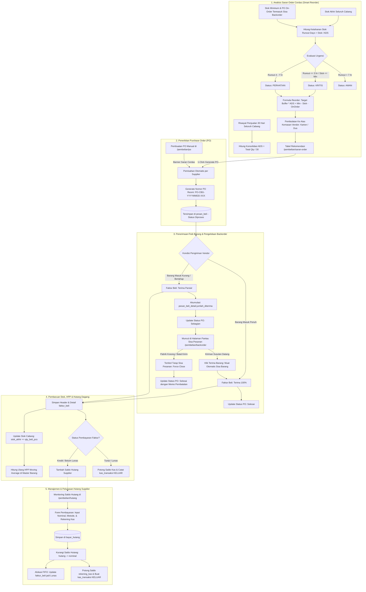

# 📦 DOKUMENTASI TEKNIS & HASIL PERBAIKAN AUDIT
## MODUL PEMBELIAN, SARAN ORDER & MANAJEMEN BACKORDER SUPPLIER (PROCUREMENT, SMART REORDER, BACKORDER & ACCOUNTS PAYABLE)
### SISTEM ENTERPRISE RESOURCE PLANNING (ERP) AL MUBAROK

> **Versi Dokumen:** 2.4.0 (Backorder & Partial Receiving Lifecycle Release)  
> **Status Sistem:** ✅ **SELESAI DIIMPLEMENTASIKAN & PRODUCTION READY**  
> **Tanggal Pembaruan:** 04 Oktober 2026  
> **Stack Teknologi:** Next.js 16 (App Router), React 19, TailwindCSS v4, Hono REST API, PostgreSQL, Drizzle ORM  
> **Target Pengguna:** Tim Pengembang (Software Engineer), Finance/Accounting, Purchasing Officer, Logistik/Gudang, dan Manajemen

---

## 📑 DAFTAR ISI

1. [Ringkasan Eksekutif & Ruang Lingkup Modul](#1-ringkasan-eksekutif--ruang-lingkup-modul)
2. [Status & Log Perbaikan Pasca-Audit & Fitur Baru](#2-status--log-perbaikan-pasca-audit--fitur-baru)
3. [Arsitektur Sistem & Alur Bisnis (Workflow)](#3-arsitektur-sistem--alur-bisnis-workflow)
4. [Struktur File & Komponen Kode](#4-struktur-file--komponen-kode)
5. [Kamus Data & Skema Database (Data Dictionary)](#5-kamus-data--skema-database-data-dictionary)
6. [Spesifikasi REST API Endpoints Lengkap](#6-spesifikasi-rest-api-endpoints-lengkap)
7. [Logika Bisnis, Algoritma & Formula Perhitungan](#7-logika-bisnis-algoritma--formula-perhitungan)
8. [Panduan Operasional & Prosedur Pengujian (Testing Scenarios)](#8-panduan-operasional--prosedur-pengujian-testing-scenarios)

---

## 1. Ringkasan Eksekutif & Ruang Lingkup Modul

Modul Pembelian (**Procurement**), Saran Order Cerdas (**Smart Reorder Engine**), Manajemen Sisa Pesanan (**Backorder & Partial Receiving**), dan Manajemen Hutang Supplier (**Accounts Payable**) adalah pilar fundamental dalam operasional rantai pasok (*supply chain*) ERP Al Mubarok. Modul ini bertanggung jawab menangani seluruh siklus hidup pengadaan barang dagangan mulai dari analisis kebutuhan restock berbasis kecerdasan data penjualan (*sales velocity*), penerbitan surat pesanan resmi, pelacakan pengiriman bertahap (kirim sebagian), penagihan sisa pesanan tertahan (*backorder tracking*), penerimaan fisik barang ke gudang/toko cabang, pembaruan stok realtime, rekalkulasi nilai aset persediaan (HPP Moving Average), pencatatan kewajiban hutang dagang, integrasi kas/bank, hingga pelunasan pembayaran ke pihak vendor/supplier.

### Ruang Lingkup Fungsional:
1. **Saran Order Pembelian Cerdas (Smart Reorder Engine):** Analisis prediktif kebutuhan stok secara konsolidasi seluruh cabang berdasarkan Average Daily Sales 30 hari (ADS), stok minimum pengaman (*safety stock*), kuantitas pesanan yang sedang berjalan (*PO on-order*), serta pembulatan cerdas ke atas (*ceiling*) sesuai kemasan vendor (Karton/Dus).
2. **Purchase Order (PO) / Pemesanan Pembelian:** Pembuatan, monitoring, dan manajemen surat pesanan resmi ke supplier per cabang dengan dukungan integrasi 1-klik dari Saran Order Cerdas dan filter status bertingkat.
3. **Manajemen Sisa Pesanan & Penerimaan Parsial (Backorder PO):** Dasbor khusus dan ramah pengguna (*user-friendly*) untuk memantau surat pesanan yang baru dikirim sebagian oleh supplier, menghitung persentase keterisian fisik, memicu penerimaan sisa barang dalam 1-klik, dan fitur penutupan resmi (*Force Close*) jika supplier mengonfirmasi pembatalan sisa kiriman.
4. **Penerimaan Barang / Faktur Pembelian (Goods Receipt & Purchase Invoice):** Pencatatan kedatangan barang dari vendor dengan impor otomatis sisa kuantitas PO yang belum tiba (*remaining unfulfilled quantity*), rekonsiliasi bertahap, dan pembaruan status PO secara atomik.
5. **Pembaruan Stok & HPP:** Otomasi penambahan kuantitas stok di cabang penerima dan rekalkulasi Harga Pokok Penjualan (HPP) menggunakan metode *Moving Average Cost*.
6. **Riwayat Faktur Pembelian:** Arsip digital seluruh dokumen penerimaan dan rincian transaksi barang masuk beserta status pelunasan.
7. **Manajemen Hutang Supplier:** Pencatatan kewajiban pembayaran tempo, monitoring saldo hutang per supplier, dan form transaksi pelunasan/cicilan hutang dengan integrasi mutasi kas keluar.
8. **Keamanan & Hak Akses Berbasis Role (RBAC):** Restriksi menu dan kapabilitas CRUD (Create, Read, Update, Delete) yang diproteksi berdasarkan jabatan (Super User, IT, Manager).

---

## 2. Status & Log Perbaikan Pasca-Audit & Fitur Baru

```text
┌─────────────────────────────────────────────────────────────────────────────┐
│                       MATRIKS STATUS FITUR & PERBAIKAN                      │
├────┬─────────────────────────────┬───────────┬──────────────────────────────┤
│ No │ Fitur / Temuan Audit        │ Status    │ Solusi & Implementasi        │
├────┼─────────────────────────────┼───────────┼──────────────────────────────┤
│ 1  │ Pantau Sisa Pesanan         │ COMPLETED │ Halaman /pembelian/backorder │
│    │ (Backorder PO Management)   │           │ ramah pengguna & progress bar│
├────┼─────────────────────────────┼───────────┼──────────────────────────────┤
│ 2  │ Penerimaan Parsial PO       │ COMPLETED │ pesan_beli_detail.jumlah_    │
│    │ (Partial Receiving Lifecycle│           │ diterima & status 'Sebagian' │
├────┼─────────────────────────────┼───────────┼──────────────────────────────┤
│ 3  │ Force Close Sisa Pesanan    │ COMPLETED │ Tutup sisa PO dengan catatan │
│    │                             │           │ pembatalan resmi supplier    │
├────┼─────────────────────────────┼───────────┼──────────────────────────────┤
│ 4  │ Harmonisasi Rumus On-Order  │ COMPLETED │ PO Sebagian hanya hitung sisa│
│    │ di Saran Order Cerdas       │           │ kuantitas unfulfilled        │
├────┼─────────────────────────────┼───────────┼──────────────────────────────┤
│ 5  │ Saran Order Cerdas          │ COMPLETED │ Analisis ADS 30h, stok min,  │
│    │ (Smart Reorder Engine)      │           │ runout days, & ceiling pack  │
├────┼─────────────────────────────┼───────────┼──────────────────────────────┤
│ 6  │ 1-Click Multi-PO Generator  │ COMPLETED │ Transaksi atomik pembuatan   │
│    │ Dari Saran Order            │           │ PO terpisah per supplier     │
├────┼─────────────────────────────┼───────────┼──────────────────────────────┤
│ 7  │ Smart Reorder Banner di     │ COMPLETED │ Deteksi otomatis item kritis │
│    │ Form PO (/pembelian/po)     │           │ vendor terpilih 1-klik masuk │
├────┼─────────────────────────────┼───────────┼──────────────────────────────┤
│ 8  │ Desinkronisasi Saldo Hutang │ RESOLVED  │ Rekonsiliasi data: Saldo     │
│    │ (Rp 0 vs Rp 10.111.028)     │           │ supplier sinkron 100%        │
├────┼─────────────────────────────┼───────────┼──────────────────────────────┤
│ 9  │ Pelunasan Hutang tanpa Link │ RESOLVED  │ Alokasi pembayaran FIFO ke   │
│    │ Faktur (bayar_hutang)       │           │ faktur-faktur belum lunas    │
├────┼─────────────────────────────┼───────────┼──────────────────────────────┤
│ 10 │ Integrasi Kas & Mutasi      │ RESOLVED  │ Form bayar hutang & faktur   │
│    │ Rekening Kas/Bank           │           │ potong saldo kas_transaksi   │
├────┼─────────────────────────────┼───────────┼──────────────────────────────┤
│ 11 │ Kompilasi TypeScript Bebas  │ RESOLVED  │ 0 Error pada Backend &       │
│    │ Masalah (Type-Safe)         │           │ Frontend Next.js 16          │
└────┴─────────────────────────────┴───────────┴──────────────────────────────┘
```

---

## 3. Arsitektur Sistem & Alur Bisnis (Workflow)

Sistem pengadaan berjalan secara terintegrasi antara Frontend (Next.js 16 Client & Server Components), Backend API (Hono Framework), dan Database (PostgreSQL).

### Diagram Alir Proses Bisnis Lengkap (Mermaid Workflow)



---

## 4. Struktur File & Komponen Kode

Modul Pembelian diimplementasikan secara bersih (*clean architecture*) dengan pemisahan tanggung jawab (*separation of concerns*):

```text
c:\Users\AFB\erp-almubarok\
├── erp-almubarok-nextjs/                      # Frontend Next.js 16
│   └── src/
│       ├── app/
│       │   └── (dashboard)/
│       │       └── pembelian/
│       │           ├── backorder/
│       │           │   └── page.tsx           # UI Pantau Sisa Pesanan (Backorder PO) [BARU]
│       │           ├── saran-order/
│       │           │   └── page.tsx           # UI Dasbor Saran Order Cerdas (Smart Reorder)
│       │           ├── po/
│       │           │   └── page.tsx           # UI Pemesanan PO [UPDATED: Status Tabs & Sisa Pesanan Action]
│       │           ├── invoice/
│       │           │   └── page.tsx           # UI Faktur Beli [UPDATED: Impor Otomatis Sisa Backorder]
│       │           ├── history/
│       │           │   └── page.tsx           # UI Riwayat Faktur & Detail
│       │           └── hutang/
│       │               └── page.tsx           # UI Saldo Hutang & Modal Bayar Kas FIFO
│       └── components/
│           ├── layout/
│           │   ├── Sidebar.tsx                # Navigasi Menu Pembelian [UPDATED: Sisa Pesanan (Backorder)]
│           │   └── HelpButton.tsx             # Panduan Interaktif Modul [UPDATED: Konteks Backorder]
│           └── providers/
│               └── PermissionProvider.tsx     # Guard Hak Akses RBAC per Halaman
│
└── erp-almubarok-api/                         # Backend Hono RESTful API
    └── src/
        ├── routes/
        │   ├── pembelian.ts                   # Router & Controller [UPDATED: Backorder & Force Close APIs]
        │   └── pengaturan.ts                  # Master Menu & Role Permissions [UPDATED: Seed Backorder Menu]
        └── lib/
            ├── db/
            │   ├── index.ts                   # Koneksi Pool Database PostgreSQL
            │   └── schema.ts                  # Definisi Skema Drizzle ORM [UPDATED: pesan_beli_detail.jumlah_diterima]
            └── auth/
                └── jwt.ts                     # Dekoder Sesi & Payload Cabang Pengguna
```

---

## 5. Kamus Data & Skema Database (Data Dictionary)

Semua entitas data pembelian disimpan di PostgreSQL dan didefinisikan menggunakan Drizzle ORM pada file [`erp-almubarok-api/src/lib/db/schema.ts`](file:///c:/Users/AFB/erp-almubarok/erp-almubarok-api/src/lib/db/schema.ts).

### 5.1 Tabel `pesan_beli` (Header Purchase Order)
Menyimpan informasi utama surat pesanan pembelian barang ke pihak supplier.

| Kolom | Tipe Data | Nullable | Default | Deskripsi & Fungsi |
|---|---|:---:|:---:|---|
| `id_pesan_beli` | `SERIAL` (PK) | ❌ | Auto | Identifikator unik Purchase Order |
| `id_cabang` | `INTEGER` (FK) | ❌ | - | Referensi cabang pembuat pesanan (`cabang.id_cabang`) |
| `id_supplier` | `INTEGER` (FK) | ❌ | - | Referensi vendor/supplier tujuan (`supplier.id_supplier`) |
| `tanggal_pesan_beli` | `TEXT` | ❌ | - | Tanggal terbit PO (Format: `YYYY-MM-DD`) |
| `nomor_pesan_beli` | `TEXT` | ❌ | - | Nomor dokumen PO (Format: `PO-KODE-YYYYMMDD-SEQ`) |
| `keterangan` | `TEXT` | ✔️ | NULL | Catatan pemesanan / catatan force-close sisa pesanan |
| `total_harga_pesan_beli` | `INTEGER` | ❌ | - | Total nilai estimasi pemesanan (Rupiah) |
| `status` | `TEXT` | ✔️ | `'Diproses'` | Status pemesanan: `'Diproses'`, `'Sebagian'`, `'Selesai'`, `'Batal'` |
| `created_at` | `TEXT` | ✔️ | `CURRENT_TIMESTAMP` | Waktu pembuatan data |

### 5.2 Tabel `pesan_beli_detail` (Rincian Item Purchase Order)
Menyimpan rincian item barang yang dipesan dalam satu Purchase Order, kini dilengkapi pelacakan jumlah barang yang sudah tiba.

| Kolom | Tipe Data | Nullable | Default | Deskripsi & Fungsi |
|---|---|:---:|:---:|---|
| `id` | `SERIAL` (PK) | ❌ | Auto | Identifikator unik baris item PO |
| `id_pesan_beli` | `INTEGER` (FK) | ❌ | - | Relasi ke header PO (`pesan_beli.id_pesan_beli`) |
| `id_barang` | `INTEGER` (FK) | ❌ | - | Relasi ke master barang (`barang.id_barang`) |
| `nama_barang` | `TEXT` | ❌ | - | *Snapshot* nama barang saat PO dibuat |
| `jumlah_barang` | `INTEGER` | ❌ | - | Kuantitas barang yang dipesan (dikonversi ke unit dasar / Pcs) |
| `jumlah_diterima` | `INTEGER` | ❌ | `0` | **[BARU]** Kuantitas fisik barang yang telah tiba dan diverifikasi |
| `harga_satuan` | `INTEGER` | ❌ | - | Estimasi harga beli per unit dasar / Pcs (Rupiah, terbulatkan) |
| `subtotal` | `INTEGER` | ❌ | - | Nilai subtotal item (`jumlah_barang` × `harga_satuan`) |

### 5.3 Tabel `faktur_beli` (Header Penerimaan & Faktur Pembelian)
Menyimpan data dokumen faktur pembelian resmi saat barang diterima dari supplier.

| Kolom | Tipe Data | Nullable | Default | Deskripsi & Fungsi |
|---|---|:---:|:---:|---|
| `id_faktur` | `SERIAL` (PK) | ❌ | Auto | Identifikator unik Faktur Pembelian |
| `id_po` | `INTEGER` (FK) | ✔️ | NULL | Relasi ke nomor PO yang direalisasikan |
| `id_cabang` | `INTEGER` (FK) | ❌ | - | Cabang lokasi fisik penerimaan barang (`cabang.id_cabang`) |
| `id_supplier` | `INTEGER` (FK) | ❌ | - | Pihak supplier pengirim barang (`supplier.id_supplier`) |
| `tanggal_faktur` | `TEXT` | ❌ | - | Tanggal fisik dokumen faktur supplier (`YYYY-MM-DD`) |
| `nomor_faktur` | `TEXT` | ❌ | - | Nomor faktur / surat jalan resmi dari pihak vendor |
| `total_faktur` | `INTEGER` | ❌ | - | Total tagihan akhir faktur setelah diskon dan pajak (Rupiah) |
| `diskon_total` | `INTEGER` | ✔️ | `0` | Potongan harga global faktur dalam Rupiah |
| `ppn_rate` | `INTEGER` | ✔️ | `0` | Tarif Pajak Pertambahan Nilai dalam persen (misal: 11%) |
| `status_pembayaran` | `TEXT` | ✔️ | `'Belum Lunas'` | Status pembayaran (`'Belum Lunas'`, `'Belum Dibayar'`, `'Lunas'`) |
| `created_at` | `TEXT` | ✔️ | `CURRENT_TIMESTAMP` | Waktu pencatatan data ke sistem |

---

## 6. Spesifikasi REST API Endpoints Lengkap

Seluruh endpoint diproteksi oleh middleware JWT (`authMiddleware`). Header wajib:  
`Cookie: erp_token=...` atau `Authorization: Bearer <token>`.

### 6.1 Endpoint Sisa Pesanan (Backorder PO)

#### `GET /api/pembelian/backorder`
Mengambil ringkasan KPI dan daftar seluruh Purchase Order yang belum lengkap dikirim oleh pihak supplier.
- **Query Parameters:**
  - `id_supplier` *(opsional, integer)*: Filter khusus satu vendor tertentu.
  - `search` *(opsional, string)*: Pencarian nomor PO, nama supplier, barcode, atau nama barang.
- **Respon Sukses (200 OK):**
```json
{
  "success": true,
  "summary": {
    "total_po_backorder": 3,
    "total_po_sebagian": 2,
    "total_sku_backorder": 14,
    "estimasi_nilai_backorder": 8450000
  },
  "data": [
    {
      "id_pesan_beli": 36,
      "nomor_pesan_beli": "PO-SR09231-20261004-001",
      "tanggal_pesan_beli": "2026-10-04",
      "status": "Sebagian",
      "nama_supplier": "PT. EKA ARTHA BUANA (UNILEVER)",
      "telepon_supplier": "08123456789",
      "nama_cabang": "Gudang Pusat (DC)",
      "total_pesan_pcs": 12,
      "total_diterima_pcs": 1,
      "total_sisa_pcs": 11,
      "total_nilai_sisa": 132000,
      "progress_percent": 8,
      "unfulfilled_items": [
        {
          "id_barang": 45,
          "barcode": "BRG-45",
          "nama_barang": "CLING REFIL LEMON FRESH 425ML 5144",
          "qty_pesan": 12,
          "qty_diterima": 1,
          "sisa_backorder": 11,
          "harga_satuan": 12000,
          "subtotal_sisa": 132000,
          "satuan_1": "PCS"
        }
      ]
    }
  ]
}
```

#### `POST /api/pembelian/po/:id/force-close`
Menutup sisa kuantitas pesanan yang belum terkirim jika pihak supplier mengonfirmasi bahwa stok pabrik habis atau disepakati batal kirim.
- **URL Parameter:** `id` *(integer, ID PO)*
- **Body Request:**
```json
{
  "alasan": "Stok pabrik vendor kosong / Dibatalkan resmi"
}
```
- **Respon Sukses (200 OK):**
```json
{
  "success": true,
  "message": "Sisa pesanan PO berhasil ditutup."
}
```

---

### 6.2 Endpoint Penerimaan Faktur Beli (Goods Receipt)

#### `POST /api/pembelian/invoice`
Mencatat penerimaan fisik barang masuk, menambah stok cabang penerima, memperbarui HPP moving average, serta mengelola status PO bertahap secara atomik.
- **Logika Otomasi Baru:**
  1. Jika `id_po` disertakan, sistem mengupdate `pesan_beli_detail.jumlah_diterima += item.jumlah_beli`.
  2. Mengevaluasi seluruh item di PO tersebut:
     - Jika seluruh item telah terpenuhi (`jumlah_diterima >= jumlah_barang`) $\rightarrow$ Status PO otomatis diperbarui menjadi `'Selesai'`.
     - Jika baru sebagian item yang tiba $\rightarrow$ Status PO otomatis diperbarui menjadi `'Sebagian'`.
  3. Memperbarui stok dan hutang dagang secara atomik (*ACID*).

---

### 6.3 Endpoint Saran Order Pembelian Cerdas (Smart Reorder)

#### `GET /api/pembelian/saran-order`
Menganalisis kebutuhan restock barang berdasarkan kecepatan penjualan (ADS 30 hari), stok konsolidasi seluruh cabang, stok minimum pengaman, dan status PO on-order.
- **Penyempurnaan Formula:** Variabel `total_on_order` untuk PO yang berstatus `'Sebagian'` kini hanya memperhitungkan sisa kuantitas unfulfilled:
  $$\text{PO On-Order} = \max(0, \text{jumlah\_barang} - \text{jumlah\_diterima})$$

---

## 7. Logika Bisnis, Algoritma & Formula Perhitungan

### 7.1 Siklus Hidup Status Bertingkat Purchase Order (PO Lifecycle)

Status Purchase Order dikelola dengan mesin status (*finite state machine*) yang mencerminkan realitas penerimaan logistik:

```text
       ┌───────────────┐
       │   Diproses    │  (PO diterbitkan, belum ada kiriman fisik)
       └───────┬───────┘
               │
       ┌───────┴────────────────────────┐
       │                                │
[Kirim Sebagian]                 [Kirim Lengkap]
       │                                │
       ▼                                │
┌───────────────┐                       │
│   Sebagian    │                       │
└───────┬───────┘                       │
        │                               │
 ┌──────┴───────────────┐               │
 │                      │               │
[Kiriman Susulan]   [Force Close]       │
 │                      │               │
 ▼                      ▼               ▼
┌───────────────────────────────────────┐
│                Selesai                │
└───────────────────────────────────────┘
```

1. **`Diproses`**: PO telah disetujui dan dikirim ke vendor. Belum ada satu pun barang yang dicatat masuk di faktur penerimaan.
2. **`Sebagian`**: Telah terjadi penerimaan fisik barang untuk PO ini minimal 1 kali, namun masih terdapat $\ge 1$ item barang yang jumlah fisiknya kurang dari kuantitas yang dipesan. PO ini otomatis dipantau di halaman `/pembelian/backorder`.
3. **`Selesai`**: Seluruh kuantitas barang yang dipesan telah diterima 100%, atau sisa barang yang tertahan telah resmi ditutup manual (*Force Close*) oleh penanggung jawab gudang/purchasing.
4. **`Batal`**: PO dibatalkan sepenuhnya sebelum ada transaksi penerimaan barang apa pun.

---

### 7.2 Formula Sisa Kuantitas Backorder & Persentase Pemenuhan

Untuk setiap baris item $i$ dalam suatu Purchase Order:

$$\mathbf{Sisa\text{ }Backorder}_i = \max\left(0, \text{Jumlah Dipesan}_i - \text{Jumlah Diterima}_i\right)$$
$$\mathbf{Nilai\text{ }Sisa}_i = \text{Sisa Backorder}_i \times \text{Harga Satuan}_i$$

Untuk header dokumen Purchase Order secara keseluruhan:

$$\mathbf{Keterisian\text{ }Fisik\text{ (\%)}} = \min\left(100, \text{round}\left(\frac{\sum \text{Jumlah Diterima}_i}{\sum \text{Jumlah Dipesan}_i} \times 100\right)\right)$$
$$\mathbf{Total\text{ }Nilai\text{ }Tertahan} = \sum \mathbf{Nilai\text{ }Sisa}_i$$

---

## 8. Panduan Operasional & Prosedur Pengujian (Testing Scenarios)

### Skenario Uji 1: Penerimaan Parsial & Otomasi Status PO Sebagian
1. Buka URL: `http://localhost:3000/pembelian/po`.
2. Buat PO baru ke vendor (misal: pesan `Barang A` sebanyak 20 Pcs dan `Barang B` sebanyak 10 Pcs).
3. Status PO terbit dengan status **Diproses**.
4. Buka URL: `http://localhost:3000/pembelian/invoice` dan klik **Penerimaan Barang Baru**.
5. Pilih nomor PO yang baru dibuat pada dropdown **Import PO Aktif**.
6. Simulasikan vendor hanya mengirim separuh:
   - Ubah kuantitas `Barang A` menjadi 12 Pcs (sisa 8 Pcs).
   - Ubah kuantitas `Barang B` menjadi 0 Pcs atau hapus barisnya (sisa 10 Pcs).
7. Klik **Simpan Penerimaan Barang & Faktur**.
8. **Verifikasi:**
   - Buka kembali `http://localhost:3000/pembelian/po`. Status PO otomatis berubah menjadi **Sebagian (Kurang Kirim)** dengan badge kuning menyala.
   - Buka modal **Detail PO**: terlihat rincian *Pesan: 20 pcs • Tiba: 12 pcs • Sisa: 8 pcs* lengkap dengan progress bar 60%.

---

### Skenario Uji 2: Monitoring Backorder di Halaman Khusus
1. Buka browser pada URL: `http://localhost:3000/pembelian/backorder`.
2. **Verifikasi:**
   - KPI Card menampilkan jumlah PO Belum Lengkap, Variasi Produk Kurang Kirim, dan Estimasi Nilai Tagihan Tertahan.
   - PO dari Skenario 1 tampil sebagai kartu interaktif dengan status *Diterima Sebagian*.
   - Rincian item menampilkan tabel barang yang masih kurang kirim.

---

### Skenario Uji 3: Penerimaan Kiriman Susulan (Second Receiving)
1. Pada kartu PO di halaman `/pembelian/backorder`, klik tombol **Terima Barang**.
2. Sistem otomatis mengarahkan ke form pembuatan faktur beli (`/pembelian/invoice`) dengan referensi PO tersebut sudah terpilih.
3. **Verifikasi:** Keranjang faktur **hanya memuat sisa barang yang belum tiba** (yaitu `Barang A` sebanyak 8 Pcs dan `Barang B` sebanyak 10 Pcs), bukan kuantitas pesanan awal!
4. Simpan faktur penerimaan kedua ini.
5. **Verifikasi:**
   - Seluruh pesanan telah terpenuhi 100%. Status PO otomatis berubah menjadi **Selesai**.
   - PO tersebut otomatis hilang dari daftar antrean `/pembelian/backorder`.

---

### Skenario Uji 4: Penutupan Sisa Pesanan Resmi (Force Close)
1. Buat PO pengujian dan simulasikan penerimaan sebagian.
2. Buka halaman `/pembelian/backorder` atau klik tombol Detail di `/pembelian/po`.
3. Klik tombol **Tutup Sisa Pesanan** (ikon silang merah).
4. Modal konfirmasi muncul: pilih alasan (misal: *"Stok pabrik vendor kosong"*).
5. Klik **Konfirmasi Tutup Sisa**.
6. **Verifikasi:**
   - Status PO berubah menjadi **Selesai**.
   - Keterangan PO memuat catatan: `[Sisa Ditutup: Stok pabrik vendor kosong]`.
   - Sisa barang tidak lagi membebani hitungan Saran Order Cerdas.

---
*Dokumentasi ini adalah versi resmi sistem operasional ERP Al Mubarok v2.4.0 setelah seluruh implementasi fitur Pantau Sisa Pesanan (Backorder PO & Penerimaan Parsial) diselesaikan secara paripurna.*
