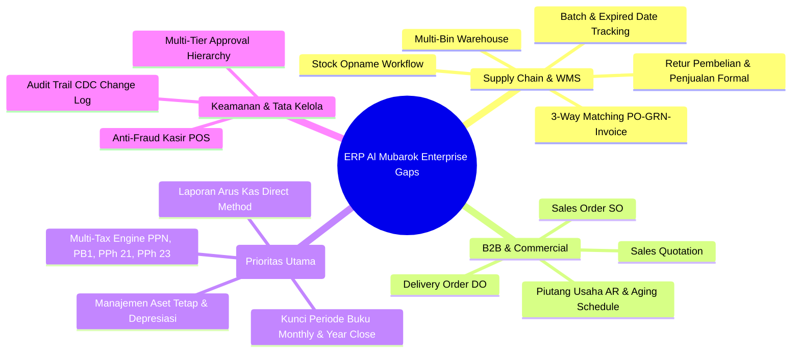
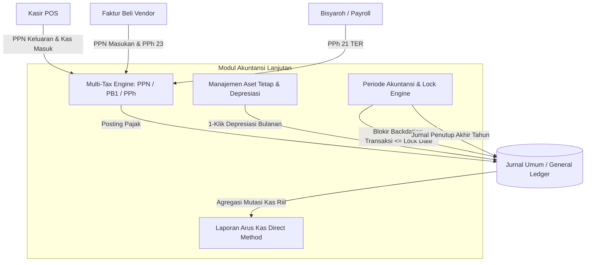
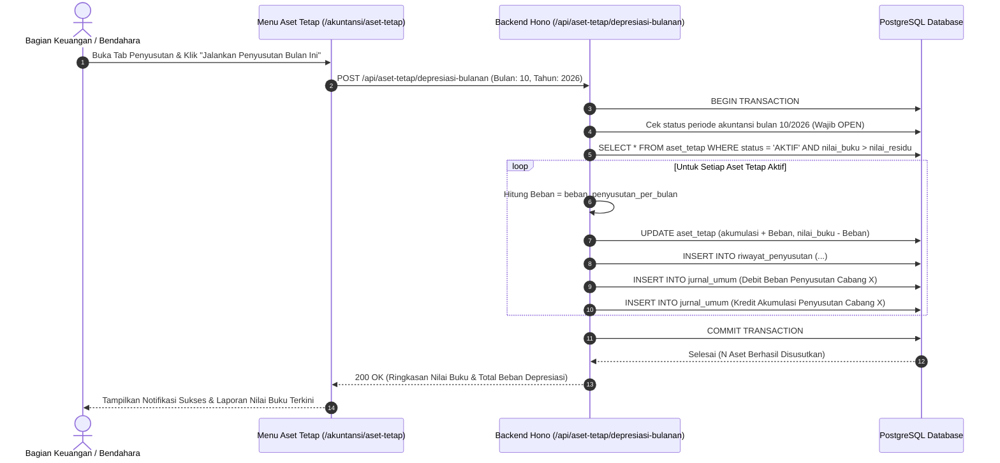
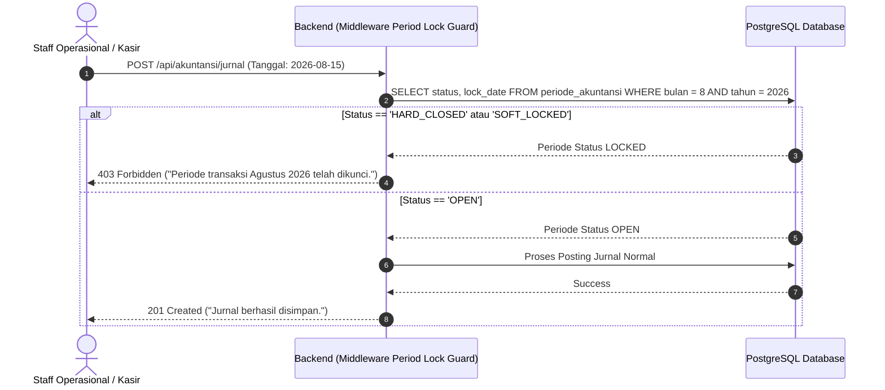
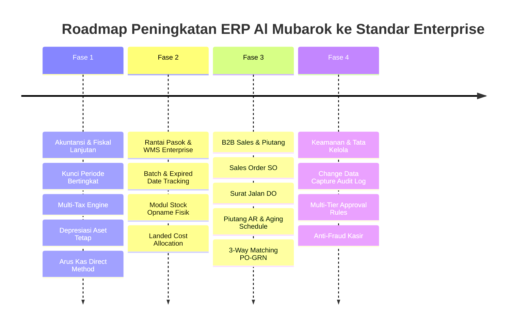

# GAP ANALISIS & CETAK BIRU FITUR ERP PROFESIONAL
**ERP AL MUBAROK (ROADMAP & TECHNICAL BLUEPRINT)**  
*Dokumen ini menyajikan audit menyeluruh atas celah fungsional (gap analysis) ERP Al Mubarok terhadap standar ERP kelas enterprise (Odoo, SAP Business One, Accurate), serta cetak biru teknis (DDL, API, Formula, Workflow) hasil alignment sesi /grill-me untuk domain prioritas Akuntansi & Fiskal Lanjutan.*

---

## 1. Executive Gap Analysis: Evaluasi 9 Modul terhadap Standar ERP Profesional

Berdasarkan audit teknis terhadap 9 modul yang telah didokumentasikan, ERP Al Mubarok saat ini telah memiliki fondasi operasional ritel dan kasir yang solid. Namun, untuk bertransformasi menjadi sistem ERP kelas profesional (*enterprise-grade*), terdapat beberapa celah fungsional kritikal lintas domain:



### Tabel Matriks Analisis Kesenjangan (Gap Matrix):

| Domain Operasional | Fitur yang Sudah Ada (As-Is) | Fitur Wajib ERP Profesional yang Belum Ada (To-Be) | Tingkat Urgensi |
|---|---|---|---|
| **1. Akuntansi & Fiskal** | CoA, Jurnal Umum, Buku Besar, Trial Balance, Neraca, Laba Rugi | • **Kunci Periode Buku (*Period Hard Close*)** mencegah manipulasi tanggal.<br>• **Multi-Tax Engine** (PPN 11%/12%, PPh 21 TER, PPh 23, PB1).<br>• **Manajemen Aset Tetap & Depresiasi Garis Lurus Otomatis**.<br>• **Laporan Arus Kas Formal (*Statement of Cash Flows: Direct Method*)**. | **KRITIKAL (P1)** |
| **2. Gudang & WMS** | Multi-Cabang, Minimum/Maksimum Buffer, Moving Average HPP | • **Batch / Lot Number & Expired Date Tracking** (Krusial untuk makanan/sembako).<br>• **Modul Stock Opname Fisik & Jurnal Selisih Inventaris**.<br>• **Multi-Bin/Aisle/Pallet Storage Mapping**.<br>• **Landed Cost Allocation** (Ongkir ekspedisi masuk ke HPP modal barang). | **TINGGI (P2)** |
| **3. Pembelian (AP)** | PO, Faktur Beli Langsung, Hutang Supplier Sederhana | • **3-Way Matching**: Pemisahan PO $\rightarrow$ Laporan Penerimaan Barang (GRN/LPB) $\rightarrow$ Faktur Tagihan Vendor.<br>• **Retur Pembelian & Nota Debet (*Debit Note*)**.<br>• **Evaluasi & Rating Kinerja Supplier**. | **TINGGI (P2)** |
| **4. Penjualan & Piutang (AR)** | Kasir POS Ritel, Nota Tunai/Transfer, Promo Engine | • **Siklus Penjualan B2B/Grosir**: Sales Quotation $\rightarrow$ Sales Order (SO) $\rightarrow$ Delivery Order (DO) $\rightarrow$ Sales Invoice.<br>• **Piutang Usaha (*Accounts Receivable*) & Aging Schedule (30/60/90 Hari)**.<br>• **Retur Penjualan & Nota Kredit (*Credit Note*)**. | **SEDANG (P3)** |
| **5. HRD & Penggajian** | Master Abdi, Presensi GPS, Kasbon, Bisyaroh Flat | • **Kalkulasi Potongan BPJS Ketenagakerjaan & Kesehatan**.<br>• **PPh 21 Skema TER Otomatis**.<br>• **Perhitungan Lembur Standar Depnaker**. | **SEDANG (P3)** |
| **6. Audit & Keamanan** | JWT Auth, Role Menu, Advisory Locks | • **System Audit Log (Change Data Capture)**: Riwayat siapa mengubah nilai apa dari A ke B.<br>• **Multi-Tier Approval Workflow Engine**.<br>• **Otomasi Backup Basis Data & Point-in-Time Recovery**. | **KRITIKAL (P1)** |

---

## 2. Cetak Biru Domain Terpilih: Akuntansi & Fiskal Lanjutan

Sesuai hasil penajaman melalui sesi `/grill-me`, berikut adalah arsitektur dan spesifikasi teknis lengkap untuk domain prioritas **Akuntansi & Fiskal Lanjutan**.

### 2.1. Arsitektur Komponen Baru



---

## 3. Skema Basis Data Drizzle ORM (Tabel Baru)

Untuk mendukung keempat pilar akuntansi lanjutan, ditambahkan 4 skema tabel baru:

```typescript
// ==========================================
// 1. PERIODE AKUNTANSI & CLOSING LOCK
// ==========================================
export const periode_akuntansi = pgTable("periode_akuntansi", {
  id: serial("id").primaryKey(),
  bulan: integer("bulan").notNull(),                         // 1 - 12
  tahun: integer("tahun").notNull(),                         // Contoh: 2026
  tanggal_mulai: text("tanggal_mulai").notNull(),            // YYYY-MM-DD
  tanggal_akhir: text("tanggal_akhir").notNull(),            // YYYY-MM-DD
  status: text("status", { enum: ["OPEN", "SOFT_LOCKED", "HARD_CLOSED"] }).default("OPEN").notNull(),
  lock_date: text("lock_date"),                              // Tanggal batas transaksi yang dikunci
  closed_by: integer("closed_by").references(() => users.id),
  closed_at: text("closed_at"),
  reopen_reason: text("reopen_reason"),                      // Wajib diisi jika Super User membuka lock
  reopened_by: integer("reopened_by").references(() => users.id),
  reopened_at: text("reopened_at"),
  created_at: text("created_at").default(sql`(CURRENT_TIMESTAMP)`),
});

// ==========================================
// 2. MASTER MULTI-PAJAK
// ==========================================
export const master_pajak = pgTable("master_pajak", {
  id: serial("id").primaryKey(),
  kode_pajak: text("kode_pajak").notNull(),                  // Misal: "PPN11", "PPN12", "PB1", "PPH23"
  nama_pajak: text("nama_pajak").notNull(),                  // Contoh: "PPN Dalam Negeri 12%"
  tipe_pajak: text("tipe_pajak", { enum: ["PPN", "PPH", "PAJAK_DAERAH"] }).notNull(),
  tarif_persen: numeric("tarif_persen", { precision: 5, scale: 2 }).notNull(), // Contoh: 11.00, 12.00, 2.00
  akun_pajak_keluaran: integer("akun_pajak_keluaran").references(() => daftar_akun.id), // Hutang Pajak (CoA)
  akun_pajak_masukan: integer("akun_pajak_masukan").references(() => daftar_akun.id),   // Piutang Pajak (CoA)
  is_aktif: boolean("is_aktif").default(true).notNull(),
});

// Relasi Pajak ke Kategori / Data Barang (BKP vs Non-BKP)
export const barang_pajak = pgTable("barang_pajak", {
  id: serial("id").primaryKey(),
  id_barang: integer("id_barang").references(() => barang.id_barang).notNull(),
  id_pajak: integer("id_pajak").references(() => master_pajak.id).notNull(),
  is_include_harga: boolean("is_include_harga").default(true).notNull(), // True: Harga jual sudah termasuk PPN
});

// ==========================================
// 3. REGISTRI ASET TETAP & DEPRESIASI
// ==========================================
export const aset_tetap = pgTable("aset_tetap", {
  id: serial("id").primaryKey(),
  kode_aset: text("kode_aset").notNull(),                    // Contoh: "AST-FREEZER-001"
  nama_aset: text("nama_aset").notNull(),                    // "Freezer Es Krim Toko Sukosari"
  id_cabang: integer("id_cabang").references(() => cabang.id_cabang).notNull(),
  kategori_aset: text("kategori_aset").notNull(),            // "Peralatan", "Kendaraan", "Elektronik", "Bangunan"
  tanggal_perolehan: text("tanggal_perolehan").notNull(),    // YYYY-MM-DD
  harga_perolehan: integer("harga_perolehan").notNull(),     // Modal beli
  nilai_residu: integer("nilai_residu").default(0).notNull(),// Nilai sisa di akhir masa manfaat
  masa_manfaat_bulan: integer("masa_manfaat_bulan").notNull(), // Umur ekonomis dalam bulan (misal 48 bulan = 4 thn)
  metode_penyusutan: text("metode_penyusutan").default("GARIS_LURUS").notNull(),
  beban_penyusutan_per_bulan: integer("beban_penyusutan_per_bulan").notNull(), // (Harga - Residu) / Bulan
  akumulasi_penyusutan: integer("akumulasi_penyusutan").default(0).notNull(),
  nilai_buku: integer("nilai_buku").notNull(),               // harga_perolehan - akumulasi_penyusutan
  akun_aset_id: integer("akun_aset_id").references(() => daftar_akun.id).notNull(),       // Contoh: 1.201.01
  akun_akumulasi_id: integer("akun_akumulasi_id").references(() => daftar_akun.id).notNull(), // Contoh: 1.201.02
  akun_beban_id: integer("akun_beban_id").references(() => daftar_akun.id).notNull(),     // Contoh: 6.201.01
  status: text("status", { enum: ["AKTIF", "DIHAPUSKAN", "TERJUAL"] }).default("AKTIF").notNull(),
  tanggal_disposal: text("tanggal_disposal"),
  nilai_disposal: integer("nilai_disposal"),
  created_at: text("created_at").default(sql`(CURRENT_TIMESTAMP)`),
});

export const riwayat_penyusutan = pgTable("riwayat_penyusutan", {
  id: serial("id").primaryKey(),
  id_aset: integer("id_aset").references(() => aset_tetap.id).notNull(),
  periode_bulan: integer("periode_bulan").notNull(),
  periode_tahun: integer("periode_tahun").notNull(),
  nominal_penyusutan: integer("nominal_penyusutan").notNull(),
  id_jurnal: integer("id_jurnal").references(() => jurnal_umum.id),
  tanggal_eksekusi: text("tanggal_eksekusi").notNull(),
  dieksekusi_oleh: integer("dieksekusi_oleh").references(() => users.id),
});
```

---

## 4. Logika Bisnis & Algoritma Matematis

### 4.1. Algoritma Kunci Periode Bertingkat (*Period Lock Guard Middleware*)
Setiap request yang berpotensi menulis jurnal atau mutasi finansial (`POST /jurnal`, `POST /transaksi`, `POST /penjualan`) dicegat oleh middleware:

$$\text{Tanggal Transaksi} \le \text{Max}(\text{Lock Date Periode AKTIF})$$

1. Sistem mencari record `periode_akuntansi` yang mencakup tanggal transaksi tersebut.
2. Jika status periode adalah `HARD_CLOSED`: Transaksi ditolak mutlak (`HTTP 403 Forbidden` - *"Periode buku tahunan telah ditutup permanen."*).
3. Jika status periode adalah `SOFT_LOCKED`:
   - Ditolak untuk seluruh role operasional dan bendahara.
   - Hanya Super User (`id_jabatan = 1`) yang dapat melakukan posting darurat dengan mencatat `reopen_reason` ke dalam audit log.
4. **Jurnal Penutup Akhir Tahun (Year-End Closing Entries):**
   Pada saat penutupan tahun buku ($31\text{ Desember}$):
   - Seluruh saldo akun **Pendapatan** (Tipe 4) di-Debit hingga bersaldo nol.
   - Seluruh saldo akun **Beban & HPP** (Tipe 5 & 6) di-Kredit hingga bersaldo nol.
   - Selisih laba bersih dialokasikan ke akun **Laba Ditahan / Retained Earnings** (Tipe 3 - Ekuitas).

---

### 4.2. Perhitungan Multi-Pajak & Split Jurnal
Untuk barang yang dikenakan PPN dengan harga jual ritel termasuk pajak (*Include Tax*):

$$\text{DPP (Dasar Pengenaan Pajak)} = \frac{\text{Harga Jual Konsumen}}{1 + \left(\frac{\text{Tarif Pajak}}{100}\right)}$$

$$\text{Nominal Pajak Keluaran} = \text{Harga Jual Konsumen} - \text{DPP}$$

**Contoh Kasus Ritel:**
Barang dijual di kasir POS dengan harga Rp 11.200 (termasuk PPN 12%):
- $\text{DPP} = \frac{11.200}{1 + 0,12} = \text{Rp } 10.000$
- $\text{PPN Keluaran} = 11.200 - 10.000 = \text{Rp } 1.200$

**Jurnal Otomatis yang Terbentuk:**
- **Debit:** Kas Toko / Bank = Rp 11.200
- **Kredit:** Pendapatan Penjualan Toko (Akun 4.101.01) = Rp 10.000
- **Kredit:** Hutang PPN Keluaran (Akun 2.105.01) = Rp 1.200

---

### 4.3. Formula Penyusutan Garis Lurus Aset Tetap (*Straight-Line Depreciation*)
Beban depresiasi bulanan dihitung konstan sejak tanggal perolehan hingga nilai buku mencapai nilai residu:

$$\text{Beban Depresiasi Bulanan} = \frac{\text{Harga Perolehan} - \text{Nilai Residu}}{\text{Masa Manfaat (Bulan)}}$$

$$\text{Nilai Buku Bulan ke-}m = \text{Harga Perolehan} - (m \times \text{Beban Depresiasi Bulanan})$$

**Eksekusi Batch 1-Klik Bulanan:**
Sistem memproses seluruh aset tetap dengan status `AKTIF` yang belum disusutkan pada bulan berjalan $M$, lalu memposting jurnal berpasangan per cabang:
- **Debit:** Beban Penyusutan Aset Tetap (`akun_beban_id`) sebesar $\sum \text{Beban}$
- **Kredit:** Akumulasi Penyusutan Aset Tetap (`akun_akumulasi_id`) sebesar $\sum \text{Beban}$

---

### 4.4. Algoritma Laporan Arus Kas Metode Langsung (*Cash Flow: Direct Method*)
Sistem mengelompokkan mutasi kas riil berdasarkan akun lawan di tabel `jurnal_umum` dan `kas_transaksi`:

```
========================================================================
LAPORAN ARUS KAS (METODE LANGSUNG)
Periode: [startDate] s.d. [endDate]
========================================================================
I. ARUS KAS DARI AKTIVITAS OPERASI
   (+) Penerimaan Kas dari Pelanggan POS
   (-) Pembayaran Kas kepada Supplier / Pemasok Barang
   (-) Pembayaran Kas untuk Bisyaroh / Gaji Abdi & Karyawan
   (-) Pembayaran Kas untuk Beban Operasional & Listrik/Air
   (-) Pembayaran Pajak (PPN / PPh)
   ---------------------------------------------------------------------
   Arus Kas Bersih dari Aktivitas Operasi                       [Subtotal A]

II. ARUS KAS DARI AKTIVITAS INVESTASI
   (-) Pembelian Aset Tetap (Peralatan Toko, Freezer, Komputer)
   (+) Penerimaan dari Penjualan / Pelepasan Aset Bekas
   ---------------------------------------------------------------------
   Arus Kas Bersih dari Aktivitas Investasi                     [Subtotal B]

III. ARUS KAS DARI AKTIVITAS PENDANAAN
   (+) Setoran Modal Pemilik / Yayasan
   (-) Pengambilan Prive / Bagi Hasil Pemilik
   (+) Penerimaan Pinjaman Bank / Pihak Ketiga
   (-) Pelunasan Pokok Pinjaman / Hutang Jangka Panjang
   ---------------------------------------------------------------------
   Arus Kas Bersih dari Aktivitas Pendanaan                     [Subtotal C]

========================================================================
KENAIKAN / (PENURUNAN) BERSIH KAS & SETARA KAS = [A + B + C]
SALDO AWAL KAS & SETARA KAS                    = [Saldo Awal]
SALDO AKHIR KAS & SETARA KAS                   = [Saldo Akhir]
========================================================================
```

---

## 5. Rencana Endpoint REST API Baru (Hono Backend)

```
// Modul Periode Buku
GET    /api/akuntansi/periode                 # List status seluruh periode bulan/tahun
POST   /api/akuntansi/periode/lock            # Soft-lock periode bulanan
POST   /api/akuntansi/periode/close-year      # Hard-close penutupan tahun buku & auto-closing entries
POST   /api/akuntansi/periode/reopen          # Emergency re-open periode (Super User only)

// Modul Perpajakan
GET    /api/pajak                            # List master pajak aktif
POST   /api/pajak                            # Tambah tarif pajak baru
GET    /api/pajak/efaktur-export             # Ekspor file CSV Pajak Keluaran standar DJP
GET    /api/pajak/rekapitulasi               # Rekapitulasi SPT PPN Kurang/Lebih Bayar

// Modul Aset Tetap
GET    /api/aset-tetap                       # Registri daftar aset, nilai perolehan & nilai buku
POST   /api/aset-tetap                       # Pendaftaran kapitalisasi aset baru
POST   /api/aset-tetap/depresiasi-bulanan    # 1-Klik eksekusi penyusutan bulanan & auto-journal
POST   /api/aset-tetap/:id/disposal          # Catat pelepasan aset & laba/rugi disposal

// Modul Arus Kas
GET    /api/akuntansi/laporan/arus-kas       # Laporan Arus Kas Direct Method
```

---

## 6. Diagram Alur Kerja (Workflow Diagrams)

### 6.1. Workflow 1-Klik Penyusutan Aset Tetap Bulanan



---

### 6.2. Workflow Kunci Periode & Pencegahan Backdating Transaksi



---

## 7. Roadmap Implementasi Bertahap



---

*Dokumen ini merupakan cetak biru resmi rancangan teknis peningkatan fitur ERP Al Mubarok hasil alignment wawancara /grill-me per Oktober 2026 dan siap dieksekusi ke tahap implementasi kode program.*

