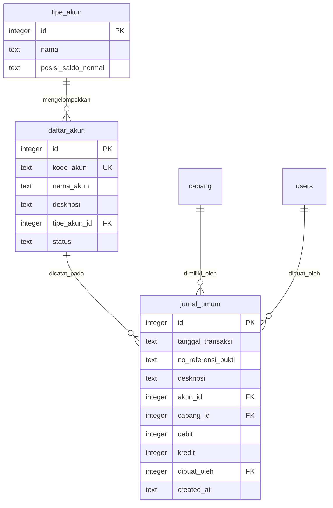
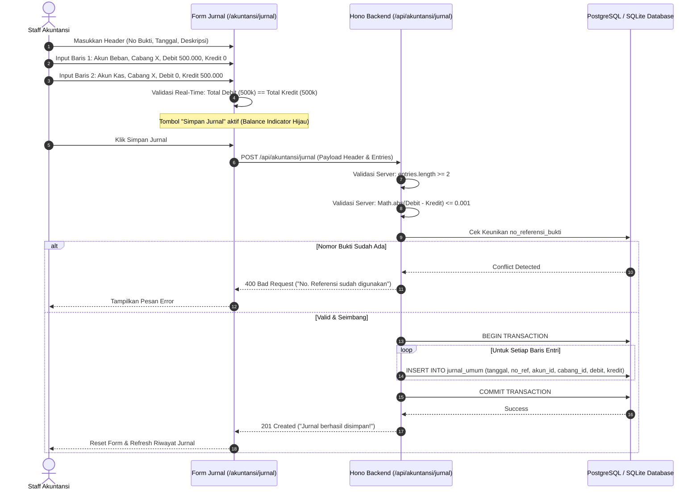
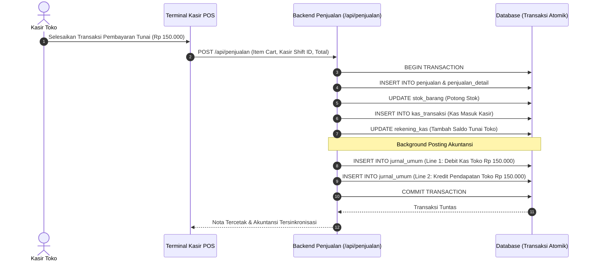
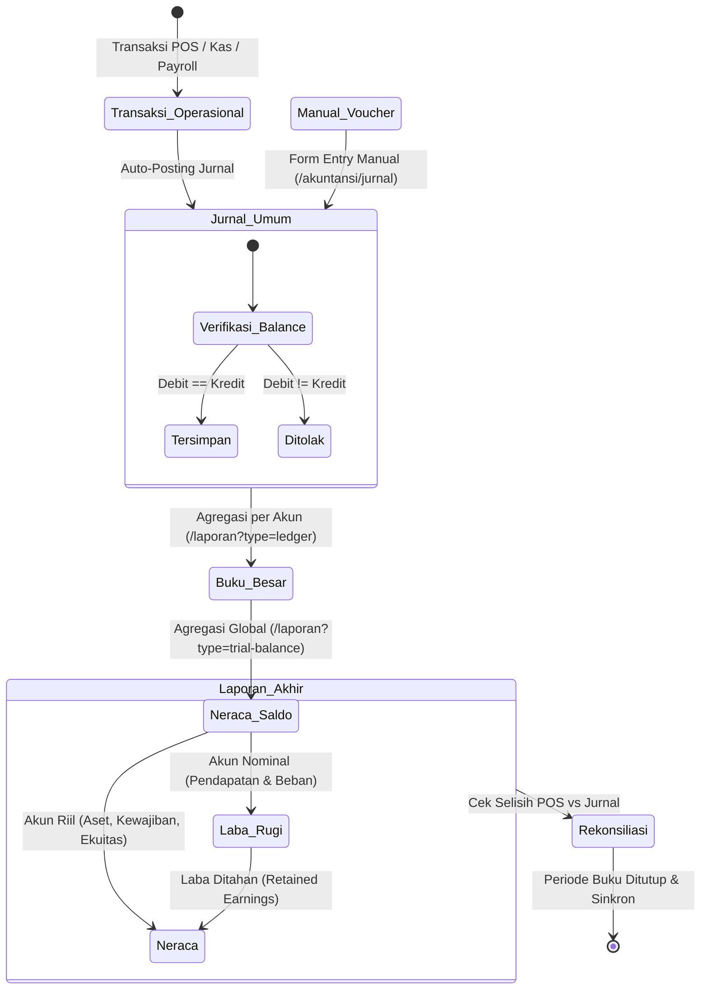

# SPESIFIKASI TEKNIS SISTEM: MODUL AKUNTANSI & KEUANGAN
**ERP AL MUBAROK (AS-IS SPECIFICATION)**  
*Dokumen ini menyajikan arsitektur lengkap, skema basis data, spesifikasi REST API, logika bisnis akuntansi, integrasi otomatis antar-modul, serta tata kelola otorisasi untuk Main Menu Akuntansi.*

---

## 1. Ringkasan Eksekutif & Arsitektur Modul

Modul Akuntansi & Keuangan merupakan inti pembukuan (*General Ledger Engine*) dari ERP Al Mubarok. Modul ini bertanggung jawab mencatat seluruh mutasi finansial operasional secara *double-entry bookkeeping* (pembukuan berpasangan), memvalidasi keseimbangan (*balancing*) Debit dan Kredit, serta menyajikan laporan keuangan standar (Buku Besar, Neraca Saldo, Laba Rugi, dan Neraca).

### Prinsip Utama Arsitektur Modul:
1. **Double-Entry Invariant Enforcement:** Setiap pencatatan jurnal umum wajib terdiri dari minimal dua baris entri dengan total nominal debit sama persis dengan total nominal kredit ($\sum \text{Debit} = \sum \text{Kredit}$). Seluruh operasi pencatatan dikemas dalam transaksi basis data atomik (`db.transaction`).
2. **Dual-Layer Financial Engine:** Modul ini menyediakan dua sudut pandang pelaporan:
   - **Aliran Operasional Riil (POS/Operasional):** Dihitung langsung dari transaksi kasir POS, harga modal HPP rata-rata transaksi, dan mutasi kas riil.
   - **Aliran Akuntansi Formal (Jurnal Umum):** Dihitung berdasarkan posting jurnal akun CoA kategori 4 (Pendapatan), 5 (HPP), dan 6 (Beban Operasional).
3. **Mesin Rekonsiliasi Finansial Cabang:** Fitur otomatis yang membandingkan omzet dan HPP POS kasir dengan entri buku jurnal umum per cabang untuk mendeteksi deviasi/ketidaksinkronan pembukuan secara *real-time*.
4. **Isolasi Multi-Cabang & Konsolidasi Pusat:** Pengguna tingkat cabang hanya dapat mengakses data jurnal dan buku besar untuk cabangnya sendiri, sedangkan manajerial pusat (Super User, IT, Bendahara, Manager, Supervisor) memiliki wewenang konsolidasi multi-cabang.

---

## 2. Peta File Kode Modul (Code File Map)

```
c:\Users\AFB\erp-almubarok\
├── erp-almubarok-nextjs\
│   ├── erp-almubarok-api\
│   │   └── src\
│   │       └── routes\
│   │           └── akuntansi.ts              # Controller utama REST API Hono (974 baris)
│   └── src\
│       ├── lib\
│       │   ├── db\
│       │   │   └── schema.ts                 # DDL Drizzle ORM (tipe_akun, daftar_akun, jurnal_umum)
│       │   └── utils.ts                      # Helper format mata uang (formatCurrency)
│       └── app\
│           └── (dashboard)\
│               └── akuntansi\
│                   ├── coa\
│                   │   └── page.tsx          # UI Chart of Accounts (Daftar Akun)
│                   ├── tipe\
│                   │   └── page.tsx          # UI Master Tipe Akun & Saldo Normal
│                   ├── jurnal\
│                   │   └── page.tsx          # UI Jurnal Umum & Form Entry Multi-Baris
│                   ├── laporan\
│                   │   └── page.tsx          # UI 4 Laporan: Buku Besar, Neraca Saldo, P&L, Neraca
│                   └── profit-cabang\
│                       └── page.tsx          # UI Dasbor Profitabilitas & Rekonsiliasi Cabang
```

---

## 3. Skema Basis Data & Data Dictionary Drizzle ORM

Modul Akuntansi berpusat pada 3 tabel utama dalam Drizzle ORM:



### 3.1. Tabel `tipe_akun`
Menyimpan klasifikasi dasar akun akuntansi beserta orientasi saldo normalnya.

```typescript
export const tipe_akun = sqliteTable("tipe_akun", {
  id: integer("id").primaryKey({ autoIncrement: true }),
  nama: text("nama").notNull(), // Aset, Kewajiban, Ekuitas, Pendapatan, Beban
  posisi_saldo_normal: text("posisi_saldo_normal", { enum: ["DEBIT", "KREDIT"] }).notNull(),
});
```

*Data Baku Sistem (`scripts/seed.ts`):*
| ID | Nama Tipe Akun | Posisi Saldo Normal | Karakteristik Perhitungan |
|---|---|---|---|
| `1` | **Aset** | `DEBIT` | Bertambah di Debit, berkurang di Kredit |
| `2` | **Kewajiban** | `KREDIT` | Bertambah di Kredit, berkurang di Debit |
| `3` | **Ekuitas** | `KREDIT` | Bertambah di Kredit, berkurang di Debit |
| `4` | **Pendapatan** | `KREDIT` | Bertambah di Kredit, berkurang di Debit |
| `5` | **Beban** | `DEBIT` | Bertambah di Debit, berkurang di Kredit |

---

### 3.2. Tabel `daftar_akun` (Chart of Accounts / CoA)
Menyimpan katalog rekening akun buku besar dengan kodefikasi hierarkis.

```typescript
export const daftar_akun = sqliteTable("daftar_akun", {
  id: integer("id").primaryKey({ autoIncrement: true }),
  kode_akun: text("kode_akun").notNull(), // format unik: misal 1.101.01
  nama_akun: text("nama_akun").notNull(), // misal: Kas Toko, Bank Mandiri
  deskripsi: text("deskripsi"),
  tipe_akun_id: integer("tipe_akun_id").references(() => tipe_akun.id).notNull(),
  status: text("status", { enum: ["Aktif", "Non-Aktif"] }).default("Aktif"),
});
```

*Integritas Data:*
- `kode_akun` bersifat unik di seluruh sistem.
- Menghapus akun diblokir jika sudah pernah tercatat pada entri `jurnal_umum` (`HTTP 409 Conflict`).

---

### 3.3. Tabel `jurnal_umum` (General Ledger Entries)
Menyimpan rincian setiap entri debet dan kredit transaksi keuangan per cabang.

```typescript
export const jurnal_umum = sqliteTable("jurnal_umum", {
  id: integer("id").primaryKey({ autoIncrement: true }),
  tanggal_transaksi: text("tanggal_transaksi").notNull(), // Format YYYY-MM-DD
  no_referensi_bukti: text("no_referensi_bukti").notNull(), // No Transaksi / No Bukti
  deskripsi: text("deskripsi").notNull(),
  akun_id: integer("akun_id").references(() => daftar_akun.id).notNull(),
  cabang_id: integer("cabang_id").references(() => cabang.id_cabang).notNull(),
  debit: integer("debit").default(0).notNull(),
  kredit: integer("kredit").default(0).notNull(),
  dibuat_oleh: integer("dibuat_oleh").references(() => users.id),
  created_at: text("created_at").default(sql`(CURRENT_TIMESTAMP)`),
});
```

---

## 4. Spesifikasi Lengkap Hono REST API

Seluruh rute akuntansi di-mount pada prefix `/api/akuntansi` dan diproteksi oleh middleware autentikasi JWT (`JWTPayload`).

### 4.1. Manajemen Tipe Akun
- **`GET /api/akuntansi/tipe-akun`**
  - **Output:** Array of `TipeAkun` diurutkan alfabetis nama.
- **`POST /api/akuntansi/tipe-akun`**
  - **Payload:** `{ nama: string, posisi_saldo_normal: "DEBIT" | "KREDIT" }`
  - **Status:** `201 Created`
- **`PUT /api/akuntansi/tipe-akun/:id`**
  - **Payload:** `{ nama: string, posisi_saldo_normal: "DEBIT" | "KREDIT" }`
  - **Status:** `200 OK`
- **`DELETE /api/akuntansi/tipe-akun/:id`**
  - **Validasi:** Mengecek apakah ID digunakan di `daftar_akun`. Jika iya, me-return `409 Conflict`.
  - **Status:** `200 OK`

---

### 4.2. Manajemen Chart of Accounts (CoA)
- **`GET /api/akuntansi/daftar-akun`**
  - **Output:** Daftar akun dengan relasi `tipe_akun` (nama tipe dan posisi saldo normal), diurutkan `kode_akun` ASC.
- **`POST /api/akuntansi/daftar-akun`**
  - **Payload:** `{ kode_akun: string, nama_akun: string, tipe_akun_id: number, deskripsi?: string, status?: "Aktif"|"Non-Aktif" }`
  - **Validasi:** Mengecek duplikasi `kode_akun`. Me-return `409 Conflict` jika kode sudah ada.
  - **Status:** `201 Created`
- **`PUT /api/akuntansi/daftar-akun/:id`**
  - **Payload:** Field akun yang diubah.
  - **Validasi:** Mengecek keunikan kode terhadap akun selain ID tersebut.
  - **Status:** `200 OK`
- **`DELETE /api/akuntansi/daftar-akun/:id`**
  - **Integritas:** Memeriksa keberadaan catatan pada `jurnal_umum`. Jika ada catatan historis, penghapusan ditolak dengan pesan error `409 Conflict`.
  - **Status:** `200 OK`

---

### 4.3. Jurnal Umum & Posting
- **`GET /api/akuntansi/jurnal`**
  - **Query Params:**
    - `no_ref` (string, optional): Mengambil baris transaksi lengkap satu bukti jurnal.
    - `startDate`, `endDate` (string YYYY-MM-DD, optional): Filter rentang tanggal.
  - **Cabang Isolation:** Jika pengguna memiliki `id_cabang`, query otomatis disaring `eq(jurnal_umum.cabang_id, activeUser.id_cabang)`.
  - **Output Grouped (jika tanpa `no_ref`):**
    ```json
    [
      {
        "no_referensi_bukti": "JRN-20261029-001",
        "tanggal_transaksi": "2026-10-29",
        "deskripsi": "Biaya Pemeliharaan AC Toko",
        "total_debit": 350000
      }
    ]
    ```
- **`POST /api/akuntansi/jurnal`**
  - **Payload Body:**
    ```json
    {
      "header": {
        "tanggal_transaksi": "2026-10-29",
        "no_referensi_bukti": "JRN-20261029-001",
        "deskripsi": "Pembelian Perlengkapan Toko Tunai"
      },
      "entries": [
        { "akun_id": 9, "cabang_id": 2, "debit": 250000, "kredit": 0 },
        { "akun_id": 1, "cabang_id": 2, "debit": 0, "kredit": 250000 }
      ]
    }
    ```
  - **Validasi Keras Server-Side:**
    1. Header lengkap: `tanggal_transaksi`, `no_referensi_bukti`, `deskripsi` wajib terisi.
    2. Baris entri minimal 2 baris (`entries.length >= 2`).
    3. Setiap baris wajib memiliki `akun_id` dan `cabang_id`.
    4. Nominal total debit $> 0$.
    5. **Balance Check:** $| \sum \text{Debit} - \sum \text{Kredit} | \le 0.001$. Jika tidak balance, melempar HTTP 400: *"Jurnal tidak seimbang. Debit (X) harus sama dengan Kredit (Y)"*.
    6. Keunikan `no_referensi_bukti`.

---

### 4.4. Laporan Keuangan Multi-Format (`GET /api/akuntansi/laporan`)
Endpoint gabungan dengan pembeda query `type`:

#### A. Buku Besar (`type=ledger`)
- **Query Wajib:** `akunId` (ID rekening CoA).
- **Query Opsional:** `startDate`, `endDate`.
- **Perhitungan Saldo Awal:** Menghitung mutasi transaksi sebelum `startDate`:
  - Jika Saldo Normal `DEBIT`: $\text{Saldo Awal} = \sum \text{Debit} - \sum \text{Kredit}$.
  - Jika Saldo Normal `KREDIT`: $\text{Saldo Awal} = \sum \text{Kredit} - \sum \text{Debit}$.
- **Output:** Objek akun, saldo awal, dan daftar mutasi kronologis.

#### B. Neraca Saldo (`type=trial-balance`)
- **Agregasi Group By Akun:** Menghitung total debit dan total kredit seluruh akun aktif dalam periode yang dipilih.
- **Output:** Array akun, total debit, dan total kredit.

#### C. Laba Rugi (`type=profit-loss`)
- **Agregasi Pendapatan:** Akun dengan `tipe_akun.nama = 'Pendapatan'`. Total dihitung: $\sum \text{Kredit} - \sum \text{Debit}$.
- **Agregasi Beban:** Akun dengan `tipe_akun.nama = 'Beban'`. Total dihitung: $\sum \text{Debit} - \sum \text{Kredit}$.
- **Trend Bulanan:** Analisis tren pendapatan dan beban per bulan (menggunakan fungsi SQL `substring(tanggal_transaksi from 1 for 7)`).

#### D. Neraca (`type=balance-sheet`)
- **Limit Transaksi:** Dibatasi per tanggal akhir (`tanggal_transaksi <= endDate`).
- **Aset:** $\sum \text{Debit} - \sum \text{Kredit}$ pada akun bertipe "Aset".
- **Kewajiban:** $\sum \text{Kredit} - \sum \text{Debit}$ pada akun bertipe "Kewajiban".
- **Ekuitas:** $\sum \text{Kredit} - \sum \text{Debit}$ pada akun bertipe "Ekuitas".
- **Laba Ditahan / Periode Berjalan (`retained_earnings`):** $\sum \text{Pendapatan Kumulatif} - \sum \text{Beban Kumulatif}$.

---

### 4.5. Dasbor Profitabilitas & Rekonsiliasi Cabang
- **`GET /api/akuntansi/dashboard-profit`**
  - Menghasilkan komparasi dual-stream (Stream POS Kasir vs Stream Jurnal Umum):
    - Penjualan Bruto, Diskon/Voucher/Poin, Penjualan Bersih, HPP POS vs HPP Jurnal.
    - Laba Kotor POS vs Laba Kotor Jurnal.
    - Margin Kotor, Margin Operasional, dan Laba Sebelum Pajak.
- **`GET /api/akuntansi/dashboard-profit/cabang`**
  - Rincian profitabilitas dan margin per cabang (penjualan bersih, HPP, laba kotor, beban operasional, laba operasional).
- **`GET /api/akuntansi/dashboard-profit/rekonsiliasi`**
  - Menghitung gap antara stream POS dengan stream Jurnal:
    $$\text{Selisih Sales} = \text{Sales}_{\text{POS}} - \text{Sales}_{\text{Jurnal}}$$
    $$\text{Selisih HPP} = \text{HPP}_{\text{POS}} - \text{HPP}_{\text{Jurnal}}$$
  - **Status Output:** `"COCOK"` (jika selisih nol) atau `"PERLU REKONSILIASI"` (jika terdapat deviasi).

---

## 5. Logika Bisnis & Algoritma Matematis Akuntansi

### 5.1. Persamaan Dasar Akuntansi (Neraca Seimbang)
Sistem menjamin keabsahan neraca keuangan pada setiap titik waktu $t$:

$$\text{Total Aset}_t = \text{Total Kewajiban}_t + \text{Total Ekuitas}_t + \text{Laba Berjalan}_t$$

Di mana:
$$\text{Laba Berjalan}_t = \sum_{\tau \le t} \text{Pendapatan}_\tau - \sum_{\tau \le t} \text{Beban}_\tau$$

---

### 5.2. Formula Rekalkulasi Saldo Berjalan Buku Besar (Running Balance)
Pada saat merender buku besar di frontend (`/akuntansi/laporan?type=ledger`), saldo berjalan pada baris ke-$k$ dihitung dinamis:

$$\text{Saldo}_k = 
\begin{cases} 
\text{Saldo}_{k-1} + \text{Debit}_k - \text{Kredit}_k, & \text{jika Saldo Normal } = \text{"DEBIT"} \\
\text{Saldo}_{k-1} + \text{Kredit}_k - \text{Debit}_k, & \text{jika Saldo Normal } = \text{"KREDIT"}
\end{cases}$$

Dengan $\text{Saldo}_0 = \text{Saldo Awal}$ yang dihasilkan dari akumulasi transaksi sebelum periode awal filter.

---

### 5.3. Integrasi Penjurnalan Otomatis Antar-Modul (Cross-Module Automatic Journaling)

Sistem ERP Al Mubarok menerapkan *automated background posting* ke tabel `jurnal_umum` pada peristiwa-peristiwa transaksi berikut:

| Modul Asal | File Handler | Pemicu Transaksi | Sisi Debit | Sisi Kredit |
|---|---|---|---|---|
| **Penjualan POS** | `penjualan.ts` | Pembayaran nota kasir POS berhasil | **Kas Toko** (`rekening.id_akun_coa`) | **Pendapatan Penjualan** (Akun CoA ID 7 / `coa_kategori_penjualan`) |
| **Kas Masuk** | `kas.ts` | Transaksi penerimaan kas dicatat | **Kas / Bank Penerima** (`rekening.id_akun_coa`) | **Akun Lawan Pendapatan / Modal** (`coaCounterAccount`) |
| **Kas Keluar** | `kas.ts` | Pengeluaran kas disetujui (*Approved*) | **Akun Beban / Lawan** (`coaCounterAccount`) | **Kas / Bank Sumber** (`rekening.id_akun_coa`) |
| **Rekonsiliasi Kas Toko** | `kas.ts` | Selisih kas fisik disetujui (Kelebihan) | **Kas Toko** (`id_akun_coa`) | **Pendapatan Selisih Kas** (`coaLawan`) |
| **Rekonsiliasi Kas Toko** | `kas.ts` | Selisih kas fisik disetujui (Kekurangan) | **Beban Selisih Kas** (`coaLawan`) | **Kas Toko** (`id_akun_coa`) |
| **Bisyaroh / Payroll** | `hrd.ts` | Penerbitan & pencairan gaji abdi/karyawan | **Beban Gaji Karyawan** (ID 15 / `6.101.01`) | **Kas Toko / Bank** (ID 1 / `1.101.01`) |

---

## 6. Alur Transaksi & Diagram Workflow

### 6.1. Workflow Posting Jurnal Umum Manual



---

### 6.2. Workflow Penjurnalan Otomatis Kasir POS



---

### 6.3. Siklus Akuntansi & Pembentukan Laporan Keuangan



---

## 7. Frontend UI/UX & Interaksi Komponen

### 7.1. Submenu Chart of Accounts / CoA (`/akuntansi/coa`)
- **Struktur Antarmuka:**
  - Header dengan filter dropdown tipe akun (Aset, Kewajiban, Ekuitas, Pendapatan, Beban) dan kolom pencarian kata kunci nama/kode akun.
  - Tabel Daftar Akun dengan kolom: *Kode Akun, Nama Akun, Tipe Akun, Saldo Normal (Badge Biru/Hijau), Status (Aktif/Non-Aktif), dan Tombol Aksi*.
  - Modal Form Tambah/Edit Akun: Memastikan format kode akun valid dan tipe akun terpilih.
  - Guard Konfirmasi Hapus: Memiliki proteksi *catch-error* jika backend menolak penghapusan akun berelasi.

---

### 7.2. Submenu Tipe Akun (`/akuntansi/tipe`)
- **Fitur:**
  - Menampilkan daftar tipe akun baku.
  - Modal penambahan/pengubahan tipe dengan opsi toggle saldo normal: `DEBIT` atau `KREDIT`.

---

### 7.3. Submenu Jurnal Umum (`/akuntansi/jurnal`)
- **Struktur Antarmuka:**
  - Filter rentang tanggal awal (`startDate`) dan tanggal akhir (`endDate`).
  - Tabel riwayat transaksi terkelompok per `no_referensi_bukti`, menampilkan tanggal, keterangan ringkas, total nominal debet, dan tombol *Lihat Detail*.
  - **Modal Detail Transaksi Jurnal:** Menampilkan seluruh baris debit dan kredit yang membentuk transaksi tersebut beserta nama pembuat transaksi (`dibuat_oleh_nama`).
  - **Modal Form Entri Jurnal Multi-Baris Interaktif:**
    - Input header: Tanggal, Nomor Bukti, dan Deskripsi umum.
    - Tabel dinamis baris entri: Tombol *Tambah Baris* dan *Hapus Baris*.
    - Per baris: Pemilih Rekening Akun CoA, Pemilih Cabang, Input Debit, Input Kredit.
    - **Live Balance Validator:** Bar indikator di bawah form yang menghitung secara *real-time* selisih $\sum \text{Debit} - \sum \text{Kredit}$. Jika selisih $\ne 0$, indikator berwarna merah (*"Tidak Seimbang"*), dan tombol Submit dinonaktifkan (*disabled*). Jika seimbang, indikator menjadi hijau centang (*"Seimbang"*).

---

### 7.4. Submenu Buku Besar & Laporan Keuangan (`/akuntansi/laporan`)
- **Navigasi Berbasis Tab Interaktif:**
  1. **Tab Buku Besar (`ledger`):**
     - Dropdown pemilih akun CoA + filter tanggal.
     - Ringkasan Saldo Awal, total pergerakan debit, total pergerakan kredit, dan Saldo Akhir.
     - Tabel mutasi dengan kolom kalkulasi *Saldo Berjalan* per baris.
     - Tombol *Cetak Buku Besar* dengan styling ramah kertas print.
  2. **Tab Neraca Saldo (`trial-balance`):**
     - Tabel seluruh akun yang memiliki mutasi, menyandingkan total debit dan total kredit.
     - Baris total bawah dengan validasi kesetaraan total debit vs total kredit.
  3. **Tab Laba Rugi (`profit-loss`):**
     - Rincian Pendapatan Usaha, Harga Pokok Penjualan, dan Beban Operasional.
     - Ringkasan Laba Kotor dan Laba Bersih.
     - Grafik batang (*BarChart*) tren bulanan pendapatan vs beban menggunakan library `Recharts`.
  4. **Tab Neraca (`balance-sheet`):**
     - Penyajian dua kolom (*T-Account*) atau format vertikal: Sisi Aset di kiri/atas, disandingkan dengan Kewajiban + Ekuitas + Laba Periode Berjalan di kanan/bawah.
     - Indikator otomatis keseimbangan Neraca: $\text{Aset} = \text{Kewajiban} + \text{Ekuitas} + \text{Laba Berjalan}$.

---

### 7.5. Submenu Profit Cabang & Rekonsiliasi (`/akuntansi/profit-cabang`)
- **Analisis Laba Rugi Operasional:** Menampilkan performa profitabilitas cabang secara terpisah.
- **Tabel Rekonsiliasi Finansial POS vs Jurnal:**
  - Menyajikan komparasi omzet kasir POS vs kredit jurnal pendapatan.
  - Menyajikan komparasi HPP POS vs debet jurnal HPP.
  - Menampilkan badge status: `COCOK` (Hijau) atau `PERLU REKONSILIASI` (Kuning/Merah).

---

## 8. Matriks Hak Akses & Keamanan Sistem (RBAC)

Otorisasi level API dikendalikan melalui token JWT (`activeUser.id_jabatan` dan `activeUser.id_cabang`).

| Submenu / Aksi Operasi | Super User (`1`) | IT Administrator (`2`) | Bendahara Pusat (`4`) | Manager Cabang (`8`) | Kasir & Staff Toko |
|---|---|---|---|---|---|
| **Kelola Tipe Akun (`/akuntansi/tipe`)** | Full Akses | Full Akses | Hanya Lihat | **Ditolak** | **Ditolak** |
| **Kelola Master CoA (`/akuntansi/coa`)** | Full Akses | Full Akses | Full Akses | Hanya Lihat | **Ditolak** |
| **Lihat Riwayat Jurnal (`/akuntansi/jurnal`)** | Seluruh Cabang | Seluruh Cabang | Seluruh Cabang | Cabangnya Sendiri | **Ditolak** |
| **Posting Jurnal Manual (`POST /jurnal`)** | Diizinkan | Diizinkan | Diizinkan | Cabangnya Sendiri | **Ditolak** |
| **Laporan Buku Besar & Neraca Saldo** | Seluruh Cabang | Seluruh Cabang | Seluruh Cabang | Cabangnya Sendiri | **Ditolak** |
| **Laporan Laba Rugi & Neraca Akhir** | Konsolidasi & Cabang | Konsolidasi & Cabang | Konsolidasi & Cabang | Cabangnya Sendiri | **Ditolak** |
| **Dasbor Profit & Rekonsiliasi Multi-Cabang** | Diizinkan | Diizinkan | Diizinkan | Cabangnya Sendiri | **Ditolak** |

---

*Dokumen ini merupakan representasi teknis faktual dari Main Menu Akuntansi & Keuangan ERP Al Mubarok per Oktober 2026 dan siap dijadikan konteks input untuk analisis, audit arsitektur, maupun refactoring kode AI.*

