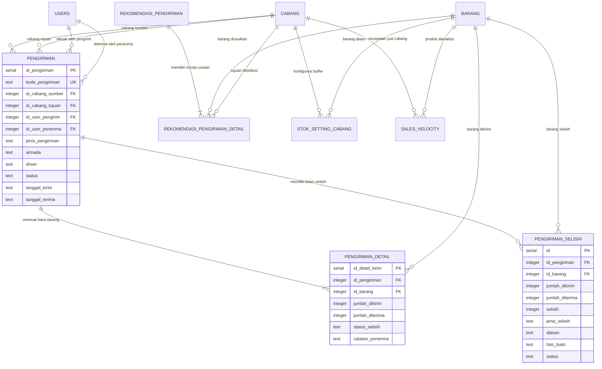
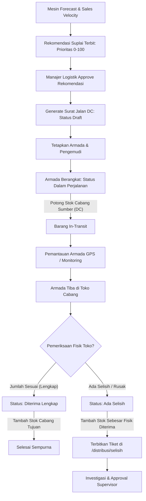
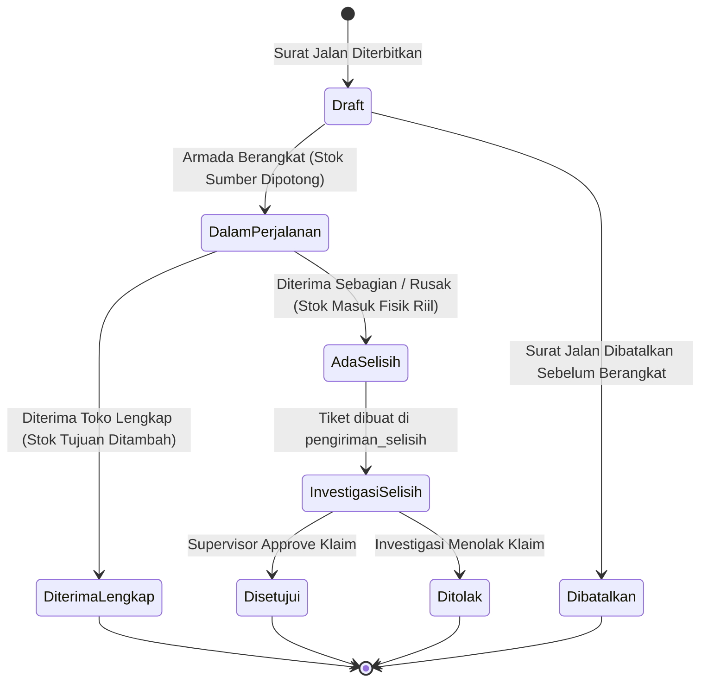

# 🚚 DOKUMENTASI TEKNIS SISTEM
## MAIN MENU DISTRIBUSI: DISTRIBUTION MANAGEMENT SYSTEM (DMS), PROYEKSI STOK, REKOMENDASI REPLENISHMENT & TRANSFER ANTARCABANG
### SISTEM ENTERPRISE RESOURCE PLANNING (ERP) AL MUBAROK

> **Status Dokumen:** Faktual / Spesifikasi Fungsional & Teknis Lengkap (*As-Is Specification*)  
> **Target Pengguna Dokumen:** AI Agent / Software Architect / Lead Developer untuk Analisis Sistem, Audit Logistik & Perencanaan Fitur  
> **Stack Arsitektur:** Next.js 16 (App Router, Turbopack), React 19, Tailwind CSS v4, Hono REST API, PostgreSQL, Drizzle ORM  
> **Domain Konteks:** Manajemen Distribusi Ritel Multi-Cabang (*Hub-and-Spoke Logistics*), Distribution Center (DC), Analisis Kecepatan Penjualan (*Sales Velocity ADS 7/30/90*), Proyeksi Kehabisan Stok (*Stock Runout Forecast*), Skoring Prioritas Pasokan, Mutasi 2-Fase (*In-Transit Stock Locking*), Pemantauan Armada GPS, dan Resolusi Selisih Pengiriman (*Discrepancy Handling*).

---

## 📑 DAFTAR ISI

1. [Ringkasan Eksekutif & Ruang Lingkup Sistem](#1-ringkasan-eksekutif--ruang-lingkup-sistem)
2. [Peta Arsitektur File & Komponen Kode](#2-peta-arsitektur-file--komponen-kode)
3. [Kamus Data & Skema Database (Database Dictionary)](#3-kamus-data--skema-database-database-dictionary)
4. [Spesifikasi REST API Endpoints (Hono Framework)](#4-spesifikasi-rest-api-endpoints-hono-framework)
5. [Logika Bisnis, Algoritma & Formula Matematis](#5-logika-bisnis-algoritma--formula-matematis)
6. [Alur Bisnis & State Machine (Mermaid Diagrams)](#6-alur-bisnis--state-machine-mermaid-diagrams)
7. [Struktur UI / UX Frontend & Interaksi Pengguna](#7-struktur-ui--ux-frontend--interaksi-pengguna)
8. [Matriks Hak Akses & Keamanan Sistem (RBAC)](#8-matriks-hak-akses--keamanan-sistem-rbac)

---

## 1. Ringkasan Eksekutif & Ruang Lingkup Sistem

Main Menu **Distribusi** (Urutan 7 pada navigasi utama ERP Al Mubarok, ikon: `Truck`) adalah sistem otomasi logistik terpadu (*Distribution Management System / DMS*) yang menghubungkan Gudang Pusat / Distribution Center (DC) dengan seluruh jaringan toko ritel cabang Al Mubarok. Modul ini menjamin ketersediaan barang di setiap cabang tanpa *stockout*, mencegah penumpukan barang (*overstock*), mengoptimalkan kapasitas muat armada, serta merekam setiap mutasi fisik antarcabang secara akurat dengan mitigasi selisih barang.

### 7 Submodul Utama:
1. **Dasbor Distribusi (`/distribusi/dashboard`):** Ringkasan operasional logistik realtime: jumlah armada aktif dalam perjalanan, total SKU berstatus kritis di cabang, jumlah draf rekomendasi pasokan yang menanti persetujuan, dan volume distribusi barang bulanan.
2. **Proyeksi Ketersediaan (`/distribusi/forecast`):** Mesin peramalan stok berbasis *Sales Velocity* (ADS 7, 30, dan 90 hari) untuk mengestimasi sisa hari ketahanan stok (*runout days*) dan tanggal prediksi kehabisan barang per cabang.
3. **Rekomendasi Pengiriman (`/distribusi/rekomendasi`):** Algoritma penjadwalan pasokan otomatis dari Gudang DC ke cabang berbasis skoring prioritas kebutuhan mendesak (*priority score*), target buffer hari, dan *safety stock*.
4. **Transfer Antarcabang (`/distribusi/transfer`):** Manajemen permohonan pasokan langsung antarcabang (*Store-to-Store Transfer / Pesan Cabang*) untuk mengatasi defisit stok lokal antar toko terdekat.
5. **Surat Jalan DC (`/distribusi/pengiriman`):** Penerbitan dokumen resmi Surat Jalan pengiriman dari DC, alur persetujuan logistik, penugasan armada dan driver, serta pemotongan stok cabang pengirim secara atomik saat armada berangkat (*in-transit*).
6. **Pemantauan GPS (`/distribusi/monitoring`):** Pelacakan posisi armada pengiriman aktif, estimasi waktu tiba (ETA), rute perjalanan pengemudi, dan durasi pengiriman.
7. **Selisih Pengiriman (`/distribusi/selisih`):** Tata kelola rekonsiliasi jika terjadi perbedaan kuantitas fisik antara barang yang dikirim DC dengan yang diterima toko (Barang Rusak, Hilang, Kurang Kirim, atau Lebih Kirim) dilengkapi bukti foto dan berita acara investigasi.

---

## 2. Peta Arsitektur File & Komponen Kode

### A. Backend API (Hono Framework + Drizzle ORM)
* **Direktori:** `erp-almubarok-nextjs/erp-almubarok-api/`
* **Skema Database:** [`src/lib/db/schema.ts`](file:///c:/Users/AFB/erp-almubarok/erp-almubarok-nextjs/erp-almubarok-api/src/lib/db/schema.ts)
  * Permohonan Transfer Cabang: Baris 422–441 (`pesan_cabang`, `pesan_cabang_detail`)
  * Surat Jalan Pengiriman: Baris 444–471 (`pengiriman`, `pengiriman_detail`)
  * Konfigurasi Buffer Stok Cabang: Baris 474–484 (`stok_setting_cabang`)
  * Kecepatan Penjualan: Baris 487–497 (`sales_velocity`)
  * Peramalan Stok: Baris 500–510 (`forecast_stok`)
  * Rekomendasi Pengiriman DC: Baris 513–536 (`rekomendasi_pengiriman`, `rekomendasi_pengiriman_detail`)
  * Selisih Pengiriman: Baris 539–554 (`pengiriman_selisih`)
* **Route Controller:** [`src/routes/distribusi.ts`](file:///c:/Users/AFB/erp-almubarok/erp-almubarok-nextjs/erp-almubarok-api/src/routes/distribusi.ts) (1.488 baris kode menangani seluruh logika DMS)
* **Mounting Router:** [`src/index.ts`](file:///c:/Users/AFB/erp-almubarok/erp-almubarok-nextjs/erp-almubarok-api/src/index.ts) (`/api/distribusi`).

### B. Frontend Web (Next.js 16 App Router)
* **Direktori:** `erp-almubarok-nextjs/src/app/(dashboard)/distribusi/`
* **File Halaman Utama:**
  * [`dashboard/page.tsx`](file:///c:/Users/AFB/erp-almubarok/erp-almubarok-nextjs/src/app/(dashboard)/distribusi/dashboard/page.tsx): Metrik utama logistik, status armada, dan grafik distribusi per cabang.
  * [`forecast/page.tsx`](file:///c:/Users/AFB/erp-almubarok/erp-almubarok-nextjs/src/app/(dashboard)/distribusi/forecast/page.tsx): Tabel peramalan stok, filter tingkat urgensi (Kritis, Perhatian, Aman, Overstock), tombol pemicu rekalkulasi kecepatan penjualan.
  * [`rekomendasi/page.tsx`](file:///c:/Users/AFB/erp-almubarok/erp-almubarok-nextjs/src/app/(dashboard)/distribusi/rekomendasi/page.tsx): Rekomendasi suplai terkomputasi, matriks skoring prioritas, penyesuaian kuantitas disetujui (*Approved Qty*), dan konversi 1-klik menjadi Surat Jalan DC.
  * [`transfer/page.tsx`](file:///c:/Users/AFB/erp-almubarok/erp-almubarok-nextjs/src/app/(dashboard)/distribusi/transfer/page.tsx): Formulir permohonan transfer stok antartoko cabang dan pelacakan status item permohonan.
  * [`pengiriman/page.tsx`](file:///c:/Users/AFB/erp-almubarok/erp-almubarok-nextjs/src/app/(dashboard)/distribusi/pengiriman/page.tsx): Manajemen Surat Jalan pengiriman, penetapan armada & driver, alur konfirmasi penerimaan toko dengan deteksi selisih otomatis.
  * [`monitoring/page.tsx`](file:///c:/Users/AFB/erp-almubarok/erp-almubarok-nextjs/src/app/(dashboard)/distribusi/monitoring/page.tsx): Peta/daftar pemantauan armada logistik aktif dalam perjalanan.
  * [`selisih/page.tsx`](file:///c:/Users/AFB/erp-almubarok/erp-almubarok-nextjs/src/app/(dashboard)/distribusi/selisih/page.tsx): Dasbor investigasi selisih barang kirim, upload foto bukti fisik, dan approval supervisor.

---

## 3. Kamus Data & Skema Database (Database Dictionary)

Database diatur menggunakan PostgreSQL dengan definisi skema Drizzle ORM (`drizzle-orm/pg-core`).



### 1. Tabel `pengiriman` (Surat Jalan / Delivery Order Header)
```typescript
export const pengiriman = pgTable("pengiriman", {
  id_pengiriman: serial("id_pengiriman").primaryKey(),
  kode_pengiriman: text("kode_pengiriman").notNull(),         // Format: SJ/YYYYMMDD/{id_cabang_sumber}/{sequence}
  id_cabang_sumber: integer("id_cabang_sumber").references(() => cabang.id_cabang).notNull(), // Asal pengiriman (DC / Toko)
  id_cabang_tujuan: integer("id_cabang_tujuan").references(() => cabang.id_cabang).notNull(), // Tujuan distribusi
  id_user_pengirim: integer("id_user_pengirim").references(() => users.id).notNull(),         // Petugas logistik pengirim
  id_user_penerima: integer("id_user_penerima").references(() => users.id),                   // Petugas toko penerima
  jenis_pengiriman: text("jenis_pengiriman").default("CABANG"), // 'DC_TO_BRANCH' | 'CABANG'
  id_rekomendasi: integer("id_rekomendasi"),                  // FK -> rekomendasi_pengiriman (jika dari auto-rekomendasi)
  armada: text("armada"),                                     // Nomor polisi / jenis kendaraan armada
  driver: text("driver"),                                     // Nama pengemudi armada
  status: text("status").default("Draft"),                    // 'Draft' | 'Dalam Perjalanan' | 'Diterima Lengkap' | 'Ada Selisih' | 'Dibatalkan'
  tanggal_kirim: text("tanggal_kirim").notNull(),             // Format: YYYY-MM-DD
  tanggal_terima: text("tanggal_terima"),                     // Format: YYYY-MM-DD saat konfirmasi tiba
  created_at: text("created_at").default(sql`(CURRENT_TIMESTAMP)`),
});
```

### 2. Tabel `pengiriman_detail` (Item Rincian Surat Jalan)
```typescript
export const pengiriman_detail = pgTable("pengiriman_detail", {
  id_detail_kirim: serial("id_detail_kirim").primaryKey(),
  id_pengiriman: integer("id_pengiriman").references(() => pengiriman.id_pengiriman).notNull(),
  id_barang: integer("id_barang").references(() => barang.id_barang).notNull(),
  jumlah_dikirim: integer("jumlah_dikirim").notNull(),        // Kuantitas fisik yang dimuat dari cabang sumber (pcs)
  jumlah_diterima: integer("jumlah_diterima"),                // Kuantitas fisik riil yang diterima di cabang tujuan
  id_request_detail: integer("id_request_detail").references(() => pesan_cabang_detail.id), // Referensi transfer toko
  status_selisih: text("status_selisih"),                     // 'SESUAI' | 'SELISIH_KURANG' | 'SELISIH_LEBIH'
  catatan_penerima: text("catatan_penerima"),
});
```

### 3. Tabel `stok_setting_cabang` (Parameter Buffer Stok Cabang)
```typescript
export const stok_setting_cabang = pgTable("stok_setting_cabang", {
  id: serial("id").primaryKey(),
  id_barang: integer("id_barang").references(() => barang.id_barang).notNull(),
  id_cabang: integer("id_cabang").references(() => cabang.id_cabang).notNull(),
  minimum_stock: integer("minimum_stock").default(0).notNull(), // Titik minimum kritis (pcs)
  safety_stock: integer("safety_stock").default(0).notNull(),   // Stok pengaman cadangan (pcs)
  target_days_stock: integer("target_days_stock").default(14).notNull(), // Target cakupan hari ketersediaan
  lead_time_days: integer("lead_time_days").default(2).notNull(), // Durasi waktu tempuh pengiriman (hari)
  created_at: text("created_at").default(sql`(CURRENT_TIMESTAMP)`),
  updated_at: text("updated_at").default(sql`(CURRENT_TIMESTAMP)`),
});
```

### 4. Tabel `sales_velocity` (Kecepatan Penjualan Produk)
```typescript
export const sales_velocity = pgTable("sales_velocity", {
  id: serial("id").primaryKey(),
  id_barang: integer("id_barang").references(() => barang.id_barang).notNull(),
  id_cabang: integer("id_cabang").references(() => cabang.id_cabang).notNull(),
  ads_7: integer("ads_7").default(0),                         // Average Daily Sales 7 hari terakhir
  ads_30: integer("ads_30").default(0),                       // Average Daily Sales 30 hari terakhir
  ads_90: integer("ads_90").default(0),                       // Average Daily Sales 90 hari terakhir
  last_calculated: text("last_calculated"),
  created_at: text("created_at").default(sql`(CURRENT_TIMESTAMP)`),
  updated_at: text("updated_at").default(sql`(CURRENT_TIMESTAMP)`),
});
```

### 5. Tabel `forecast_stok` (Tabel Peramalan Ketersediaan)
```typescript
export const forecast_stok = pgTable("forecast_stok", {
  id: serial("id").primaryKey(),
  id_barang: integer("id_barang").references(() => barang.id_barang).notNull(),
  id_cabang: integer("id_cabang").references(() => cabang.id_cabang).notNull(),
  stok_sekarang: integer("stok_sekarang").default(0).notNull(),
  ads: integer("ads").default(0),                             // ADS aktif yang digunakan untuk estimasi
  estimasi_habis_hari: integer("estimasi_habis_hari").default(0), // Sisa hari sebelum stok habis (Runout Days)
  tanggal_habis: text("tanggal_habis"),                       // Format: YYYY-MM-DD
  status: text("status").default("AMAN"),                     // 'KRITIS' | 'PERHATIAN' | 'AMAN' | 'OVERSTOCK'
  created_at: text("created_at").default(sql`(CURRENT_TIMESTAMP)`),
});
```

### 6. Tabel `rekomendasi_pengiriman` & Detail (Mesin Usulan Suplai DC)
```typescript
export const rekomendasi_pengiriman = pgTable("rekomendasi_pengiriman", {
  id: serial("id").primaryKey(),
  kode_rekomendasi: text("kode_rekomendasi").notNull(),       // Format: REK/YYYYMMDD/{sequence}
  tanggal_rekomendasi: text("tanggal_rekomendasi").notNull(), // Format: YYYY-MM-DD
  status: text("status").default("DRAFT"),                    // 'DRAFT' | 'APPROVED' | 'PROCESSED'
  dibuat_oleh: integer("dibuat_oleh").references(() => users.id),
  catatan: text("catatan"),
  created_at: text("created_at").default(sql`(CURRENT_TIMESTAMP)`),
  updated_at: text("updated_at").default(sql`(CURRENT_TIMESTAMP)`),
});

export const rekomendasi_pengiriman_detail = pgTable("rekomendasi_pengiriman_detail", {
  id: serial("id").primaryKey(),
  id_rekomendasi: integer("id_rekomendasi").references(() => rekomendasi_pengiriman.id).notNull(),
  id_barang: integer("id_barang").references(() => barang.id_barang).notNull(),
  id_cabang_tujuan: integer("id_cabang_tujuan").references(() => cabang.id_cabang).notNull(),
  stok_sekarang: integer("stok_sekarang").default(0).notNull(),
  ads: integer("ads").default(0),
  qty_rekomendasi: integer("qty_rekomendasi").default(0).notNull(), // Usulan kuantitas dari sistem
  target_stock: integer("target_stock").default(0).notNull(),
  prioritas_score: integer("prioritas_score").default(0),     // Nilai prioritas (0 - 100)
  qty_approved: integer("qty_approved"),                      // Kuantitas yang disetujui logistik/manajer
});
```

### 7. Tabel `pengiriman_selisih` (Rekonsiliasi Klaim Selisih)
```typescript
export const pengiriman_selisih = pgTable("pengiriman_selisih", {
  id: serial("id").primaryKey(),
  id_pengiriman: integer("id_pengiriman").references(() => pengiriman.id_pengiriman).notNull(),
  id_barang: integer("id_barang").references(() => barang.id_barang).notNull(),
  jumlah_dikirim: integer("jumlah_dikirim").notNull(),
  jumlah_diterima: integer("jumlah_diterima").notNull(),
  selisih: integer("selisih").notNull(),                      // jumlah_diterima - jumlah_dikirim
  jenis_selisih: text("jenis_selisih").notNull(),             // 'RUSAK' | 'HILANG' | 'KURANG_KIRIM' | 'LEBIH_KIRIM'
  alasan: text("alasan"),
  foto_bukti: text("foto_bukti"),                             // URL gambar / base64 bukti kerusakan
  status: text("status").default("MENUNGGU_PEMERIKSAAN"),     // 'MENUNGGU_PEMERIKSAAN' | 'DISETUJUI' | 'DITOLAK'
  dibuat_oleh: text("dibuat_oleh"),
  disetujui_oleh: integer("disetujui_oleh").references(() => users.id),
  created_at: text("created_at").default(sql`(CURRENT_TIMESTAMP)`),
  updated_at: text("updated_at").default(sql`(CURRENT_TIMESTAMP)`),
});
```

---

## 4. Spesifikasi REST API Endpoints (Hono Framework)

Seluruh endpoint diproteksi oleh otentikasi JWT (`authMiddleware`).

### A. Endpoints Forecast & Sales Velocity (`/api/distribusi/forecast`)
| Endpoint | Method | Parameter / Payload | Aturan Validasi & Logika Bisnis |
|---|---|---|---|
| `/api/distribusi/forecast` | `GET` | Query params: `id_cabang`, `status` (`KRITIS`\|`PERHATIAN`\|`AMAN`\|`OVERSTOCK`), `search` | Mengembalikan daftar peramalan stok per barang dan cabang terurut tingkat urgensi tertinggi (Kritis $\rightarrow$ Perhatian $\rightarrow$ Aman $\rightarrow$ Overstock). |
| `/api/distribusi/forecast` | `POST` | Body JSON: `{ id_cabang }` | **Trigger Rekalkulasi Kecepatan Penjualan:** Menghitung ulang `ads_7`, `ads_30`, dan `ads_90` dari riwayat `penjualan_detail`, memperbarui estimasi hari habis dan status stok di tabel `forecast_stok`. |

### B. Endpoints Rekomendasi Suplai DC (`/api/distribusi/rekomendasi`)
| Endpoint | Method | Parameter / Payload | Aturan Validasi & Logika Bisnis |
|---|---|---|---|
| `/api/distribusi/rekomendasi` | `GET` | Query params: `id_cabang`, `status` | Menampilkan draf usulan pengiriman dari Gudang Pusat DC ke cabang toko, lengkap dengan nilai prioritas dan kuantitas usulan. |
| `/api/distribusi/rekomendasi` | `POST` | Body JSON: `{ items: [{ id_barang, id_cabang_tujuan, qty_rekomendasi, ... }], catatan }` | Menghasilkan draf dokumen rekomendasi baru (`REK/YYYYMMDD/...`) dalam status `DRAFT`. |
| `/api/distribusi/rekomendasi` | `PUT` | Body JSON: `{ action: 'approve' \| 'generate_sj', id_rekomendasi, items: [...] }` | Menyetujui usulan (`status = 'APPROVED'`) atau otomatis mengonversinya menjadi dokumen Surat Jalan Pengiriman DC (`pengiriman`). |

### C. Endpoints Surat Jalan DC & Mutasi Stok (`/api/distribusi/pengiriman`)
| Endpoint | Method | Parameter / Payload | Aturan Validasi & Mutasi Stok 2-Fase |
|---|---|---|---|
| `/api/distribusi/pengiriman` | `GET` | Query params: `id_cabang_sumber`, `id_cabang_tujuan`, `status` | Menampilkan daftar seluruh dokumen Surat Jalan pengiriman antarcabang. |
| `/api/distribusi/pengiriman` | `POST` | Body JSON: `{ id_cabang_sumber, id_cabang_tujuan, armada, driver, items: [{ id_barang, jumlah_dikirim }] }` | **Penerbitan Surat Jalan Baru:** Menghasilkan dokumen `SJ/YYYYMMDD/{cabang}/{sequence}` dalam status `Draft`. |
| `/api/distribusi/pengiriman` | `PUT` | Body JSON: `{ action: 'update_status', id, status, items: [...] }` | **Mesin Transisi Mutasi 2-Fase (Atomik ACID):**<br>1. **Fase Kirim (`status = 'Dalam Perjalanan'`):** Memeriksa kecukupan stok di cabang sumber, lalu memotong saldo fisik `stok_barang.stok_akhir` di cabang pengirim.<br>2. **Fase Terima (`status = 'Diterima Lengkap'` / `'Ada Selisih'`):** Mengisi `jumlah_diterima`, menambah saldo fisik `stok_barang.stok_akhir` di cabang penerima. Jika ada selisih, otomatis membuat tiket di `pengiriman_selisih`. Menerapkan *Idempotency Guard* untuk mencegah double-submit. |

### D. Endpoints Transfer Cabang, Monitoring & Selisih
| Endpoint | Method | Parameter / Payload | Aturan Validasi & Logika Bisnis |
|---|---|---|---|
| `/api/distribusi/transfer` | `GET` | Query params: `id_cabang_peminta`, `status` | Mengambil data permohonan transfer stok antartoko (`pesan_cabang`). |
| `/api/distribusi/transfer` | `PUT` | Body JSON: `{ id_request, action: 'approve' \| 'reject' }` | Memproses persetujuan transfer antarcabang. |
| `/api/distribusi/monitoring` | `GET` | - | Mengambil daftar pengiriman yang sedang berstatus `Dalam Perjalanan`, data kendaraan armada, supir, dan jam keberangkatan. |
| `/api/distribusi/selisih` | `GET` | Query params: `status`, `id_cabang` | Mengambil daftar kasus selisih penerimaan barang di toko. |
| `/api/distribusi/selisih` | `PUT` | Body JSON: `{ id_selisih, action: 'approve' \| 'reject', catatan }` | Supervisor menyetujui laporan selisih, melakukan penyesuaian nilai buku persediaan. |
| `/api/distribusi/dashboard` | `GET` | - | Ringkasan metrik konsolidasi DMS (Armada aktif, SKU kritis, tren kirim). |

---

## 5. Logika Bisnis, Algoritma & Formula Matematis

### A. Formula Kecepatan Penjualan (Sales Velocity)
Kecepatan penjualan harian rata-rata (*Average Daily Sales / ADS*) dihitung dari akumulasi kuantitas produk terjual pada satuan terkecil (pcs) dalam 3 rentang waktu:
$$\text{ADS}_7 = \text{round}\left( \frac{\sum_{t=1}^{7} Q_{\text{terjual}, t}}{7.0}, 2 \right)$$
$$\text{ADS}_{30} = \text{round}\left( \frac{\sum_{t=1}^{30} Q_{\text{terjual}, t}}{30.0}, 2 \right)$$
$$\text{ADS}_{90} = \text{round}\left( \frac{\sum_{t=1}^{90} Q_{\text{terjual}, t}}{90.0}, 2 \right)$$

### B. Proyeksi Ketahanan Stok (Runout Days & Target Date)
$$\text{RunoutDays} = \begin{cases} 
\text{round}\left( \frac{\text{StokSekarang}}{\text{ADS}_{30}}, 1 \right), & \text{ADS}_{30} > 0 \\
999 \text{ hari (Aman)}, & \text{ADS}_{30} = 0 \land \text{StokSekarang} > 0 \\
0 \text{ hari (Kosong)}, & \text{ADS}_{30} = 0 \land \text{StokSekarang} \le 0 
\end{cases}$$
$$\text{TanggalHabis} = \text{CurrentDate} + \text{RunoutDays}$$

#### Matriks Klasifikasi Status Ketersediaan:
$$\text{StatusForecast} = \begin{cases} 
\text{\textbf{KRITIS}}, & \text{RunoutDays} \le 3 \lor (\text{StokSekarang} \le \text{MinimumStock}) \\
\text{\textbf{PERHATIAN}}, & 3 < \text{RunoutDays} \le 7 \\
\text{\textbf{AMAN}}, & 7 < \text{RunoutDays} \le \text{TargetDaysStock} \\
\text{\textbf{OVERSTOCK}}, & \text{RunoutDays} > 30 \lor (\text{StokSekarang} > \text{TargetStock} \times 1.5)
\end{cases}$$

### C. Algoritma Skoring Prioritas & Kuantitas Rekomendasi Suplai
Untuk setiap cabang tujuan, sistem menghitung kuantitas usulan pasokan dari Gudang DC:
$$\text{TargetStock} = (\text{ADS}_{30} \times \text{TargetDaysStock}) + \text{SafetyStock}$$
$$\text{DefisitStok} = \max(0, \text{TargetStock} - \text{StokSekarang})$$
* **Skoring Prioritas Pasokan (0 s/d 100):**
  $$\text{PrioritasScore} = \min\left(100, \text{round}\left( \left( 1 - \frac{\text{StokSekarang}}{\text{TargetStock}} \right) \times 70 + \left( \frac{\text{ADS}_{30}}{\text{MaxADS}} \right) \times 30 \right)\right)$$
  * Nilai $100$: Kritis absolut (stok kosong dengan penjualan tinggi).
  * Nilai $< 30$: Pasokan sekunder/rendah urgensi.
* **Pembulatan ke Dus / Kemasan Vendor:**
  $$\text{QtyRekomendasi} = \lceil \frac{\text{DefisitStok}}{\text{IsiKemasan}} \rceil \times \text{IsiKemasan}$$

### D. Mutasi Fisik 2-Fase (Two-Phase Inventory Lock)
Untuk menjamin saldo fisik tidak hilang saat barang sedang di perjalanan (*in-transit*):
1. **Fase 1 (Keberangkatan Armada):**
   * Status pengiriman: `Dalam Perjalanan`.
   * Stok cabang sumber: $\text{stok\_akhir}_{\text{sumber}} = \text{stok\_akhir}_{\text{sumber}} - Q_{\text{kirim}}$.
   * Akumulasi mutasi keluar: $\text{transfer\_keluar}_{\text{sumber}} = \text{transfer\_keluar}_{\text{sumber}} + Q_{\text{kirim}}$.
2. **Fase 2 (Konfirmasi Tiba di Toko Cabang):**
   * Status pengiriman: `Diterima Lengkap` atau `Ada Selisih`.
   * Stok cabang tujuan: $\text{stok\_akhir}_{\text{tujuan}} = \text{stok\_akhir}_{\text{tujuan}} + Q_{\text{terima}}$.
   * Akumulasi mutasi masuk: $\text{transfer\_masuk}_{\text{tujuan}} = \text{transfer\_masuk}_{\text{tujuan}} + Q_{\text{terima}}$.
   * Evaluasi selisih: $\Delta = Q_{\text{terima}} - Q_{\text{kirim}}$. Jika $\Delta \ne 0 \implies \text{Tiket Selisih Diterbitkan}$.

---

## 6. Alur Bisnis & State Machine (Mermaid Diagrams)

### A. Alur Kerja Distribusi DC ke Toko Cabang (Hub-and-Spoke Flow)


### B. State Machine Surat Jalan Pengiriman DC (Shipment Lifecycle)


---

## 7. Struktur UI / UX Frontend & Interaksi Pengguna

Frontend dikembangkan dengan Next.js 16 menggunakan styling Tailwind CSS v4, modal dialog transparan, serta integrasi ikon Lucide React.

```text
src/app/(dashboard)/distribusi/
├── dashboard/
│   └── page.tsx              # Metrik logistik konsolidasi, KPI armada, volume kirim
├── forecast/
│   └── page.tsx              # Peramalan stok, filter tingkat urgensi (Kritis/Aman), kalkulator ADS
├── monitoring/
│   └── page.tsx              # Pemantauan armada logistik realtime in-transit
├── pengiriman/
│   └── page.tsx              # Daftar Surat Jalan DC, form penerbitan SJ, modal terima barang
├── rekomendasi/
│   └── page.tsx              # Tabel rekomendasi suplai DC, matriks prioritas, konversi 1-klik ke SJ
├── selisih/
│   └── page.tsx              # Dasbor rekonsiliasi selisih barang, upload bukti foto, approval
└── transfer/
    └── page.tsx              # Permohonan transfer antarcabang (Store-to-Store)
```

### Karakteristik Desain & UX:
1. **Visual Badge Urgensi:** Pada `/distribusi/forecast`, setiap produk diberi label warna kontras: Merah (*KRITIS / Stok Habis $\le$ 3 Hari*), Kuning (*PERHATIAN / 4-7 Hari*), Hijau (*AMAN*), dan Biru (*OVERSTOCK*).
2. **Kalkulator ADS Otomatis:** Tombol *Refresh Data Velocity* menghitung ulang ribuan pergerakan transaksi POS kasir secara asinkron tanpa membebani browser kasir.
3. **Form Penerimaan Barang Interaktif:** Saat toko mengonfirmasi barang tiba di `/distribusi/pengiriman`, sistem menampilkan kuantitas awal yang dikirim dan menyediakan kolom kuantitas fisik riil yang diterima. Jika berbeda, form otomatis meminta keterangan alasan dan foto bukti.
4. **Cetak Surat Jalan Monospace & A4:** Mendukung pencetakan Surat Jalan rangkap 3 (Arsip DC, Driver, dan Toko Penerima).

---

## 8. Matriks Hak Akses & Keamanan Sistem (RBAC)

Otorisasi level API dikendalikan melalui token JWT (`activeUser.id_jabatan` dan `activeUser.id_cabang`).

| Submenu / Operasi | Super User (`1`) | IT Administrator (`2`) | Manager Logistik DC | Manager Toko Cabang (`3`) | Staff Gudang / Toko (`4+`) |
|---|---|---|---|---|---|
| **Dasbor Distribusi (`/dashboard`)** | Full Akses | Full Akses | Full Akses | Cabangnya Sendiri | Terbatas |
| **Forecast Stok Global** | Full Akses | Full Akses | Full Akses | Cabangnya Sendiri | Hanya Lihat |
| **Persetujuan Rekomendasi Suplai** | Diizinkan | Diizinkan | Diizinkan | **Ditolak** (Khusus DC) | **Ditolak** |
| **Penerbitan Surat Jalan DC** | Diizinkan | Diizinkan | Diizinkan | **Ditolak** (Khusus DC) | **Ditolak** |
| **Konfirmasi Barang Tiba di Toko** | Diizinkan | Diizinkan | Diizinkan | Diizinkan di Cabangnya | Diizinkan (Penerima) |
| **Pengajuan Transfer Antartoko** | Diizinkan | Diizinkan | Diizinkan | Diizinkan (Cabangnya) | **Ditolak** |
| **Approval Selisih Barang Kirim** | Diizinkan | Diizinkan | Diizinkan | **Ditolak** (Wajib Manajerial DC) | **Ditolak** |

---

*Dokumen ini merupakan representasi teknis faktual dari Main Menu Distribusi ERP Al Mubarok per Oktober 2026 dan siap dijadikan konteks input untuk analisis, refactoring, atau integrasi AI.*

