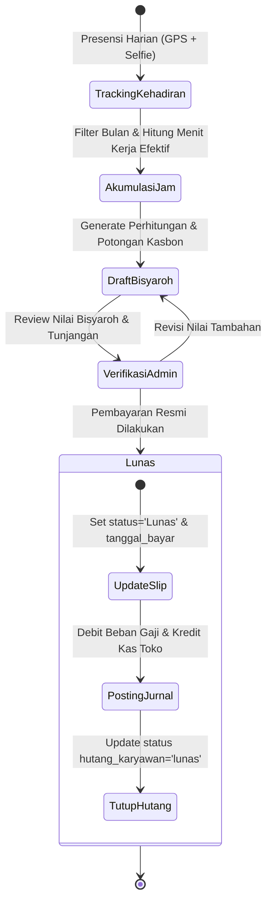
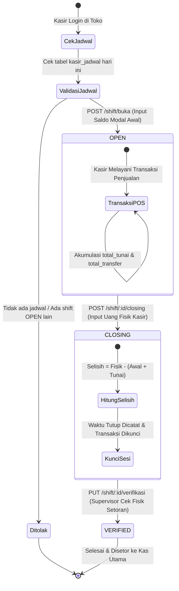

# 👥 DOKUMENTASI TEKNIS AS-IS (GROUND TRUTH)
## MODUL HRD, DATA ABDI, PRESENSI, BISYAROH & MANAJEMEN SHIFT KASIR
### SISTEM ENTERPRISE RESOURCE PLANNING (ERP) AL MUBAROK

> **Status Dokumen:** Faktual / Kondisi Riil Sistem Saat Ini (*As-Is Specification*)  
> **Target Pengguna Dokumen:** AI Agent / Software Architect / Lead Developer untuk Analisis Sistem & Perencanaan Fitur  
> **Stack Arsitektur:** Next.js 16 (App Router, Turbopack), React 19, Tailwind CSS v4, Hono REST API, PostgreSQL, Drizzle ORM  
> **Domain Konteks:** Manajemen Sumber Daya Insani (SDI / HRD), Personil Abdi Dalem / Karyawan Pesantren-Ritel, Penggajian Berbasis Waktu Efektif (*Bisyaroh*), Otomasi Penjadwalan Kasir, dan Siklus Buka-Tutup Kasir Toko.

---

## 📑 DAFTAR ISI

1. [Ringkasan Eksekutif & Ruang Lingkup Sistem](#1-ringkasan-eksekutif--ruang-lingkup-sistem)
2. [Peta Arsitektur File & Komponen Kode](#2-peta-arsitektur-file--komponen-kode)
3. [Kamus Data & Skema Database (Database Dictionary)](#3-kamus-data--skema-database-database-dictionary)
4. [Spesifikasi REST API Endpoints (Hono Framework)](#4-spesifikasi-rest-api-endpoints-hono-framework)
5. [Logika Bisnis, Algoritma & Formula Matematis](#5-logika-bisnis-algoritma--formula-matematis)
6. [Alur Bisnis & State Machine (Workflow Diagrams)](#6-alur-bisnis--state-machine-workflow-diagrams)
7. [Struktur UI / UX Frontend & Interaksi Pengguna](#7-struktur-ui--ux-frontend--interaksi-pengguna)
8. [Matriks Matriks Hak Akses & Isolasi Data (RBAC)](#8-matriks-hak-akses--isolasi-data-rbac)

---

## 1. Ringkasan Eksekutif & Ruang Lingkup Sistem

Modul HRD & Abdi pada ERP Al Mubarok adalah sub-sistem operasional terintegrasi yang menggabungkan fungsi personalia modern dengan tata kelola kepegawaian institusi berbasis pesantren/ritel (menggunakan istilah kultural seperti *Abdi*, *Bisyaroh*, dan *Lembaga*). Modul ini terhubung secara langsung dengan modul Akuntansi (Buku Besar/Jurnal Umum) serta modul Kasir Toko.

### Ruang Lingkup Fungsional:
1. **Manajemen Data Abdi / Karyawan (`/hrd/users`):** Profil identitas lengkap, nomor KTP, riwayat pendidikan, riwayat lembaga/pekerjaan, foto profil dengan kompresi pasfoto otomatis, status kepegawaian (*Abdi Tetap*, *Kontrak*, *Training*, *Non-Aktif*), penempatan cabang, serta fitur impor/ekspor massal (Excel & CSV).
2. **Master Jabatan & Departemen (`/hrd/jabatan`):** Klasifikasi tingkat struktural organisasi yang menjadi penentu hak otorisasi peran (RBAC) dan standar tarif bisyaroh.
3. **Master Jam Kerja & Pengaturan Shift (`/hrd/jam-kerja`):** Definisi nama shift, jam masuk, batas akhir toleransi masuk, jam pulang, serta batas awal jam pulang.
4. **Master Hari Libur (`/hrd/hari-libur`):** Kalender hari libur operasional institusi dan nasional untuk referensi jadwal kerja.
5. **Presensi Digital & Geolocation (`/hrd/absensi`):** Pencatatan log masuk, pulang, lembur mulai, dan lembur selesai yang dilengkapi dengan koordinat lintang/bujur (Latitude/Longitude), status validasi radius lokasi, dan foto bukti.
6. **Manajemen Izin & Cuti (`/hrd/izin-cuti`):** Pengajuan permohonan dispensasi (Sakit, Izin, Cuti) secara mandiri oleh personil dengan alur approval bertingkat oleh pimpinan cabang / administrator.
7. **Kasbon & Hutang Karyawan (`/hrd/hutang`):** Pencatatan pinjaman dana darurat abdi dengan pelacakan status aktif/lunas yang secara otomatis memotong komponen pembayaran bisyaroh.
8. **Penggajian / Bisyaroh Terotomasi (`/hrd/bisyaroh` & `/hrd/gaji-jabatan`):** Mesin kalkulasi honor berbasis total jam kerja efektif (dengan deduksi otomatis jam istirahat untuk kerja > 5 jam), jam lembur, tunjangan, dan potongan pinjaman, yang terintegrasi secara *double-entry* ke Jurnal Umum Akuntansi (Beban Gaji vs Kas).
9. **Penjadwalan Kasir Cerdas (`/hrd/jadwal-kasir`):** Penyusunan roster kasir per cabang, generator rotasi otomatis (*Auto-Generate*) shift pagi-sore berbasis pola bergantian, serta penyalinan jadwal lintas bulan (*Copy Schedule*) dengan proteksi konflik jadwal ganda O(1).
10. **Manajemen Sesi Shift Kasir (`/hrd/shift-kasir` & `/api/kas/shift`):** Tata kelola buka kasir (verifikasi modal awal), transaksi penjualan kasir terisolasi shift, closing kasir (rekonsiliasi uang fisik vs sistem tunai/transfer), dan verifikasi supervisi.

---

## 2. Peta Arsitektur File & Komponen Kode

### A. Backend API (Hono.js + Drizzle ORM)
* **Direktori:** `erp-almubarok-nextjs/erp-almubarok-api/`
* **Entry Point:** [`src/index.ts`](file:///c:/Users/AFB/erp-almubarok/erp-almubarok-nextjs/erp-almubarok-api/src/index.ts)
* **Skema Database:** [`src/lib/db/schema.ts`](file:///c:/Users/AFB/erp-almubarok/erp-almubarok-nextjs/erp-almubarok-api/src/lib/db/schema.ts) (Baris 4–146, 812–845)
* **Koneksi Database:** [`src/lib/db/index.ts`](file:///c:/Users/AFB/erp-almubarok/erp-almubarok-nextjs/erp-almubarok-api/src/lib/db/index.ts) (PostgreSQL Pool via `drizzle-orm/node-postgres`)
* **Route Controller HRD:** [`src/routes/hrd.ts`](file:///c:/Users/AFB/erp-almubarok/erp-almubarok-nextjs/erp-almubarok-api/src/routes/hrd.ts) (1.432 baris kode menangani Users, Jabatan, Absensi, Jam Kerja, Hari Libur, Izin Cuti, Hutang, Gaji Jabatan, Bisyaroh, Kasir Jadwal)
* **Route Controller Shift Kasir:** [`src/routes/kas.ts`](file:///c:/Users/AFB/erp-almubarok/erp-almubarok-nextjs/erp-almubarok-api/src/routes/kas.ts) (Baris 512–820 menangani Sesi Buka, Closing, dan Verifikasi Shift)
* **Middleware Auth:** [`src/middleware/auth.ts`](file:///c:/Users/AFB/erp-almubarok/erp-almubarok-nextjs/erp-almubarok-api/src/middleware/auth.ts) (Verifikasi JWT Bearer & injeksi payload pengguna aktif ke context)

### B. Frontend Web (Next.js 16 App Router)
* **Direktori:** `erp-almubarok-nextjs/src/app/(dashboard)/hrd/`
* **Halaman & Komponen Utama:**
  * [`users/page.tsx`](file:///c:/Users/AFB/erp-almubarok/erp-almubarok-nextjs/src/app/(dashboard)/hrd/users/page.tsx): Data Master Abdi, filter status/cabang/jabatan, modal pasfoto, import/export XLSX/CSV.
  * [`jabatan/page.tsx`](file:///c:/Users/AFB/erp-almubarok/erp-almubarok-nextjs/src/app/(dashboard)/hrd/jabatan/page.tsx): Master Data Jabatan & Organisasi.
  * [`jam-kerja/page.tsx`](file:///c:/Users/AFB/erp-almubarok/erp-almubarok-nextjs/src/app/(dashboard)/hrd/jam-kerja/page.tsx): Konfigurasi Shift Jam Masuk/Pulang dan batas toleransi.
  * [`hari-libur/page.tsx`](file:///c:/Users/AFB/erp-almubarok/erp-almubarok-nextjs/src/app/(dashboard)/hrd/hari-libur/page.tsx): Kalender Hari Libur.
  * [`absensi/page.tsx`](file:///c:/Users/AFB/erp-almubarok/erp-almubarok-nextjs/src/app/(dashboard)/hrd/absensi/page.tsx): Log Presensi, filter harian/cabang, modal input presensi mandiri.
  * [`izin-cuti/page.tsx`](file:///c:/Users/AFB/erp-almubarok/erp-almubarok-nextjs/src/app/(dashboard)/hrd/izin-cuti/page.tsx): Pengajuan izin/cuti abdi & panel verifikasi status (Menunggu, Disetujui, Ditolak).
  * [`hutang/page.tsx`](file:///c:/Users/AFB/erp-almubarok/erp-almubarok-nextjs/src/app/(dashboard)/hrd/hutang/page.tsx): Pencatatan kasbon, monitoring saldo pinjaman per abdi, toggle status aktif/lunas.
  * [`bisyaroh/page.tsx`](file:///c:/Users/AFB/erp-almubarok/erp-almubarok-nextjs/src/app/(dashboard)/hrd/bisyaroh/page.tsx): Panel Penggajian Bulanan, kalkulator real-time, cetak slip gaji per abdi, simpan draft & finalisasi status Lunas.
  * [`jadwal-kasir/page.tsx`](file:///c:/Users/AFB/erp-almubarok/erp-almubarok-nextjs/src/app/(dashboard)/hrd/jadwal-kasir/page.tsx): Tampilan kalender & tabel shift kasir, generator rotasi otomatis bulanan, copy jadwal antar-bulan.
  * [`shift-kasir/page.tsx`](file:///c:/Users/AFB/erp-almubarok/erp-almubarok-nextjs/src/app/(dashboard)/hrd/shift-kasir/page.tsx): Monitoring status sesi kasir toko realtime (OPEN/CLOSING/VERIFIED).
  * [`shift-kasir/laporan/page.tsx`](file:///c:/Users/AFB/erp-almubarok/erp-almubarok-nextjs/src/app/(dashboard)/hrd/shift-kasir/laporan/page.tsx): Rekapitulasi historis kasir, total selisih kas, dan total setoran ke brankas/bank.

---

## 3. Kamus Data & Skema Database (Database Dictionary)

Database diatur menggunakan PostgreSQL dengan pendefinisian skema pada Drizzle ORM (`drizzle-orm/pg-core`).

### 1. Tabel `users` (Personil / Abdi Dalem)
Tabel identitas personil dan otentikasi login sistem.
```typescript
export const users = pgTable("users", {
  id: serial("id").primaryKey(),
  kode_user: text("kode_user").notNull(),                    // Unique identifier (contoh: ABD-001)
  nama_user: text("nama_user").notNull(),
  tempat_lahir: text("tempat_lahir"),
  tanggal_lahir: text("tanggal_lahir"),                      // Format YYYY-MM-DD
  no_ktp: text("no_ktp"),                                    // Nomor Induk Kependudukan
  pendidikan_terakhir: text("pendidikan_terakhir"),
  riwayat_lembaga: text("riwayat_lembaga"),                  // Riwayat pesantren/institusi internal
  riwayat_pekerjaan: text("riwayat_pekerjaan"),
  status: text("status").default("Kontrak"),                 // 'Abdi Tetap' | 'Kontrak' | 'Training' | 'Non-Aktif'
  no_hp: text("no_hp").notNull(),
  foto: text("foto"),                                        // Base64 URI atau URL foto profil
  password: text("password").notNull(),                      // Hashed bcrypt string
  id_jabatan: integer("id_jabatan"),                         // FK -> jabatan.id_jabatan
  id_cabang: integer("id_cabang"),                           // FK -> cabang.id_cabang
  tanggal_masuk: text("tanggal_masuk"),                      // Format YYYY-MM-DD
  refresh_token: text("refresh_token"),
  refresh_token_expires: text("refresh_token_expires"),
  updated_at: text("updated_at").default(sql`(CURRENT_TIMESTAMP)`),
});
```

### 2. Tabel `jabatan` (Struktur Organisasi)
```typescript
export const jabatan = pgTable("jabatan", {
  id_jabatan: serial("id_jabatan").primaryKey(),
  jabatan: text("jabatan").notNull(),                        // Nama jabatan (Super User, IT, Manager, Kasir, Gudang, dll)
});
```

### 3. Tabel `jam_kerja` (Master Shift Kerja)
```typescript
export const jam_kerja = pgTable("jam_kerja", {
  id: serial("id").primaryKey(),
  nama_shift: text("nama_shift").notNull(),                  // Contoh: 'Shift Pagi', 'Shift Sore', 'Office Regular'
  jam_masuk: text("jam_masuk").notNull(),                    // Format HH:mm (contoh: '07:00')
  jam_masuk_batas_akhir: text("jam_masuk_batas_akhir").notNull(), // Toleransi telat (contoh: '07:15')
  jam_pulang: text("jam_pulang").notNull(),                  // Format HH:mm (contoh: '15:00')
  jam_pulang_batas_awal: text("jam_pulang_batas_awal").notNull(), // Batas awal boleh pulang (contoh: '14:50')
  keterangan: text("keterangan"),
});
```

### 4. Tabel `hari_libur` (Kalender Libur)
```typescript
export const hari_libur = pgTable("hari_libur", {
  id: serial("id").primaryKey(),
  tanggal: text("tanggal").notNull(),                        // Format YYYY-MM-DD
  nama_libur: text("nama_libur").notNull(),
  keterangan: text("keterangan"),
});
```

### 5. Tabel `absensi` (Log Presensi Harian)
```typescript
export const absensi = pgTable("absensi", {
  id: serial("id").primaryKey(),
  user_id: integer("user_id").notNull(),                     // FK -> users.id
  tanggal: text("tanggal").notNull(),                        // Format YYYY-MM-DD
  jam: text("jam").notNull(),                                // Format HH:mm:ss
  jenis: text("jenis").notNull(),                            // 'masuk' | 'pulang' | 'lembur_mulai' | 'lembur_selesai'
  shift: text("shift"),                                      // Nama shift saat absen
  latitude: text("latitude"),                                // Koordinat GPS
  longitude: text("longitude"),                              // Koordinat GPS
  status_lokasi: text("status_lokasi").default("valid"),     // 'valid' | 'diluar_radius'
  foto_selfie: text("foto_selfie"),                          // URL / base64 foto bukti presensi
  id_shift: integer("id_shift"),                             // FK -> jam_kerja.id
  catatan: text("catatan"),
  created_at: text("created_at").default(sql`(CURRENT_TIMESTAMP)`),
});
```

### 6. Tabel `izin_cuti` (Dispensasi & Cuti)
```typescript
export const izin_cuti = pgTable("izin_cuti", {
  id: serial("id").primaryKey(),
  user_id: integer("user_id").notNull(),                     // FK -> users.id
  jenis: text("jenis").notNull(),                            // 'Cuti' | 'Izin' | 'Sakit'
  tanggal_mulai: text("tanggal_mulai").notNull(),            // Format YYYY-MM-DD
  tanggal_selesai: text("tanggal_selesai").notNull(),        // Format YYYY-MM-DD
  keterangan: text("keterangan"),
  bukti_file: text("bukti_file"),                            // Lampiran dokumen/surat dokter
  status: text("status").default("pending"),                 // 'Menunggu' | 'Disetujui' | 'Ditolak'
  tanggal_pengajuan: text("tanggal_pengajuan").default(sql`(CURRENT_TIMESTAMP)`),
  tanggal_approval: text("tanggal_approval"),
  approver_id: integer("approver_id"),                       // FK -> users.id (Pejabat yang menyetujui)
  catatan_approval: text("catatan_approval"),
});
```

### 7. Tabel `hutang_karyawan` (Kasbon & Pinjaman)
```typescript
export const hutang_karyawan = pgTable("hutang_karyawan", {
  id: serial("id").primaryKey(),
  user_id: integer("user_id").notNull(),                     // FK -> users.id
  nominal: integer("nominal").notNull(),                     // Nilai pinjaman rupiah
  tanggal: text("tanggal").notNull(),                        // Format YYYY-MM-DD
  keterangan: text("keterangan"),                            // Alasan kasbon
  status: text("status").default("aktif"),                   // 'aktif' | 'lunas'
});
```

### 8. Tabel `daftar_gaji_jabatan` (Konfigurasi Standar Tarif Bisyaroh)
```typescript
export const daftar_gaji_jabatan = pgTable("daftar_gaji_jabatan", {
  id: serial("id").primaryKey(),
  id_jabatan: integer("id_jabatan").notNull(),               // FK -> jabatan.id_jabatan (Unik per jabatan)
  gaji_pokok: integer("gaji_pokok").notNull(),               // Nominal tetap bulanan (IDR)
  gaji_per_jam: integer("gaji_per_jam").notNull(),           // Tarif per jam kerja normal (IDR)
  lembur_per_jam: integer("lembur_per_jam").notNull().default(0), // Tarif per jam lembur (IDR)
  updated_at: text("updated_at").default(sql`(CURRENT_TIMESTAMP)`),
});
```

### 9. Tabel `bisyaroh` (Slip Penggajian Bulanan)
```typescript
export const bisyaroh = pgTable("bisyaroh", {
  id: serial("id").primaryKey(),
  user_id: integer("user_id").notNull(),                     // FK -> users.id
  bulan: integer("bulan").notNull(),                         // 1 s/d 12
  tahun: integer("tahun").notNull(),                         // Format YYYY
  gaji_pokok: integer("gaji_pokok").notNull().default(0),
  gaji_per_jam: integer("gaji_per_jam").notNull().default(0),
  lembur_per_jam: integer("lembur_per_jam").notNull().default(0),
  hari_kerja: integer("hari_kerja").notNull().default(0),    // Akumulasi hari kehadiran riil
  total_jam_kerja: integer("total_jam_kerja").notNull().default(0), // Menit kerja efektif akumulasi
  total_jam_lembur: integer("total_jam_lembur").notNull().default(0), // Menit lembur akumulasi
  gaji_kehadiran: integer("gaji_kehadiran").notNull().default(0), // (total_jam_kerja/60) * gaji_per_jam
  gaji_lembur: integer("gaji_lembur").notNull().default(0),       // (total_jam_lembur/60) * lembur_per_jam
  tunjangan: integer("tunjangan").notNull().default(0),      // Tunjangan insidental
  potongan: integer("potongan").notNull().default(0),        // Pemotongan hutang_karyawan aktif
  total_diterima: integer("total_diterima").notNull().default(0), // Take Home Pay bersih
  status: text("status").default("Draft"),                   // 'Draft' | 'Lunas'
  tanggal_bayar: text("tanggal_bayar"),                      // Format YYYY-MM-DD saat status diubah ke Lunas
  catatan: text("catatan"),
  created_at: text("created_at").default(sql`(CURRENT_TIMESTAMP)`),
  updated_at: text("updated_at").default(sql`(CURRENT_TIMESTAMP)`),
});
```

### 10. Tabel `kasir_jadwal` (Roster Jadwal Kasir Toko)
```typescript
export const kasir_jadwal = pgTable("kasir_jadwal", {
  id: serial("id").primaryKey(),
  id_cabang: integer("id_cabang").references(() => cabang.id_cabang).notNull(),
  id_kasir: integer("id_kasir").references(() => users.id).notNull(),
  id_shift: integer("id_shift").references(() => jam_kerja.id).notNull(),
  tanggal: text("tanggal").notNull(),                        // Format YYYY-MM-DD
  catatan: text("catatan"),
  aktif: boolean("aktif").default(true).notNull(),
  created_by: integer("created_by").references(() => users.id),
  created_at: text("created_at").default(sql`(CURRENT_TIMESTAMP)`),
});
```

### 11. Tabel `kasir_shift` (Sesi Operasional Buka-Tutup Kasir)
```typescript
export const kasir_shift = pgTable("kasir_shift", {
  id: serial("id").primaryKey(),
  id_cabang: integer("id_cabang").references(() => cabang.id_cabang).notNull(),
  id_kasir: integer("id_kasir").references(() => users.id).notNull(),
  id_rekening: integer("id_rekening").references(() => rekening_kas.id).notNull(),
  waktu_buka: text("waktu_buka").notNull(),                  // ISO Timestamp
  waktu_tutup: text("waktu_tutup"),                          // ISO Timestamp
  saldo_awal: integer("saldo_awal").default(0).notNull(),    // Modal uang kembalian di laci kasir
  total_sistem: integer("total_sistem").default(0),          // Akumulasi penjualan sistem (tunai + transfer)
  total_tunai: integer("total_tunai").default(0),            // Omset tunai POS
  total_transfer: integer("total_transfer").default(0),      // Omset non-tunai / QRIS POS
  uang_fisik: integer("uang_fisik"),                         // Uang cash riil hasil hitung manual saat closing
  selisih: integer("selisih"),                               // uang_fisik - (saldo_awal + total_tunai)
  setoran: integer("setoran").default(0),                    // Uang diserahkan ke brankas/bank
  catatan: text("catatan"),
  status: text("status").default("OPEN"),                    // 'OPEN' | 'CLOSING' | 'VERIFIED'
  verified_by: integer("verified_by").references(() => users.id),
  verified_at: text("verified_at"),
  created_at: text("created_at").default(sql`(CURRENT_TIMESTAMP)`),
});
```

---

## 4. Spesifikasi REST API Endpoints (Hono Framework)

Semua endpoint diproteksi oleh `authMiddleware` dan mewajibkan header `Authorization: Bearer <jwt_token>`.

### A. Submodul Dashboard HRD & Master Data
| Endpoint | Method | Deskripsi | RBAC / Hak Akses |
|---|---|---|---|
| `/api/hrd/dashboard-stats` | `GET` | Mengambil statistik ringkas: total personil aktif, jumlah presensi hadir hari ini, dan distribusi personil per jabatan. | Semua role terautentikasi |
| `/api/hrd/users` | `GET` | Daftar personil abdi dengan filter `search`, `status`, `id_jabatan`, `id_cabang`, `tahun_masuk`, serta pagination (`page`, `limit`) dan sorting. Non-admin terisolasi per cabang sendiri. | Super User/IT (All cabang), Non-admin (Cabang sendiri) |
| `/api/hrd/users` | `POST` | Pendaftaran personil/abdi baru. Password otomatis di-hash menggunakan `bcryptjs`. | Administrator (Super User / IT) |
| `/api/hrd/users/:id` | `GET` | Detail profil lengkap satu personil berdasarkan ID. | Super User, IT, Manager, Pemilik data |
| `/api/hrd/users/:id` | `PUT` | Perbarui data profil, penempatan cabang, status, atau password baru personil. | Administrator (Super User / IT) |
| `/api/hrd/users/:id` | `DELETE` | Hapus data personil permanen dari database. | Administrator (Super User / IT) |
| `/api/hrd/jabatan` | `GET` | Daftar seluruh jabatan organisasi. | Semua role terautentikasi |
| `/api/hrd/jabatan` | `POST` | Menambah nama jabatan baru. Payload: `{ jabatan: string }`. | Super User / IT |
| `/api/hrd/jabatan/:id` | `PUT` | Memperbarui nama jabatan. | Super User / IT |
| `/api/hrd/jabatan/:id` | `DELETE` | Menghapus record jabatan. | Super User / IT |
| `/api/hrd/jam-kerja` | `GET` | Daftar konfigurasi shift kerja dan batasan toleransi waktu. | Semua role terautentikasi |
| `/api/hrd/jam-kerja` | `POST` | Menambah shift kerja baru. Payload: `{ nama_shift, jam_masuk, jam_masuk_batas_akhir, jam_pulang, jam_pulang_batas_awal, keterangan }`. | Super User / IT |
| `/api/hrd/jam-kerja/:id` | `PUT` | Mengubah detail shift kerja. | Super User / IT |
| `/api/hrd/jam-kerja/:id` | `DELETE` | Menghapus shift kerja. | Super User / IT |
| `/api/hrd/hari-libur` | `GET` | Daftar hari libur operasional institusi. | Semua role terautentikasi |
| `/api/hrd/hari-libur` | `POST` | Mendaftarkan hari libur baru. Payload: `{ tanggal, nama_libur, keterangan }`. | Super User / IT |
| `/api/hrd/hari-libur/:id` | `PUT` | Mengubah jadwal hari libur. | Super User / IT |
| `/api/hrd/hari-libur/:id` | `DELETE` | Menghapus hari libur. | Super User / IT |

### B. Submodul Presensi & Izin / Cuti
| Endpoint | Method | Deskripsi | Aturan Bisnis & RBAC |
|---|---|---|---|
| `/api/hrd/absensi` | `GET` | Menampilkan log presensi harian dengan parameter query `tanggal`, pagination `page`, dan `limit`. | Non-admin hanya melihat data cabang sendiri. |
| `/api/hrd/absensi` | `POST` | Input presensi mandiri atau manual oleh admin. Payload: `{ jenis, shift, latitude, longitude, status_lokasi, catatan, user_id? }`. | Non-admin dipaksa menginput untuk `user_id = activeUser.id`. Waktu `tanggal` dan `jam` di-generate server secara atomik. |
| `/api/hrd/izin-cuti` | `GET` | Menampilkan riwayat permohonan izin/cuti dengan filter `status` dan pagination. | Super User/IT melihat semua cabang; Manager melihat cabang sendiri; Pegawai biasa hanya melihat milik sendiri. |
| `/api/hrd/izin-cuti` | `POST` | Mengajukan izin/cuti baru. Payload: `{ jenis, tanggal_mulai, tanggal_selesai, keterangan, bukti_file }`. | Non-admin otomatis diset status `'Menunggu'` dan `user_id = activeUser.id`. |
| `/api/hrd/izin-cuti/:id` | `PUT` | Update pengajuan atau verifikasi persetujuan (Approval). | Non-admin hanya bisa edit deskripsi jika status masih `'Menunggu'`. Admin/Manager dapat mengubah `status` ('Disetujui' / 'Ditolak') dan mengisi `catatan_approval`. |
| `/api/hrd/izin-cuti/:id` | `DELETE` | Batalkan pengajuan izin/cuti. | Hanya pemilik pengajuan (jika status masih `'Menunggu'`) atau Super User/IT. |

### C. Submodul Kasbon & Bisyaroh (Penggajian)
| Endpoint | Method | Deskripsi | Aturan Bisnis & RBAC |
|---|---|---|---|
| `/api/hrd/hutang` | `GET` | Menampilkan daftar pinjaman abdi yang aktif beserta nama personil. | Pegawai biasa hanya melihat saldo kasbon dirinya. Admin melihat seluruh personil. |
| `/api/hrd/hutang` | `POST` | Mencatat kasbon baru. Payload: `{ user_id, nominal, tanggal, keterangan }`. | Khusus Administrator (`id_jabatan` 1 & 2). |
| `/api/hrd/hutang/:id` | `PATCH` | Update status pinjaman: `{ status: 'aktif' \| 'lunas' }`. | Khusus Administrator. |
| `/api/hrd/hutang/:id` | `DELETE` | Menghapus riwayat kasbon. | Khusus Administrator. |
| `/api/hrd/gaji-jabatan` | `GET` | Menampilkan standar tarif bisyaroh per jabatan. | Khusus Administrator (`id_jabatan` 1 & 2). |
| `/api/hrd/gaji-jabatan` | `POST` | Simpan / perbarui konfigurasi tarif per jabatan (Upsert logic). Payload: `{ id_jabatan, gaji_pokok, gaji_per_jam, lembur_per_jam }`. | Khusus Administrator. |
| `/api/hrd/bisyaroh` | `GET` | Mengambil data perhitungan penggajian seluruh personil untuk `bulan` dan `tahun` tertentu. Mengkombinasikan data tersimpan di tabel `bisyaroh` atau mengkalkulasi secara on-the-fly dari log `absensi` dan `daftar_gaji_jabatan`. | Khusus Administrator (`id_jabatan` 1 & 2). |
| `/api/hrd/bisyaroh` | `POST` | Menyimpan slip gaji (Draft / Lunas). Jika `status === "Lunas"`, otomatis membuat jurnal pembukuan akuntansi (Debit Beban Gaji, Credit Kas) dan menandai hutang aktif menjadi lunas. | Khusus Administrator. |

### D. Submodul Penjadwalan & Sesi Shift Kasir
| Endpoint | Method | Deskripsi | Aturan Bisnis & RBAC |
|---|---|---|---|
| `/api/hrd/kasir-jadwal` | `GET` | Menampilkan jadwal kasir dengan filter `id_cabang`, `id_kasir`, rentang tanggal `startDate` & `endDate`, dan status `aktif`. | Terbuka untuk monitoring operasional kasir. |
| `/api/hrd/kasir-jadwal` | `POST` | Input jadwal kasir baru (bisa single object atau array). Memiliki validasi konflik jadwal aktif di tanggal & kasir yang sama. | Supervisor / Admin Cabang. |
| `/api/hrd/kasir-jadwal/copy` | `POST` | Menyalin jadwal aktif dari bulan asal ke bulan tujuan (`fromMonth` -> `toMonth` format YYYY-MM). Memvalidasi tanggal valid (contoh kabisat/akhir bulan) dan men-skip entri konflik. | Administrator / Manajer. |
| `/api/hrd/kasir-jadwal/auto-generate` | `POST` | Otomasi pembentukan roster 1 bulan penuh berbasis giliran shift (pagi/sore berselang-seling). Mendukung opsi `overwrite: true`. Chunking insert per 100 baris. | Administrator / Manajer. |
| `/api/hrd/kasir-jadwal/:id` | `PUT` | Mengubah jadwal kasir tertentu dengan validasi konflik jadwal silang. | Supervisor / Admin. |
| `/api/hrd/kasir-jadwal/:id` | `DELETE` | Menghapus entri jadwal kasir. | Supervisor / Admin. |
| `/api/kas/shift` | `GET` | Menampilkan 50 sesi shift kasir terakhir di cabang user aktif. | Kasir, Supervisor, Manager Cabang. |
| `/api/kas/shift/buka` | `POST` | Kasir membuka shift baru. Payload: `{ saldo_awal, id_rekening }`. Validasi: Kasir wajib memiliki jadwal aktif di tabel `kasir_jadwal` pada hari ini dan tidak boleh memiliki shift yang masih berstatus `OPEN`. | Kasir terdaftar. |
| `/api/kas/shift/:id/closing` | `POST` | Kasir menutup shift kerja. Payload: `{ uang_fisik, setoran, catatan }`. Sistem mengunci waktu tutup, menghitung total transaksi POS tunai/transfer, dan menghitung selisih. Status berubah menjadi `CLOSING`. | Kasir bersangkutan. |
| `/api/kas/shift/:id/verifikasi` | `PUT` | Supervisor memverifikasi closing kasir setelah menghitung fisik setoran. Status berubah menjadi `VERIFIED`. | Supervisor / Kepala Cabang. |

---

## 5. Logika Bisnis, Algoritma & Formula Matematis

### A. Algoritma Perhitungan Jam Kerja Efektif & Bisyaroh
Pada saat `/api/hrd/bisyaroh` (GET) dieksekusi untuk abdi yang slip gajinya belum tersimpan final:
1. Log presensi (`absensi`) untuk personil bersangkutan dikelompokkan per tanggal (`absByDate`).
2. Setiap tanggal dievaluasi keberadaan log `masuk` dan `pulang`:
   $$\text{JamMasuk} = H_m + \frac{M_m}{60} + \frac{S_m}{3600}$$
   $$\text{JamPulang} = H_p + \frac{M_p}{60} + \frac{S_p}{3600}$$
   $$\Delta\text{JamKerja} = \text{JamPulang} - \text{JamMasuk}$$
3. **Aturan Istirahat Otomatis:**
   $$\text{Jika } \Delta\text{JamKerja} > 5 \implies \Delta\text{JamKerja} = \Delta\text{JamKerja} - 1 \text{ jam}$$
   $$\text{TotalMenitKerja} = \sum \text{round}(\Delta\text{JamKerja} \times 60)$$
4. **Perhitungan Jam Lembur:**
   Dievaluasi dari pasangan log `lembur_mulai` dan `lembur_selesai`:
   $$\Delta\text{JamLembur} = \text{JamLemburSelesai} - \text{JamLemburMulai}$$
   $$\text{TotalMenitLembur} = \sum \text{round}(\Delta\text{JamLembur} \times 60)$$
5. **Kalkulasi Finansial:**
   $$\text{GajiKehadiran} = \text{round}\left( \frac{\text{TotalMenitKerja}}{60} \times \text{GajiPerJam} \right)$$
   $$\text{GajiLembur} = \text{round}\left( \frac{\text{TotalMenitLembur}}{60} \times \text{LemburPerJam} \right)$$
   $$\text{PotonganKasbon} = \sum \text{hutang\_karyawan.nominal (status = 'aktif')}$$
   $$\text{TotalDiterima (Take Home Pay)} = \text{GajiPokok} + \text{GajiKehadiran} + \text{GajiLembur} + \text{Tunjangan} - \text{PotonganKasbon}$$

### B. Otomasi Double-Entry Akuntansi saat Bisyaroh Dibayar (Status Lunas)
Ketika endpoint `POST /api/hrd/bisyaroh` dipanggil dengan `status = "Lunas"`:
* Dibuat entri jurnal umum atomik:
  1. **Debit:** Akun Beban Gaji (`akun_id: 15` / `5.101.01`) sebesar $\text{TotalDiterima}$.
  2. **Kredit:** Akun Kas Toko (`akun_id: 1` / `1.101.01`) sebesar $\text{TotalDiterima}$.
* Otomasi pelunasan kasbon: Seluruh record `hutang_karyawan` aktif milik abdi tersebut diupdate menjadi `status = 'lunas'`.

### C. Algoritma Generator Jadwal Kasir Otomatis (Auto-Generate)
1. Menghitung jumlah hari dalam bulan target: $\text{daysInMonth} = \text{Date}(year, month, 0).\text{getDate}()$.
2. Jika parameter `overwrite = true`, menghapus seluruh entri jadwal kasir yang ada di cabang & bulan tersebut.
3. Mengambil seluruh jadwal aktif yang sudah ada dan memasukkannya ke dalam struktur data `Set` (`"${id_kasir}_${tanggal}"`) untuk menjamin pendeteksian konflik dalam waktu $O(1)$.
4. Melakukan iterasi untuk setiap kasir:
   * Menentukan shift awal (`shift_awal = 'pagi'` atau `'sore'`).
   * Iterasi hari $d = 0 \dots (\text{daysInMonth}-1)$:
     * Jika kasir mulai pagi: hari genap ($d \pmod 2 = 0$) mendapat Shift Pagi; hari ganjil mendapat Shift Sore.
     * Jika kasir mulai sore: hari genap mendapat Shift Sore; hari ganjil mendapat Shift Pagi.
5. Melakukan *chunking insert* per 100 entri ke PostgreSQL untuk mencegah batasan parameter binding SQL driver.

### D. Rekonsiliasi Kasir & Perhitungan Selisih Kas
Pada saat kasir melakukan penutupan shift (`POST /api/kas/shift/:id/closing`):
$$\text{ExpectedCashInDrawer} = \text{SaldoAwal} + \text{TotalPenjualanTunai}$$
$$\text{Selisih} = \text{UangFisikHasilHitung} - \text{ExpectedCashInDrawer}$$
* $\text{Selisih} = 0 \implies \text{Kas klop/sesuai}.$
* $\text{Selisih} < 0 \implies \text{Kas kurang (minus)}.$
* $\text{Selisih} > 0 \implies \text{Kas lebih (surplus)}.$

---

## 6. Alur Bisnis & State Machine (Workflow Diagrams)

### A. Siklus Penggajian (Bisyaroh Lifecycle)


### B. Siklus Sesi Shift Kasir (Cashier Shift Lifecycle)


---

## 7. Struktur UI / UX Frontend & Interaksi Pengguna

Frontend dikembangkan dengan Next.js 16 menggunakan styling Tailwind CSS v4 dan komponen Lucide React icons.

```text
src/app/(dashboard)/hrd/
├── absensi/
│   └── page.tsx              # Kalender & tabel presensi, status validitas GPS
├── bisyaroh/
│   └── page.tsx              # Grid rekap gaji bulanan, modal kalkulasi, cetak slip
├── hari-libur/
│   └── page.tsx              # Tabel agenda hari libur & modal tambah libur
├── hutang/
│   └── page.tsx              # Ringkasan total kasbon abdi & riwayat pinjaman
├── izin-cuti/
│   └── page.tsx              # Tab permohonan abdi & panel approval supervisor
├── jabatan/
│   └── page.tsx              # Manajemen master nama jabatan
├── jadwal-kasir/
│   └── page.tsx              # Tampilan roster bulanan, auto-generator rotasi
├── jam-kerja/
│   └── page.tsx              # Tabel konfigurasi shift masuk/pulang
├── shift-kasir/
│   ├── page.tsx              # Live monitoring kasir toko (Status OPEN/CLOSING)
│   └── laporan/
│       └── page.tsx          # Laporan audit historis setoran kasir & selisih
└── users/
    └── page.tsx              # Direktori Abdi Dalem, foto paspor, import/export Excel
```

### Karakteristik UI Khusus Modul HRD & Abdi:
* **Pengolah Pasfoto Otomatis:** Saat mengunggah foto profil di form abdi, fungsi `compressAndCropToPassport()` di `@/lib/image` memotong gambar ke aspek rasio 3:4 dan mengompres ukurannya sebelum disimpan ke database.
* **Import CSV/Excel Cerdas:** Di halaman Data Abdi (`/hrd/users`), sistem menyediakan unduh template CSV (`template_import_abdi.csv`), validasi header kolom, pemetaan kolom otomatis, serta normalisasi status kepegawaian.
* **Cetak Slip Gaji:** Halaman bisyaroh menyediakan tampilan cetak slip berukuran standar A5 / thermal yang siap dicetak ke printer kasir maupun printer dokumen.

---

## 8. Matriks Hak Akses & Isolasi Data (RBAC)

Otorisasi level API dikendalikan melalui `activeUser.id_jabatan` dan `activeUser.id_cabang` yang tersimpan pada token JWT.

| Aktor / Jabatan | ID Jabatan | Ruang Lingkup Data (Scope) | Batasan Hak Akses |
|---|---|---|---|
| **Super User / Pimpinan** | `1` | Seluruh Cabang (Global Konsolidasi) | Akses mutlak ke seluruh data abdi, persetujuan cuti, konfigurasi bisyaroh, ekspor/impor data, dan posting jurnal. |
| **IT Administrator** | `2` | Seluruh Cabang (Global Konsolidasi) | Akses konfigurasi teknis, manajemen user abdi, jam kerja, master shift, dan reset password. |
| **Kepala Toko / Manager Cabang** | `3` | Cabang Sendiri | Hanya melihat personil di cabangnya, melakukan approval izin/cuti bawahan langsung, dan menyusun jadwal kasir cabang. **Dilarang** mengakses konfigurasi bisyaroh global. |
| **Staff Kasir / Karyawan Toko** | `4+` | Data Pribadi | Melakukan presensi masuk/pulang mandiri, mengajukan permohonan izin/cuti, memantau jadwal tugas kasir, dan membuka/menutup shift kasir. |

---

*Dokumen ini merupakan representasi teknis faktual (As-Is) dari basis kode ERP Al Mubarok per Oktober 2026 dan siap dijadikan konteks input untuk analisis, refactoring, atau ekspansi fitur oleh kecerdasan buatan (AI).*

