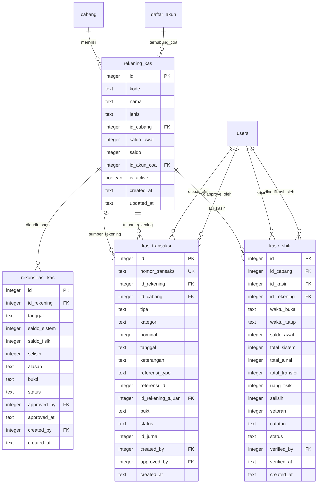
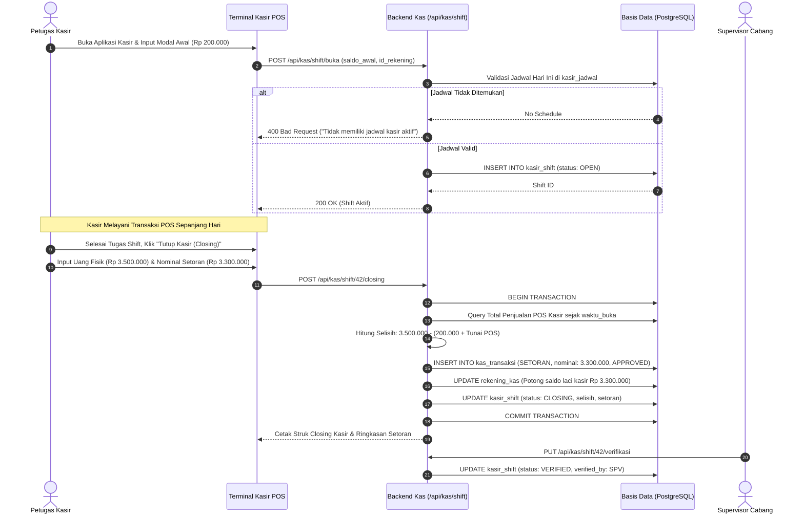
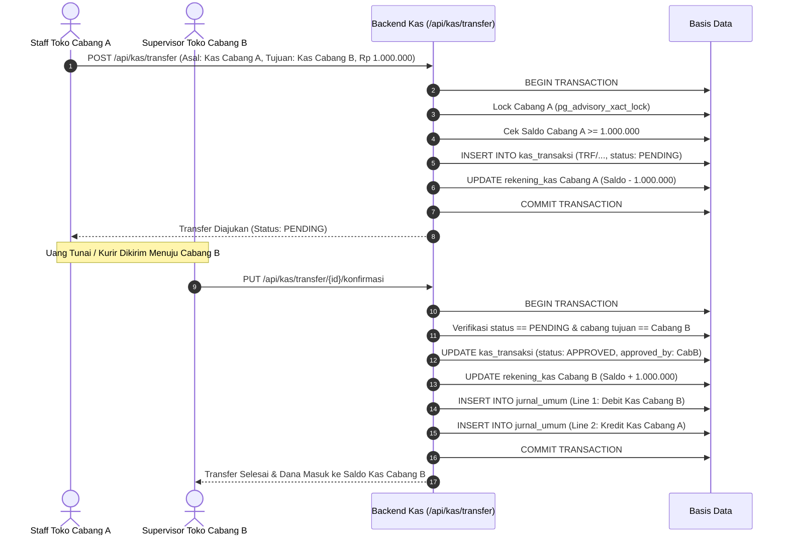
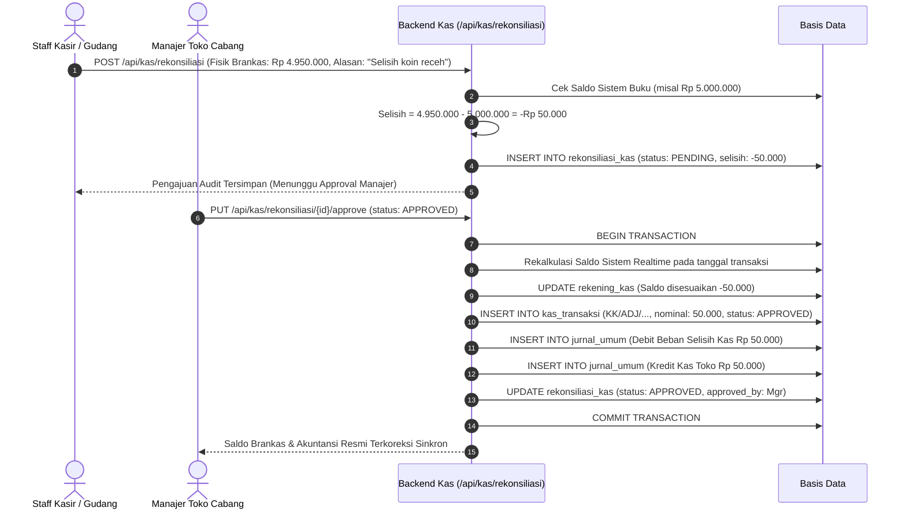

# SPESIFIKASI TEKNIS SISTEM: MODUL MANAJEMEN KAS & REKONSILIASI
**ERP AL MUBAROK (AS-IS SPECIFICATION)**  
*Dokumen ini menyajikan arsitektur lengkap, skema basis data, spesifikasi REST API, logika kontrol likuiditas, alur shift kasir POS, rekonsiliasi kas fisik, transfer dana 2-fase, serta matriks otorisasi untuk Main Menu Manajemen Kas.*

---

## 1. Ringkasan Eksekutif & Arsitektur Modul

Modul Manajemen Kas merupakan sub-sistem pengelolaan likuiditas, brankas toko (*cash drawer*), rekening perbankan, dan pengawasan aliran dana tunai/non-tunai di seluruh cabang ERP Al Mubarok. Modul ini menjadi jembatan operasional antara kasir POS, pengeluaran kas harian (*petty cash*), setoran toko, dan pembukuan formal di buku besar akuntansi.

### Pilar Utama Pengendalian Arsitektur Kas:
1. **Multi-Account & Multi-Type Architecture:** Mendukung klasifikasi rekening likuiditas: `KAS_TOKO` (laci kasir), `KAS_DC` (brankas pusat logistik), `BANK` (rekening bank giro/operasional), dan `PETTY_CASH` (dana kas kecil operasional harian).
2. **Shift-Based Cash Drawer Lifecycle:** Integrasi ketat dengan terminal kasir POS. Kasir wajib membuka shift dengan mencatat modal awal, melakukan transaksi penjualan tunai/transfer, dan menutup shift (*closing*) dengan menghitung fisik riil laci kasir, yang otomatis menghitung selisih dan memicu setoran.
3. **Threshold-Based Approval Engine:** Pengeluaran kas keluar di atas batas toleransi (*Cash Approval Threshold*, default Rp 500.000) otomatis berstatus `PENDING` dan membekukan pemotongan saldo hingga disetujui oleh Supervisor atau Manajer Toko.
4. **Audit Rekonsiliasi Kas Toko:** Prosedur audit fisik berkala yang membandingkan saldo riil brankas dengan saldo kalkulasi sistem. Apabila disetujui, sistem otomatis melakukan rekalkulasi mutasi *real-time*, mengoreksi saldo rekening, dan memposting jurnal koreksi selisih kas ke Buku Besar Akuntansi.
5. **Two-Phase Settlement Transfer Kas:** Pengiriman uang antar-rekening atau antarcabang diamankan dengan skema 2-fase: saldo rekening pengirim dipotong saat pengajuan (`PENDING`), dan saldo rekening penerima bertambah saat cabang penerima mengonfirmasi (`APPROVED`), sekaligus memicu jurnal transfer inter-rekening.
6. **Concurrency Guard:** Penggunaan PostgreSQL Advisory Lock (`pg_advisory_xact_lock(idCabang)`) untuk mencegah *race condition* dan bentrok nomor urut bukti mutasi kas.

---

## 2. Peta File Kode Modul (Code File Map)

```
c:\Users\AFB\erp-almubarok\
├── erp-almubarok-nextjs\
│   ├── erp-almubarok-api\
│   │   └── src\
│   │       └── routes\
│   │           └── kas.ts                    # Controller REST API Hono lengkap (1.795 baris)
│   └── src\
│       ├── lib\
│       │   └── db\
│       │       └── schema.ts                 # DDL Drizzle ORM (rekening_kas, kas_transaksi, kasir_shift, rekonsiliasi_kas)
│       └── app\
│           └── (dashboard)\
│               └── kas\
│                   ├── dashboard\
│                   │   └── page.tsx          # UI Dasbor Ringkasan Kas & Metrik Likuiditas
│                   ├── rekening\
│                   │   └── page.tsx          # UI Master Rekening Kas & Bank
│                   ├── transaksi\
│                   │   └── page.tsx          # UI Transaksi Kas Masuk & Keluar (Approval Workflow)
│                   ├── transfer\
│                   │   └── page.tsx          # UI Pengajuan & Konfirmasi Transfer Antar-Rekening
│                   ├── rekonsiliasi\
│                   │   └── page.tsx          # UI Audit Selisih Fisik vs Sistem & Approval Koreksi
│                   └── laporan\
│                       └── page.tsx          # UI Buku Pembantu Kas (Mutasi Kas per Periode)
```

---

## 3. Skema Basis Data & Data Dictionary Drizzle ORM

Modul Manajemen Kas ditopang oleh 4 tabel relasional utama:



### 3.1. Tabel `rekening_kas`
Menyimpan data master buku kas dan rekening perbankan di setiap cabang.

```typescript
export const rekening_kas = sqliteTable("rekening_kas", {
  id: integer("id").primaryKey({ autoIncrement: true }),
  kode: text("kode").notNull(),                   // Contoh: "REK-SUKOSARI-01"
  nama: text("nama").notNull(),                   // Contoh: "Kas Toko Sukosari"
  jenis: text("jenis").notNull(),                 // 'KAS_TOKO' | 'KAS_DC' | 'BANK' | 'PETTY_CASH'
  id_cabang: integer("id_cabang").references(() => cabang.id_cabang).notNull(),
  saldo_awal: integer("saldo_awal").default(0).notNull(),
  saldo: integer("saldo").default(0).notNull(),
  id_akun_coa: integer("id_akun_coa").references(() => daftar_akun.id), // Tautan Akuntansi
  is_active: integer("is_active", { mode: "boolean" }).default(true).notNull(),
  created_at: text("created_at").default(sql`(CURRENT_TIMESTAMP)`),
  updated_at: text("updated_at").default(sql`(CURRENT_TIMESTAMP)`),
});
```

---

### 3.2. Tabel `kas_transaksi`
Menyimpan setiap rekaman mutasi arus kas masuk, kas keluar, dan transfer.

```typescript
export const kas_transaksi = sqliteTable("kas_transaksi", {
  id: integer("id").primaryKey({ autoIncrement: true }),
  nomor_transaksi: text("nomor_transaksi").notNull(), // Format: KM/YYYYMMDD/cabang/seq atau KK/... atau TRF/...
  id_rekening: integer("id_rekening").references(() => rekening_kas.id).notNull(),
  id_cabang: integer("id_cabang").references(() => cabang.id_cabang).notNull(),
  tipe: text("tipe").notNull(),                       // 'MASUK' | 'KELUAR' | 'TRANSFER'
  kategori: text("kategori"),                         // 'PENJUALAN' | 'OPERASIONAL' | 'GAJI' | 'PEMBELIAN' | 'SETORAN' | 'LAIN'
  nominal: integer("nominal").notNull(),
  tanggal: text("tanggal").notNull(),                 // YYYY-MM-DD
  keterangan: text("keterangan"),
  referensi_type: text("referensi_type"),             // 'PENJUALAN' | 'FAKTUR_BELI' | 'SHIFT' | 'MANUAL'
  referensi_id: integer("referensi_id"),
  id_rekening_tujuan: integer("id_rekening_tujuan").references(() => rekening_kas.id),
  bukti: text("bukti"),                               // Path file bukti pembayaran / nota
  status: text("status").default("APPROVED"),         // 'PENDING' | 'APPROVED' | 'REVERSED'
  id_jurnal: integer("id_jurnal"),
  created_by: integer("created_by").references(() => users.id),
  approved_by: integer("approved_by").references(() => users.id),
  created_at: text("created_at").default(sql`(CURRENT_TIMESTAMP)`),
});
```

---

### 3.3. Tabel `kasir_shift`
Mencatat siklus buka/tutup laci kasir terminal POS per sesi operasional.

```typescript
export const kasir_shift = sqliteTable("kasir_shift", {
  id: integer("id").primaryKey({ autoIncrement: true }),
  id_cabang: integer("id_cabang").references(() => cabang.id_cabang).notNull(),
  id_kasir: integer("id_kasir").references(() => users.id).notNull(),
  id_rekening: integer("id_rekening").references(() => rekening_kas.id).notNull(),
  waktu_buka: text("waktu_buka").notNull(),           // ISO Timestamp pembukaan shift
  waktu_tutup: text("waktu_tutup"),                   // ISO Timestamp closing kasir
  saldo_awal: integer("saldo_awal").default(0).notNull(), // Modal awal laci kasir (uang receh)
  total_sistem: integer("total_sistem").default(0),   // Akumulasi total transaksi POS
  total_tunai: integer("total_tunai").default(0),     // Akumulasi transaksi pembayaran Tunai
  total_transfer: integer("total_transfer").default(0),// Akumulasi pembayaran QRIS/Transfer
  uang_fisik: integer("uang_fisik"),                 // Perhitungan kas fisik riil oleh kasir
  selisih: integer("selisih"),                       // Fisik - (Saldo Awal + Total Tunai)
  setoran: integer("setoran").default(0),             // Nominal uang yang disetorkan saat closing
  catatan: text("catatan"),
  status: text("status").default("OPEN"),             // 'OPEN' | 'CLOSING' | 'VERIFIED'
  verified_by: integer("verified_by").references(() => users.id), // SPV / Manager pemeriksa
  verified_at: text("verified_at"),
  created_at: text("created_at").default(sql`(CURRENT_TIMESTAMP)`),
});
```

---

### 3.4. Tabel `rekonsiliasi_kas`
Mencatat hasil pemeriksaan fisik brankas (*cash count*) dan verifikasi selisih pembukuan.

```typescript
export const rekonsiliasi_kas = sqliteTable("rekonsiliasi_kas", {
  id: integer("id").primaryKey({ autoIncrement: true }),
  id_rekening: integer("id_rekening").references(() => rekening_kas.id).notNull(),
  tanggal: text("tanggal").notNull(),                 // YYYY-MM-DD
  saldo_sistem: integer("saldo_sistem").notNull(),    // Saldo buku sistem saat pengajuan
  saldo_fisik: integer("saldo_fisik").notNull(),      // Hasil hitung fisik uang di brankas
  selisih: integer("selisih").notNull(),              // saldo_fisik - saldo_sistem
  alasan: text("alasan"),
  bukti: text("bukti"),                               // Foto lembar perhitungan fisik
  status: text("status").default("PENDING"),         // 'PENDING' | 'APPROVED' | 'REJECTED'
  approved_by: integer("approved_by").references(() => users.id),
  approved_at: text("approved_at"),
  created_by: integer("created_by").references(() => users.id),
  created_at: text("created_at").default(sql`(CURRENT_TIMESTAMP)`),
});
```

---

## 4. Spesifikasi Lengkap Hono REST API

Seluruh rute kas di-mount pada prefix `/api/kas` dan dilindungi oleh otentikasi token JWT (`JWTPayload`).

### 4.1. Manajemen Master Rekening Kas
- **`GET /api/kas/rekening`**
  - **Filter Otomatis:** Mengambil daftar rekening milik cabang aktif pengguna (`id_cabang`).
  - **Output:** Array rekening kas lengkap dengan nama akun CoA terhubung.
- **`POST /api/kas/rekening`**
  - **Payload:** `{ kode, nama, jenis, saldo_awal, id_akun_coa }`
  - **Status:** `201 Created` (Saldo awal otomatis menjadi saldo berjalan awal).
- **`PUT /api/kas/rekening/:id`**
  - **Payload:** Field yang diperbarui (`nama`, `jenis`, `id_akun_coa`, `is_active`).

---

### 4.2. Transaksi Kas Masuk & Kas Keluar
- **`GET /api/kas/transaksi`**
  - **Query Params:** `startDate`, `endDate`, `tipe` (`MASUK`|`KELUAR`|`TRANSFER`), `kategori`, `status` (`APPROVED`|`PENDING`), `id_rekening`.
  - **Output:** Daftar transaksi urut kronologis menurun.
- **`POST /api/kas/transaksi/masuk`**
  - **Payload:** `{ id_rekening, nominal, tanggal, keterangan, kategori, bukti }`
  - **Alur Operasi:**
    1. Membuka transaksi atomik dan mengambil advisory lock cabang `pg_advisory_xact_lock(idCabang)`.
    2. Menghasilkan nomor transaksi: `KM/YYYYMMDD/{id_cabang}/{sequence}`.
    3. Menyimpan `kas_transaksi` berstatus `APPROVED`.
    4. Menambah saldo rekening: `saldo = saldo + nominal`.
    5. **Auto-Journaling Akuntansi:**
       - Debit: Akun Kas (`rekening.id_akun_coa`)
       - Kredit: Akun Lawan Dinamis (`getCoaCounterAccount(tx, kategori)`)
- **`POST /api/kas/transaksi/keluar`**
  - **Payload:** `{ id_rekening, nominal, tanggal, keterangan, kategori, bukti }`
  - **Validasi Overdraft:** Menolak transaksi jika `saldo < nominal`.
  - **Mekanisme Threshold Limit:**
    - Membaca setting `cash_approval_threshold` dari `pengaturan_aplikasi` (default: Rp 500.000).
    - Jika `nominal > threshold`: Transaksi berstatus `PENDING` (saldo rekening **belum** dipotong).
    - Jika `nominal <= threshold`: Transaksi langsung `APPROVED`, saldo dipotong, dan jurnal diposting.
- **`PUT /api/kas/transaksi/:id/approve`**
  - **Wewenang:** Supervisor / Manajer Cabang.
  - **Alur Operasi:** Memvalidasi saldo kembali $\rightarrow$ update status ke `APPROVED` $\rightarrow$ potong `saldo = saldo - nominal` $\rightarrow$ insert jurnal umum (Debit Akun Beban, Kredit Akun Kas).

---

### 4.3. Siklus Kasir POS (Shift Terminal)
- **`GET /api/kas/shift`**
  - **Query Params:** `status` (`OPEN`|`CLOSING`|`VERIFIED`), `tanggal`, `id_kasir`.
- **`POST /api/kas/shift/buka`**
  - **Payload:** `{ saldo_awal, id_rekening }`
  - **Validasi Jadwal Hari Ini:** Memeriksa keberadaan jadwal kasir aktif di tabel `kasir_jadwal` untuk kasir dan cabang tersebut pada tanggal berjalan. Jika tidak ada jadwal, sistem menolak pembukaan shift.
  - **Validasi Shift Tunggal:** Menolak jika kasir masih memiliki shift berstatus `OPEN`.
  - **Status Output:** Shift baru tersimpan dengan status `OPEN`.
- **`POST /api/kas/shift/:id/closing`**
  - **Payload:** `{ uang_fisik, setoran, catatan }`
  - **Kalkulasi POS Otomatis:**
    - Query transaksi `penjualan` oleh kasir sejak `waktu_buka`.
    - Menghitung `totalTunai` dan `totalTransfer`.
    - Menghitung $\text{Selisih} = \text{Uang Fisik} - (\text{Saldo Awal} + \text{Total Tunai})$.
  - **Eksekusi Setoran Otomatis:**
    - Jika `setoran > 0`: Otomatis membuat entri `kas_transaksi` tipe `KELUAR` kategori `SETORAN` status `APPROVED` (`SETORAN/YYYYMMDD/cabang/shiftId`).
    - Memotong saldo laci kasir sebesar nominal setoran.
  - **Status Output:** Shift diperbarui menjadi `CLOSING`.
- **`PUT /api/kas/shift/:id/verifikasi`**
  - **Wewenang:** Supervisor / Manager. Mengubah status shift dari `CLOSING` menjadi `VERIFIED`.

---

### 4.4. Transfer Kas Dua Fase (Two-Phase Settlement)
- **`GET /api/kas/transfer`**
  - Mengambil daftar transfer kas masuk dan keluar di cabang aktif.
- **`POST /api/kas/transfer` (Fase 1: Pengajuan Transfer)**
  - **Payload:** `{ id_rekening_asal, id_rekening_tujuan, nominal, tanggal, keterangan }`
  - **Validasi:** Rekening asal $\ne$ rekening tujuan; Saldo asal mencukupi.
  - **Operasi Fase 1:**
    - Nomor transaksi: `TRF/YYYYMMDD/{id_cabang}/{sequence}`.
    - Status transaksi: `PENDING`.
    - **Saldo Asal Langsung Dipotong:** `saldo_asal = saldo_asal - nominal`.
- **`PUT /api/kas/transfer/:id/konfirmasi` (Fase 2: Penerimaan Transfer)**
  - **Wewenang:** User dari cabang rekening tujuan.
  - **Operasi Fase 2:**
    - Status transaksi diperbarui menjadi `APPROVED` (`approved_by = activeUser.id`).
    - **Saldo Tujuan Bertambah:** `saldo_tujuan = saldo_tujuan + nominal`.
    - **Posting Jurnal Antar-Rekening:**
      - Debit: Rekening Kas Penerima (`rekTujuan.id_akun_coa`)
      - Kredit: Rekening Kas Pengirim (`rekAsal.id_akun_coa`)

---

### 4.5. Rekonsiliasi Kas Toko & Laporan Arus Kas
- **`GET /api/kas/rekonsiliasi`**
  - Mengambil daftar riwayat audit selisih kas fisik.
- **`POST /api/kas/rekonsiliasi`**
  - **Payload:** `{ id_rekening, tanggal, saldo_fisik, alasan, bukti }`
  - Menghitung $\text{Selisih} = \text{Saldo Fisik} - \text{Saldo Sistem Buku}$.
  - Tersimpan dengan status `PENDING`.
- **`PUT /api/kas/rekonsiliasi/:id/approve`**
  - **Rekalkulasi Real-Time:** Menghitung ulang saldo buku riil pada tanggal rekonsiliasi berdasarkan seluruh transaksi masuk, keluar, dan transfer sebelum tanggal tersebut:
    $$\text{Saldo Sistem Realtime} = \text{Saldo Awal} + \sum \text{Masuk} + \sum \text{Trf Masuk} - \sum \text{Keluar} - \sum \text{Trf Keluar}$$
  - **Koreksi Saldo:** Jika disetujui (`APPROVED`) dan $\text{Selisih} \ne 0$:
    - Memperbarui saldo rekening: `saldo = saldo + selisih`.
    - Menerbitkan `kas_transaksi` penyesuaian: `KM/ADJ/...` (jika kelebihan fisik) atau `KK/ADJ/...` (jika kekurangan fisik).
    - Posting jurnal koreksi:
      - Kelebihan Kas: Debit Kas Toko, Kredit Akun Pendapatan Selisih Kas (`coa_kategori_penjualan`).
      - Kekurangan Kas: Debit Beban Selisih Kas (`coa_kategori_operasional`), Kredit Kas Toko.
- **`GET /api/kas/laporan`**
  - Menghasilkan laporan buku kas per rekening dalam periode `startDate` s.d. `endDate`: Saldo awal kumulatif sebelum `startDate`, rincian seluruh mutasi debit/kredit, dan saldo akhir.

---

## 5. Logika Bisnis & Algoritma Matematis Manajemen Kas

### 5.1. Formula Keseimbangan Buku Pembantu Kas (Cash Ledger Invariant)
Pada setiap rekening kas $i$ pada akhir periode $T$, saldo kas harus memenuhi:

$$\text{Saldo}_i(T) = \text{Saldo Awal}_i + \sum_{t=1}^{T} \text{KM}_{i,t} + \sum_{t=1}^{T} \text{TRF\_IN}_{i,t} - \sum_{t=1}^{T} \text{KK}_{i,t} - \sum_{t=1}^{T} \text{TRF\_OUT}_{i,t}$$

Hanya transaksi dengan status `APPROVED` yang diikutsertakan dalam rekalkulasi saldo. Transaksi `PENDING` pada kas keluar tidak mengurangi saldo sebelum disetujui.

---

### 5.2. Formula Audit Closing Laci Kasir POS
Ketika kasir menutup shift, sistem menentukan selisih laci kasir secara deterministik:

$$\text{Expected Cash Drawer} = \text{Saldo Awal Modal Kasir} + \sum_{j \in \text{Sales}_{\text{shift}}} \text{Tunai}_j$$

$$\Delta_{\text{Laci}} = \text{Uang Fisik Hasil Hitung} - \text{Expected Cash Drawer}$$

- Jika $\Delta_{\text{Laci}} = 0$: Kasir seimbang (*Perfect Balance*).
- Jika $\Delta_{\text{Laci}} > 0$: Terjadi kelebihan fisik kasir (*Cash Overage*).
- Jika $\Delta_{\text{Laci}} < 0$: Terjadi kekurangan kas fisik (*Cash Shortage*).

---

### 5.3. Pemetaan Akun Lawan Dinamis (Dynamic Counter Account)
Saat mutasi kas masuk/keluar diposting ke jurnal akuntansi, akun lawan ditentukan melalui fungsi `getCoaCounterAccount(tx, kategori)`:

```typescript
switch (kategori) {
  case "PENJUALAN":   return setting["coa_kategori_penjualan"] || 7;  // Pendapatan Penjualan Toko
  case "OPERASIONAL": return setting["coa_kategori_operasional"] || 10; // Beban Operasional Toko
  case "GAJI":        return setting["coa_kategori_gaji"] || 8;         // Beban Gaji Karyawan
  default:            return 10;
}
```

---

## 6. Alur Transaksi & Diagram Workflow

### 6.1. Workflow Siklus Shift Kasir POS & Setoran



---

### 6.2. Workflow Transfer Kas Dua Fase (Two-Phase Settlement)



---

### 6.3. Workflow Pengajuan & Approval Rekonsiliasi Kas Toko



---

## 7. Frontend UI/UX & Interaksi Komponen

### 7.1. Submenu Dasbor Kas (`/kas/dashboard`)
- **Metric Cards Interaktif:**
  - *Total Saldo Kas*: Agregasi saldo seluruh rekening kas cabang aktif.
  - *Arus Kas Masuk Hari Ini*: Akumulasi kas masuk berstatus approved hari ini.
  - *Arus Kas Keluar Hari Ini*: Akumulasi kas keluar berstatus approved hari ini.
  - *Shift Aktif*: Jumlah terminal kasir yang sedang dalam kondisi `OPEN`.
  - *Alert Rekonsiliasi*: Indikator pengajuan audit fisik yang memerlukan tindakan approval manajer.
- **Tabel Mutasi Kas Terkini:** Menampilkan 10 transaksi arus kas terbaru dengan badge arah panah hijau (Masuk) dan merah (Keluar).

---

### 7.2. Submenu Master Rekening Kas (`/kas/rekening`)
- Menampilkan kartu/tabel seluruh rekening: Kode, Nama Rekening, Jenis (`KAS_TOKO`, `BANK`, dsb.), Saldo Berjalan, dan Akun CoA terhubung.
- Modal tambah/edit rekening dengan validasi kode unik dan pemilih akun CoA.

---

### 7.3. Submenu Transaksi Kas Masuk & Keluar (`/kas/transaksi`)
- Filter tab: *Semua Transaksi*, *Kas Masuk*, *Kas Keluar*, dan *Menunggu Persetujuan (Pending)*.
- **Modal Input Kas Masuk:** Pemilih rekening penerima, input nominal, tanggal, kategori penerimaan, dan unggah berkas bukti nota.
- **Modal Input Kas Keluar:** Pemilih rekening sumber, input nominal, tanggal, keterangan, dan indikator peringatan jika nominal melampaui limit threshold approval.
- **Tombol Approval Kas Keluar:** Khusus untuk pengguna berwewenang manajerial guna menyetujui kas keluar tertunda.

---

### 7.4. Submenu Transfer Dana (`/kas/transfer`)
- Tabel riwayat transfer dana dengan pemisahan status `PENDING` (Dalam Perjalanan) dan `APPROVED` (Diterima).
- Modal pengajuan transfer dana dengan validasi saldo instan (menolak jika saldo rekening asal kurang).
- Tombol aksi *"Konfirmasi Terima"* pada transfer kas masuk yang berstatus pending untuk memicu penambahan saldo dan penjurnalan akuntansi.

---

### 7.5. Submenu Rekonsiliasi Kas Toko (`/kas/rekonsiliasi`)
- Tabel audit perhitungan kas fisik brankas menyajikan: *Tanggal, Rekening, Saldo Sistem, Saldo Fisik, Selisih, dan Status*.
- Modal hitung fisik (*Cash Opname Modal*): Input hasil hitung fisik lembaran uang dan alasan deviasi.
- Dialog persetujuan manajerial (*Approve/Reject Dialog*) dengan kalkulasi otomatis jurnal koreksi pembukuan.

---

### 7.6. Submenu Laporan Mutasi Kas (`/kas/laporan`)
- Filter pemilih rekening buku kas dan rentang tanggal transaksi.
- Ringkasan 4 parameter kunci: *Saldo Awal, Total Kas Masuk (+), Total Kas Keluar (-), dan Saldo Akhir*.
- Tabel kronologis mutasi kas per baris (Tanggal, Bukti Transaksi, Keterangan, Debit, Kredit, Saldo Berjalan).
- Fitur *Print Friendly* untuk cetak fisik buku kas kasir dan arsip bendahara toko.

---

## 8. Matriks Hak Akses & Keamanan Sistem (RBAC)

Otorisasi level API dikendalikan melalui token JWT (`activeUser.id_jabatan` dan `activeUser.id_cabang`).

| Submenu / Aksi Operasi | Super User (`1`) | IT Administrator (`2`) | Bendahara Pusat (`4`) | Manager Toko (`8`) | Kasir & Staff Toko |
|---|---|---|---|---|---|
| **Lihat Dasbor Kas (`/kas/dashboard`)** | Seluruh Cabang | Seluruh Cabang | Seluruh Cabang | Cabangnya Sendiri | Cabangnya Sendiri |
| **Kelola Master Rekening Kas** | Full Akses | Full Akses | Full Akses | Hanya Lihat | **Ditolak** |
| **Input Kas Masuk (`POST /masuk`)** | Diizinkan | Diizinkan | Diizinkan | Diizinkan | Diizinkan |
| **Input Kas Keluar (`POST /keluar`)** | Diizinkan | Diizinkan | Diizinkan | Diizinkan | Diizinkan |
| **Approval Kas Keluar > Threshold** | Diizinkan | Diizinkan | Diizinkan | Diizinkan (Cabangnya) | **Ditolak** |
| **Buka & Closing Shift Kasir POS** | Diizinkan | Diizinkan | Diizinkan | Diizinkan | **Khusus Kasir Bertugas** |
| **Verifikasi Shift Kasir POS** | Diizinkan | Diizinkan | Diizinkan | Diizinkan (Cabangnya) | **Ditolak** |
| **Pengajuan Transfer Kas Antarcabang** | Diizinkan | Diizinkan | Diizinkan | Diizinkan (Cabangnya) | **Ditolak** |
| **Konfirmasi Penerimaan Transfer** | Diizinkan | Diizinkan | Diizinkan | Diizinkan (Penerima) | **Ditolak** |
| **Pengajuan Audit Rekonsiliasi** | Diizinkan | Diizinkan | Diizinkan | Diizinkan (Cabangnya) | Diizinkan |
| **Approval & Penjurnalan Rekonsiliasi** | Diizinkan | Diizinkan | Diizinkan | Diizinkan (Cabangnya) | **Ditolak** |

---

*Dokumen ini merupakan representasi teknis faktual dari Main Menu Manajemen Kas ERP Al Mubarok per Oktober 2026 dan siap dijadikan konteks input untuk analisis, audit keandalan kas, maupun refactoring kode AI.*

