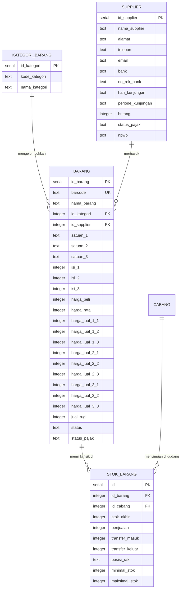
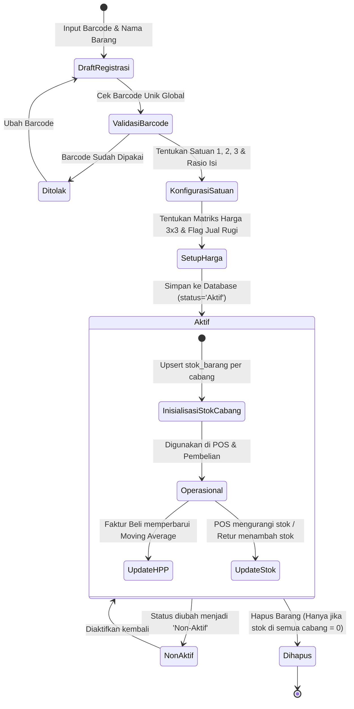
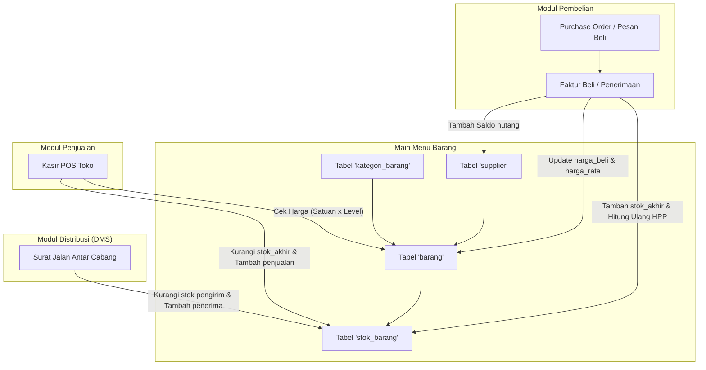

# 📦 DOKUMENTASI TEKNIS AS-IS (GROUND TRUTH)
## MAIN MENU BARANG: DATA BARANG, KATEGORI, SUPPLIER & STOK MULTI-CABANG
### SISTEM ENTERPRISE RESOURCE PLANNING (ERP) AL MUBAROK

> **Status Dokumen:** Faktual / Kondisi Riil Sistem Saat Ini (*As-Is Technical Specification*)  
> **Target Pengguna Dokumen:** AI Agent / Software Architect / Lead Developer untuk Analisis Sistem, Audit Logika & Perencanaan Fitur  
> **Stack Arsitektur:** Next.js 16 (App Router, Turbopack), React 19, Tailwind CSS v4, Hono REST API, PostgreSQL, Drizzle ORM  
> **Domain Konteks:** Katalog Master Produk Ritel-Grosir, Matriks Multi-Satuan & Multi-Tier Pricing (3x3), Manajemen Rekanan Vendor/Supplier, Monitoring Persediaan Multi-Cabang, serta Buffer Stok Pengaman (*Safety Stock*).

---

## 📑 DAFTAR ISI

1. [Ringkasan Eksekutif & Ruang Lingkup Sistem](#1-ringkasan-eksekutif--ruang-lingkup-sistem)
2. [Peta Arsitektur File & Komponen Kode](#2-peta-arsitektur-file--komponen-kode)
3. [Kamus Data & Skema Database (Database Dictionary)](#3-kamus-data--skema-database-database-dictionary)
4. [Spesifikasi REST API Endpoints (Hono Framework)](#4-spesifikasi-rest-api-endpoints-hono-framework)
5. [Logika Bisnis, Algoritma & Formula Matematis](#5-logika-bisnis-algoritma--formula-matematis)
6. [Alur Bisnis & Integrasi Lintas Modul (Mermaid Diagrams)](#6-alur-bisnis--integrasi-lintas-modul-mermaid-diagrams)
7. [Struktur UI / UX Frontend & Interaksi Pengguna](#7-struktur-ui--ux-frontend--interaksi-pengguna)
8. [Matriks Hak Akses & Isolasi Data Cabang (RBAC)](#8-matriks-hak-akses--isolasi-data-cabang-rbac)

---

## 1. Ringkasan Eksekutif & Ruang Lingkup Sistem

Main Menu **Barang** (Urutan 3 pada navigasi utama ERP Al Mubarok, ikon: `Package`) merupakan fondasi katalog data master barang dagangan dan persediaan inventori fisik. Seluruh transaksi pada modul Penjualan (POS Kasir), Pembelian (Pengadaan Vendor), Distribusi (Mutasi Antar Cabang), dan Akuntansi (Nilai Aset Persediaan) bertumpu pada integritas data master barang ini.

### 4 Submenu Utama:
1. **Data Barang (`/barang`):** Manajemen katalog produk, kode barcode unik global, relasi kategori dan vendor utama, spesifikasi multi-satuan bertingkat 3 tingkat (*Satuan 1, 2, 3*), rasio konversi kemasan (*Isi 1, 2, 3*), rekam jejak harga beli dan HPP rata-rata bergerak (*Moving Average Cost*), matriks harga jual berjenjang 3x3 (3 satuan $\times$ 3 level pelanggan), serta izin proteksi jual rugi (*dumping restriction*).
2. **Kategori (`/kategori`):** Klasifikasi taksonomi produk dagangan untuk mempermudah grouping laporan penjualan, penyaringan katalog, serta analisis margin per divisi produk.
3. **Supplier (`/supplier`):** Direktori mitra bisnis pengadaan, rekening bank vendor, jadwal siklus kunjungan salesman/distributor (*hari & periode kunjungan*), status perpajakan (PKP/Non-PKP, NPWP), serta pemantauan akumulasi saldo hutang dagang (*Accounts Payable*).
4. **Stok Barang (`/stok`):** Manajemen persediaan fisik terdesentralisasi per toko/cabang, pemetaan lokasi rak fisik (*posisi rak*), penentuan ambang batas pengaman (*minimal & maksimal stok*), penyesuaian stok langsung (*stock adjustment/opname*), serta indikator peringatan stok menipis (*reorder alert*).

---

## 2. Peta Arsitektur File & Komponen Kode

### A. Backend API (Hono Framework + Drizzle ORM)
* **Direktori:** `erp-almubarok-nextjs/erp-almubarok-api/`
* **Skema Database:** [`src/lib/db/schema.ts`](file:///c:/Users/AFB/erp-almubarok/erp-almubarok-nextjs/erp-almubarok-api/src/lib/db/schema.ts) (Baris 208–276)
* **Route Controller:** [`src/routes/master.ts`](file:///c:/Users/AFB/erp-almubarok/erp-almubarok-nextjs/erp-almubarok-api/src/routes/master.ts)
  * Endpoints Kategori: Baris 41–119
  * Endpoints Supplier: Baris 124–178
  * Endpoints Barang: Baris 183–375
  * Endpoints Stok: Baris 600–744
* **Mounting Router:** [`src/index.ts`](file:///c:/Users/AFB/erp-almubarok/erp-almubarok-nextjs/erp-almubarok-api/src/index.ts) (Dimounting ganda pada `/api/master` dan `/api` langsung untuk backward-compatibility).

### B. Frontend Web (Next.js 16 App Router)
* **Direktori:** `erp-almubarok-nextjs/src/app/(dashboard)/`
* **File Halaman:**
  * [`barang/page.tsx`](file:///c:/Users/AFB/erp-almubarok/erp-almubarok-nextjs/src/app/(dashboard)/barang/page.tsx): Katalog produk, pencarian debounced, form modal multi-satuan & matriks harga 3x3, modal detail barang, validasi pencegahan hapus barang berstok aktif.
  * [`kategori/page.tsx`](file:///c:/Users/AFB/erp-almubarok/erp-almubarok-nextjs/src/app/(dashboard)/kategori/page.tsx): CRUD taksonomi kategori barang dengan proteksi integritas relasi referensial ke tabel barang.
  * [`supplier/page.tsx`](file:///c:/Users/AFB/erp-almubarok/erp-almubarok-nextjs/src/app/(dashboard)/supplier/page.tsx): Data master pemasok/vendor, jadwal kunjungan rutin, pencatatan no rekening, dan riwayat mutasi hutang.
  * [`stok/page.tsx`](file:///c:/Users/AFB/erp-almubarok/erp-almubarok-nextjs/src/app/(dashboard)/stok/page.tsx): Monitoring kuantitas fisik per cabang, filter status stok (Aman, Menipis, Habis, Overstock), input posisi rak, penyesuaian min/max stok.
* **Komponen & Utilities Terkait:**
  * [`PermissionProvider.tsx`](file:///c:/Users/AFB/erp-almubarok/erp-almubarok-nextjs/src/components/providers/PermissionProvider.tsx): Kontrol otorisasi visibilitas tombol CRUD (`can_create`, `can_read`, `can_update`, `can_delete`).
  * [`next.config.ts`](file:///c:/Users/AFB/erp-almubarok/erp-almubarok-nextjs/next.config.ts): Proxy reverse rewrite `/api/:path*` mengarah ke backend port 3001.

---

## 3. Kamus Data & Skema Database (Database Dictionary)

Database diatur menggunakan PostgreSQL dengan definisi tabel melalui Drizzle ORM (`drizzle-orm/pg-core`).



### 1. Tabel `kategori_barang`
Tabel pengelompokan jenis produk dagangan.
```typescript
export const kategori_barang = pgTable("kategori_barang", {
  id_kategori: serial("id_kategori").primaryKey(),
  kode_kategori: text("kode_kategori").notNull(),            // Kode unik (contoh: 'KT-001')
  nama_kategori: text("nama_kategori").notNull(),            // Contoh: 'Makanan', 'Minuman', 'ATK'
});
```

### 2. Tabel `supplier`
Tabel mitra pengadaan barang dagangan dan data termin kunjungan.
```typescript
export const supplier = pgTable("supplier", {
  id_supplier: serial("id_supplier").primaryKey(),
  nama_supplier: text("nama_supplier").notNull(),            // Nama PT / CV / Distributor
  alamat: text("alamat"),
  telepon: text("telepon"),
  email: text("email"),
  bank: text("bank"),                                        // Nama bank rekanan (contoh: 'BCA', 'Mandiri')
  no_rek_bank: text("no_rek_bank"),                          // Rekening penampung pembayaran faktur
  hari_kunjungan: text("hari_kunjungan"),                    // 'Senin', 'Selasa', 'Rabu', dll.
  periode_kunjungan: text("periode_kunjungan"),              // 'Mingguan', '2 Mingguan', 'Bulanan'
  hutang: integer("hutang").default(0),                      // Saldo total kewajiban hutang dagang (IDR)
  status_pajak: text("status_pajak"),                        // 'PKP' | 'Non-PKP'
  npwp: text("npwp"),                                        // Nomor Pokok Wajib Pajak
  keterangan_1: text("keterangan_1"),                        // Catatan operasional 1
  keterangan_2: text("keterangan_2"),                        // Catatan operasional 2
});
```

### 3. Tabel `barang`
Tabel master katalog produk utama dengan matriks multi-satuan dan harga jual bertingkat.
```typescript
export const barang = pgTable("barang", {
  id_barang: serial("id_barang").primaryKey(),
  barcode: text("barcode").notNull(),                        // Barcode unik EAN-13 / kustom (Unique constraint)
  nama_barang: text("nama_barang").notNull(),                // Deskripsi lengkap produk
  id_kategori: integer("id_kategori").references(() => kategori_barang.id_kategori),
  id_supplier: integer("id_supplier").references(() => supplier.id_supplier),
  
  // Konfigurasi 3 Tingkat Satuan & Rasio Kemasan
  satuan_1: text("satuan_1"),                                // Satuan dasar terkecil (contoh: 'pcs', 'butir')
  satuan_2: text("satuan_2"),                                // Satuan menengah (contoh: 'pack', 'renteng')
  satuan_3: text("satuan_3"),                                // Satuan terbesar (contoh: 'dus', 'karton', 'box')
  isi_1: integer("isi_1"),                                   // Selalu bernilai 1 (basis konversi terkecil)
  isi_2: integer("isi_2"),                                   // Rasio pengali satuan 2 ke satuan 1 (contoh: 10)
  isi_3: integer("isi_3"),                                   // Rasio pengali satuan 3 ke satuan 1 (contoh: 120)

  // Harga Pokok & Pembelian Terkini (per Satuan 1)
  harga_beli: integer("harga_beli"),                         // Harga beli terakhir dari faktur supplier (IDR)
  harga_rata: integer("harga_rata"),                         // Moving Average Cost / HPP dasar (IDR)

  // Matriks Harga Jual 3x3:
  // Satuan 1 (Kemasan Terkecil)
  harga_jual_1_1: integer("harga_jual_1_1"),                 // Satuan 1 - Level 1 (Pelanggan Umum/Retail)
  harga_jual_1_2: integer("harga_jual_1_2"),                 // Satuan 1 - Level 2 (Member / Santri)
  harga_jual_1_3: integer("harga_jual_1_3"),                 // Satuan 1 - Level 3 (Grosir / Agen)

  // Satuan 2 (Kemasan Menengah)
  harga_jual_2_1: integer("harga_jual_2_1"),                 // Satuan 2 - Level 1 (Pelanggan Umum/Retail)
  harga_jual_2_2: integer("harga_jual_2_2"),                 // Satuan 2 - Level 2 (Member / Santri)
  harga_jual_2_3: integer("harga_jual_2_3"),                 // Satuan 2 - Level 3 (Grosir / Agen)

  // Satuan 3 (Kemasan Terbesar)
  harga_jual_3_1: integer("harga_jual_3_1"),                 // Satuan 3 - Level 1 (Pelanggan Umum/Retail)
  harga_jual_3_2: integer("harga_jual_3_2"),                 // Satuan 3 - Level 2 (Member / Santri)
  harga_jual_3_3: integer("harga_jual_3_3"),                 // Satuan 3 - Level 3 (Grosir / Agen)

  jual_rugi: integer("jual_rugi").default(0),                // 0 = Larang jual di bawah HPP; 1 = Izinkan
  status: text("status").default("Aktif"),                   // 'Aktif' | 'Non-Aktif'
  status_pajak: text("status_pajak"),                        // 'PPn' | 'Non PPn'
  keterangan_1: text("keterangan_1"),
  keterangan_2: text("keterangan_2"),
});
```

### 4. Tabel `stok_barang`
Tabel saldo persediaan terisolasi per cabang/gudang toko.
```typescript
export const stok_barang = pgTable("stok_barang", {
  id: serial("id").primaryKey(),
  id_barang: integer("id_barang").references(() => barang.id_barang),
  id_cabang: integer("id_cabang").references(() => cabang.id_cabang),
  stok_akhir: integer("stok_akhir").default(0),              // Kuantitas fisik terkini di cabang (satuan terkecil)
  penjualan: integer("penjualan").default(0),                // Akumulator total terjual di cabang
  transfer_masuk: integer("transfer_masuk").default(0),      // Total mutasi kirim masuk dari cabang lain/DC
  transfer_keluar: integer("transfer_keluar").default(0),    // Total mutasi kirim keluar ke cabang lain
  posisi_rak: text("posisi_rak"),                            // Lokasi fisik lorong/rak toko (contoh: 'A1-03')
  minimal_stok: integer("minimal_stok").default(0),          // Titik pemesanan ulang (Reorder Point / Safety Stock)
  maksimal_stok: integer("maksimal_stok").default(0),        // Batas kapasitas maksimal penyimpanan rak
});
```

---

## 4. Spesifikasi REST API Endpoints (Hono Framework)

Seluruh endpoint terpasang otentikasi JWT (`authMiddleware`).

### A. Submenu Kategori (`/api/master/kategori` atau `/api/kategori`)
| Endpoint | Method | Parameter / Payload | Aturan Validasi & Logika |
|---|---|---|---|
| `/kategori` | `GET` | - | Mengembalikan seluruh daftar kategori terurut menurut `nama_kategori` secara alfabetis. |
| `/kategori` | `POST` | Body: `{ kode_kategori, nama_kategori }` | Validasi wajib isi. Pengecekan duplikasi `kode_kategori` secara global (melempar HTTP 409 jika duplikat). |
| `/kategori/:id` | `PUT` | Body: `{ kode_kategori, nama_kategori }` | Validasi unik `kode_kategori` dengan mengecualikan ID saat ini (`id != current_id`). |
| `/kategori/:id` | `DELETE` | Path param: `id` | **Proteksi Integritas Relasional:** Memeriksa apakah `id_kategori` masih dipakai pada tabel `barang`. Jika ada barang yang menggunakannya, penghapusan ditolak (HTTP 400). |

### B. Submenu Supplier (`/api/master/supplier` atau `/api/supplier`)
| Endpoint | Method | Parameter / Payload | Aturan Validasi & Logika |
|---|---|---|---|
| `/supplier` | `GET` | - | Mengembalikan seluruh daftar supplier terurut berdasarkan `nama_supplier`. |
| `/supplier` | `POST` | Body: `{ nama_supplier, alamat, telepon, email, bank, no_rek_bank, hari_kunjungan, periode_kunjungan, status_pajak, npwp, keterangan_1, keterangan_2 }` | Registrasi rekanan vendor baru. Status pajak PKP/Non-PKP. |
| `/supplier/:id` | `PUT` | Body: Field supplier yang diperbarui | Pembaruan data kontak, jadwal kunjungan, dan nomor rekening penampung. |
| `/supplier/:id` | `DELETE` | Path param: `id` | Menghapus record supplier dari sistem. |

### C. Submenu Data Barang (`/api/master/barang` atau `/api/barang`)
| Endpoint | Method | Parameter / Payload | Aturan Validasi & Logika |
|---|---|---|---|
| `/barang` | `GET` | Query params: `q` atau `search` (nama/barcode), `barcode` (lookup persis) | Melakukan `LEFT JOIN` ke `kategori_barang`, `supplier`, dan `stok_barang` sesuai `id_cabang` user aktif (`user.id_cabang`). Mengembalikan data detail produk sekaligus saldo fisik `stok_akhir` di cabang peminta. |
| `/barang` | `POST` | Body: Seluruh properti barang (barcode, nama, kategori, supplier, 3 satuan, 3 rasio isi, harga beli, harga rata, 9 matriks harga jual, jual rugi, status, pajak) | **Validasi Barcode Unik:** Barcode dipotong spasi (`trim()`) dan dicek duplikasinya di seluruh database. Nilai `isi_1` dipaksa konstan bernilai 1. |
| `/barang/:id` | `PUT` | Body: Properti barang yang diupdate | Validasi barcode unik dengan mengecualikan barang yang sedang diedit. |
| `/barang/:id` | `DELETE` | Path param: `id` | **Proteksi Fisik Stok:** Sistem mengecek tabel `stok_barang` di seluruh cabang. Jika barang masih memiliki `stok_akhir > 0` di cabang mana pun, penghapusan **dibatalkan secara ketat** (HTTP 400). |

### D. Submenu Stok Barang (`/api/master/stok` atau `/api/stok`)
| Endpoint | Method | Parameter / Payload | Aturan Validasi & Isolasi Cabang |
|---|---|---|---|
| `/stok` | `GET` | Query params: `id_cabang` (opsional), `id_barang` (opsional) | **Isolasi Keamanan Cabang:** User cabang biasa otomatis dibatasi hanya melihat stok cabangnya sendiri. Parameter `id_cabang` luar hanya diizinkan untuk Super User (`id_jabatan === 1`) atau IT (`id_jabatan === 2`). |
| `/stok` | `POST` | Body: `{ id_barang, id_cabang, stok_akhir, posisi_rak, minimal_stok, maksimal_stok }` | **Upsert Stok:** Jika kombinasi `id_barang` dan `id_cabang` sudah ada, sistem menjalankan `UPDATE`; jika belum ada, sistem menjalankan `INSERT`. |
| `/stok/:id` | `PUT` | Body: `{ posisi_rak, stok_akhir, minimal_stok, maksimal_stok }` | Mengubah detail penataan rak atau ambang batas buffer stok per item di cabang terkait. |
| `/stok/:id` | `DELETE` | Path param: `id` | Menghapus record persediaan barang di cabang. |

---

## 5. Logika Bisnis, Algoritma & Formula Matematis

### A. Matriks Harga Bertingkat 3x3 (Multi-Tier & Multi-Unit Pricing)
ERP Al Mubarok menerapkan struktur harga 2 dimensi: **Tingkat Kemasan (Unit)** $\times$ **Golongan Konsumen (Customer Level)**.

| Tingkat Kemasan | Satuan | Rasio Isi | Level 1 (Umum / Ritel) | Level 2 (Member / Santri) | Level 3 (Grosir / Partai) |
|---|---|---|---|---|---|
| **Kemasan 1 (Dasar)** | `satuan_1` (misal: Pcs) | $\text{isi\_1} = 1$ | `harga_jual_1_1` | `harga_jual_1_2` | `harga_jual_1_3` |
| **Kemasan 2 (Menengah)** | `satuan_2` (misal: Pack) | $\text{isi\_2} = K_2$ | `harga_jual_2_1` | `harga_jual_2_2` | `harga_jual_2_3` |
| **Kemasan 3 (Besar)** | `satuan_3` (misal: Dus) | $\text{isi\_3} = K_3$ | `harga_jual_3_1` | `harga_jual_3_2` | `harga_jual_3_3` |

#### Formula Konversi Stok Saat Transaksi Kasir POS:
Ketika kasir menjual produk sebanyak $Q$ pada tingkat satuan $U \in \{1, 2, 3\}$, kuantitas pengurang persediaan fisik dasar ($Q_{\text{dasar}}$) dihitung dengan:
$$Q_{\text{dasar}} = Q \times \text{isi}_U$$
*Contoh:* Menjual 2 Dus Indomie (`satuan_3`), di mana `isi_3 = 40`, maka saldo `stok_akhir` berkurang sebanyak $2 \times 40 = 80\text{ pcs}$.

#### Formula Evaluasi Margin & Proteksi Jual Rugi:
Margin keuntungan kotor per unit dihitung dengan:
$$\text{Margin IDR} = \text{HargaJual}_{U, L} - (\text{HPP}_{\text{dasar}} \times \text{isi}_U)$$
$$\text{Margin \%} = \frac{\text{Margin IDR}}{\text{HargaJual}_{U, L}} \times 100\%$$
* **Aturan Proteksi Jual Rugi (`jual_rugi`):**
  $$\text{Validasi Penjualan} = \begin{cases} \text{Ditolak oleh POS}, & \text{jual\_rugi} = 0 \land \text{HargaJual}_{U, L} < (\text{HPP}_{\text{dasar}} \times \text{isi}_U) \\ \text{Diizinkan}, & \text{jual\_rugi} = 1 \lor \text{HargaJual}_{U, L} \ge (\text{HPP}_{\text{dasar}} \times \text{isi}_U) \end{cases}$$

### B. Formula HPP Rata-Rata Bergerak (Moving Average Cost)
Ketika terjadi penerimaan barang dari supplier melalui faktur pembelian (`faktur_beli`), nilai `harga_rata` pada tabel `barang` direkalkulasi secara atomik:
$$\text{HPP}_{\text{baru}} = \text{round}\left( \frac{(S_{\text{lama}} \times \text{HPP}_{\text{lama}}) + (Q_{\text{masuk}} \times P_{\text{beli\_baru}})}{S_{\text{lama}} + Q_{\text{masuk}}} \right)$$
* Di mana:
  * $S_{\text{lama}}$: Total saldo stok fisik sebelum barang masuk.
  * $\text{HPP}_{\text{lama}}$: Nilai `harga_rata` sebelum transaksi.
  * $Q_{\text{masuk}}$: Kuantitas barang masuk yang diterima dalam satuan terkecil.
  * $P_{\text{beli\_baru}}$: Harga beli netto per satuan terkecil dari faktur vendor.

### C. Klasifikasi Status Persediaan & Buffer Stok Pengaman
Pada halaman `/stok`, setiap item di cabang dievaluasi secara dinamis menurut ambang batas `minimal_stok` dan `maksimal_stok`:

$$\text{StatusStok}(s) = \begin{cases} 
\text{\textbf{HABIS} (Merah)}, & s = 0 \\
\text{\textbf{MENIPIS} (Kuning)}, & 0 < s \le \text{minimal\_stok} \\
\text{\textbf{AMAN} (Hijau)}, & \text{minimal\_stok} < s \le \text{maksimal\_stok} \\
\text{\textbf{OVERSTOCK} (Biru)}, & s > \text{maksimal\_stok} \land \text{maksimal\_stok} > 0
\end{cases}$$
* Di mana $s = \text{stok\_akhir}$.
* Item dengan status **MENIPIS** otomatis ditarik oleh algoritma *Smart Reorder Engine* pada Modul Pembelian untuk diterbitkan saran order ke supplier.

---

## 6. Alur Bisnis & Integrasi Lintas Modul (Mermaid Diagrams)

### A. Siklus Daur Hidup Master Barang (Item Master Lifecycle)


### B. Hubungan Transaksional Barang Lintas Modul ERP


---

## 7. Struktur UI / UX Frontend & Interaksi Pengguna

Frontend dikembangkan dengan Next.js 16 menggunakan styling Tailwind CSS v4, modal dialog transparan, dan icon Lucide React.

```text
src/app/(dashboard)/
├── barang/
│   └── page.tsx              # Katalog produk, form matriks harga 3x3, filter kategori/supplier
├── kategori/
│   └── page.tsx              # Master kategori barang & proteksi hapus data berelasi
├── supplier/
│   └── page.tsx              # Master supplier, termin jadwal kunjungan salesman & saldo hutang
└── stok/
    └── page.tsx              # Live monitoring stok per cabang, posisi rak, filter indikator buffer
```

### Karakteristik Desain & UX:
1. **Debounced Search Bar:** Input pencarian pada katalog barang dilengkapi penundaan 300ms untuk menekan beban query backend saat mengetik nama produk atau memindai barcode.
2. **Form Matriks Harga Interaktif:** Modal input barang menampilkan tabel input 3 kolom (Level 1, Level 2, Level 3) dan 3 baris (Satuan 1, Satuan 2, Satuan 3) dengan kalkulator margin persentase otomatis terhadap `harga_rata` (HPP).
3. **Filter Multi-Kondisi Stok:** Pada halaman `/stok`, pengguna dapat menyaring produk dengan 1 klik: *Semua*, *Stok Habis (=0)*, *Stok Menipis (<= Min)*, *Stok Aman*, atau *Overstock (> Max)*.
4. **Modal Konfirmasi Penghapusan Custom:** Mencegah penghapusan tidak disengaja dengan modal konfirmasi eksplisit dan pesan rincian jika terjadi penolakan akibat dependensi relasional.

---

## 8. Matriks Hak Akses & Isolasi Data Cabang (RBAC)

Otorisasi level API dikendalikan melalui `activeUser.id_jabatan` dan `activeUser.id_cabang`.

| Submenu / Operasi | Super User (`1`) | IT Administrator (`2`) | Manager Cabang (`3`) | Staff Kasir / Gudang (`4+`) |
|---|---|---|---|---|
| **Katalog Barang (`/barang`)** | Full Akses (CRUD) | Full Akses (CRUD) | Lihat & Edit Harga Lokal | Hanya Lihat (*Read Only*) |
| **Kategori (`/kategori`)** | Full Akses (CRUD) | Full Akses (CRUD) | Hanya Lihat (*Read Only*) | Hanya Lihat (*Read Only*) |
| **Supplier (`/supplier`)** | Full Akses (CRUD) | Full Akses (CRUD) | Lihat Kontak & Jadwal | Hanya Lihat Kontak |
| **Stok Barang: Cabang Sendiri** | Full Akses (Lihat & Edit) | Full Akses (Lihat & Edit) | Full Akses (Lihat & Edit) | Lihat Stok Sendiri |
| **Stok Barang: Lintas Cabang Lain**| Diizinkan (Bisa pilih cabang) | Diizinkan (Bisa pilih cabang) | **Ditolak** (Terkunci di cabang sendiri) | **Ditolak** (Terkunci di cabang sendiri) |
| **Hapus Barang Berstok > 0** | **Ditolak Otomatis oleh Sistem** | **Ditolak Otomatis oleh Sistem** | **Ditolak Otomatis oleh Sistem** | **Ditolak Otomatis oleh Sistem** |

---

*Dokumen ini merupakan representasi teknis faktual (As-Is) dari Main Menu Barang ERP Al Mubarok per Oktober 2026 dan siap dijadikan konteks input untuk analisis, refactoring, atau integrasi AI.*

