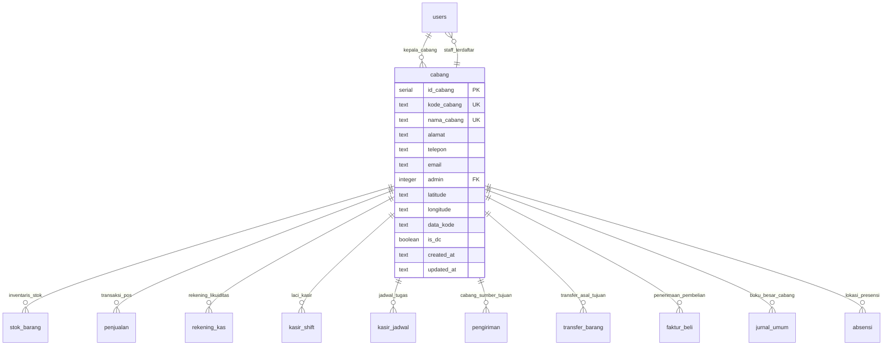
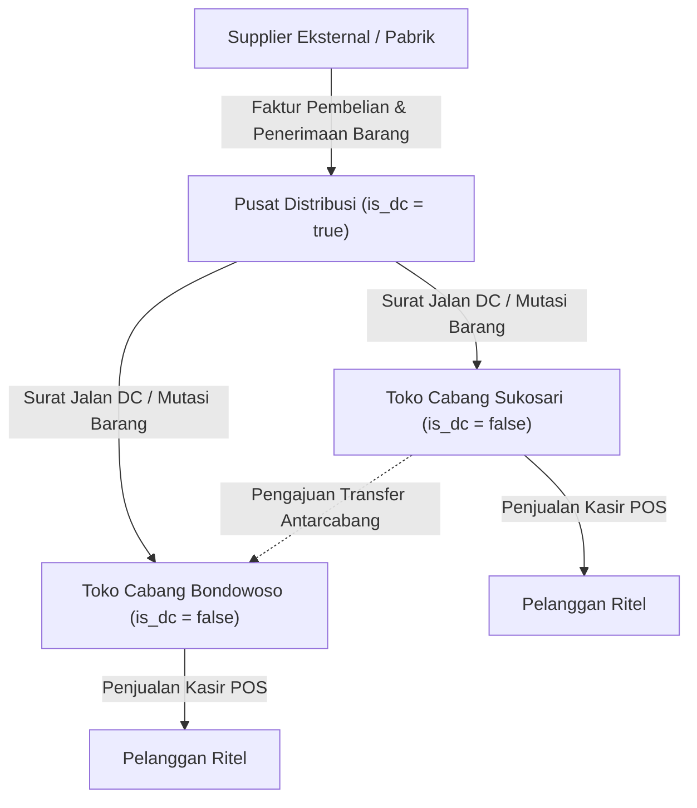
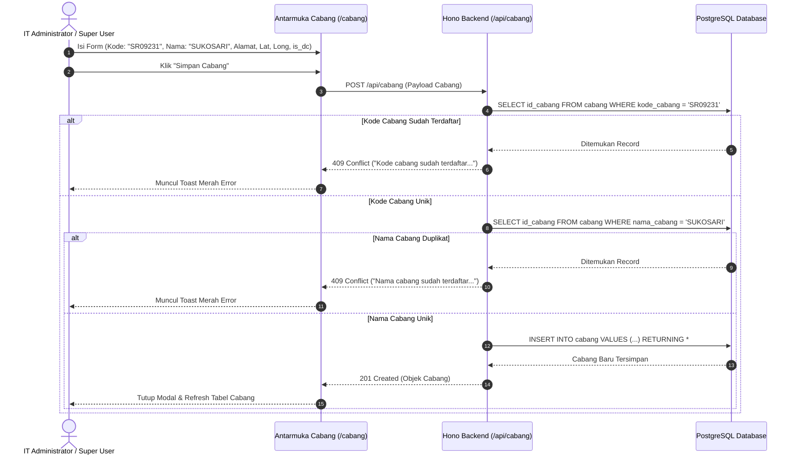
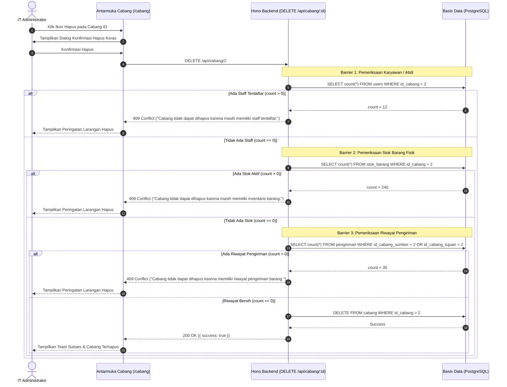

# SPESIFIKASI TEKNIS SISTEM: MODUL MASTER CABANG
**ERP AL MUBAROK (AS-IS SPECIFICATION)**  
*Dokumen ini menyajikan arsitektur lengkap, skema basis data, spesifikasi REST API, logika isolasi data multi-cabang, kalkulasi geofencing GPS, aturan penghapusan protektif, serta matriks otorisasi untuk Main Menu Master Cabang.*

---

## 1. Ringkasan Eksekutif & Arsitektur Multi-Cabang

Modul Master Cabang merupakan pondasi konfigurasi organisasi fisik (*Tenant & Branch Boundary Engine*) dalam ERP Al Mubarok. Entitas cabang (`cabang`) berfungsi sebagai pembatas ruang lingkup (*data boundary*) untuk seluruh transaksi operasional: absensi abdi, inventaris stok barang, transaksi kasir POS, pembukuan kas laci, rantai suplai distribusi, hingga pembukuan jurnal umum akuntansi.

### Karakteristik & Peran Arsitektur Cabang:
1. **Tenant & Data Boundary Partitioning:** Setiap transaksi operasional (penjualan, pembelian, stok barang, kas, jurnal umum) terikat secara mandatori ke sebuah `id_cabang`. Hal ini memungkinkan penerapan *Row-Level Security* dan isolasi data per cabang bagi petugas operasional tingkat toko.
2. **Dikotomi Peran Toko Ritel vs Distribution Center (DC):** Atribut boolean `is_dc` menentukan peran cabang dalam ekosistem logistik:
   - **Toko Ritel (`is_dc = false`):** Berfungsi sebagai unit penjualan langsung kepada pelanggan melalui kasir POS, pengelola kas laci harian, dan penerima barang kiriman.
   - **Pusat Distribusi / DC (`is_dc = true`):** Berfungsi sebagai gudang penyangga (*central warehouse*), pusat konsolidasi pengadaan barang supplier (*Purchase Order*), serta penerbit Surat Jalan pengiriman antarcabang.
3. **Anchor Koordinat Geospasial GPS (`latitude`, `longitude`):** Titik koordinat cabang menjadi acuan verifikasi kehadiran presensi GPS karyawan/abdi (Modul HRD) dan penentuan rute pemantauan armada logistik (Modul Distribusi).
4. **Kepala Cabang / Pimpinan Entitas (`admin`):** Menautkan cabang ke entitas pengguna (`users.id`) yang bertindak sebagai penanggung jawab utama operasional toko/kantor cabang.
5. **Multi-Barrier Delete Protection:** Sistem menerapkan 3 lapis validasi penolakan penghapusan cabang guna mencegah anomali *orphaned records* pada riwayat transaksi.

---

## 2. Peta File Kode Modul (Code File Map)

```
c:\Users\AFB\erp-almubarok\
├── erp-almubarok-nextjs\
│   ├── erp-almubarok-api\
│   │   └── src\
│   │       ├── routes\
│   │       │   └── master.ts                 # Handler REST API /cabang (baris 374-546)
│   │       └── lib\
│   │           └── db\
│   │               └── schema.ts             # DDL PostgreSQL tabel cabang (baris 11-25)
│   └── src\
│       ├── lib\
│       │   └── db\
│       │       └── schema.ts                 # DDL Drizzle ORM tabel cabang
│       └── app\
│           └── (dashboard)\
│               └── cabang\
│                   └── page.tsx              # UI Manajemen Cabang, Modal QR & Peta (883 baris)
```

---

## 3. Skema Basis Data & Data Dictionary Drizzle ORM

Modul Master Cabang direpresentasikan oleh tabel `cabang` dan memiliki dependensi *foreign key* terhadap 11 tabel operasional lainnya:



### 3.1. Tabel `cabang`
Menyimpan profil fisik dan konfigurasi geografis setiap cabang.

```typescript
export const cabang = pgTable("cabang", {
  id_cabang: serial("id_cabang").primaryKey(),
  kode_cabang: text("kode_cabang").notNull(),    // Kode unik cabang (contoh: "SR09231", "Kantor")
  nama_cabang: text("nama_cabang").notNull(),    // Nama unik cabang (contoh: "SUKOSARI", "Kantor")
  alamat: text("alamat").notNull(),              // Alamat lengkap fisik cabang
  telepon: text("telepon"),                      // Nomor telepon operasional kantor/toko
  email: text("email"),                          // Surel korespondensi cabang
  admin: integer("admin"),                       // ID User kepala/penanggung jawab cabang
  latitude: text("latitude"),                    // Titik koordinat Latitude (misal: "-8.123456")
  longitude: text("longitude"),                  // Titik koordinat Longitude (misal: "113.123456")
  data_kode: text("data_kode"),                  // Kode identifikasi integrasi eksternal / barcode
  is_dc: boolean("is_dc").default(false).notNull(), // Flag Pusat Distribusi vs Toko Ritel
  created_at: text("created_at").default(sql`(CURRENT_TIMESTAMP)`),
  updated_at: text("updated_at").default(sql`(CURRENT_TIMESTAMP)`),
});
```

*Data Baku Sistem (`scripts/seed.ts`):*
| `id_cabang` | `kode_cabang` | `nama_cabang` | `alamat` | `telepon` | `email` | `is_dc` |
|---|---|---|---|---|---|---|
| `2` | `SR09231` | `SUKOSARI` | Sukosari | 021812481 | info@almubarok.com | `false` (Toko) |
| `3` | `Kantor` | `Kantor` | Sukowono | 082337522221 | kantor@almubarok.com | `true` (DC / Kantor) |

---

### 3.2. Matriks Dependensi Relasi Entitas (Foreign Key Network)

| Tabel Sasaran | Kolom Kunci Asing | Sifat Integritas | Dampak Operasional Jika Cabang Dihapus |
|---|---|---|---|
| `users` | `id_cabang` | Restrict / Block | Abdi kehilangan cabang penempatan kerja |
| `stok_barang` | `id_cabang` | Restrict / Block | Nilai aset barang fisik di toko menjadi yatim (*orphaned*) |
| `penjualan` | `id_cabang` | Historical Record | Omzet dan audit nota kasir cabang terputus |
| `rekening_kas` | `id_cabang` | Restrict / Block | Saldo brankas dan rekening laci kasir kehilangan induk |
| `kasir_shift` | `id_cabang` | Operational | Laci kasir POS tidak dapat diverifikasi |
| `pengiriman` | `id_cabang_sumber` & `id_cabang_tujuan` | Restrict / Block | Riwayat surat jalan logistik DC rusak |
| `jurnal_umum` | `cabang_id` | Audit Trail | Laporan Neraca & Laba Rugi konsolidasi tidak seimbang |
| `absensi` | `id_cabang` | Presensi | Riwayat kehadiran abdi tidak dapat diverifikasi geofencing-nya |

---

## 4. Spesifikasi Lengkap Hono REST API

Seluruh rute master cabang di-mount pada router `masterRoutes` dengan path `/api/cabang` (melalui proxy Next.js rewrite).

### 4.1. `GET /api/cabang` (Daftar Cabang)
- **Deskripsi:** Mengambil seluruh daftar cabang aktif yang terdaftar di basis data, lengkap dengan nama user administrator/kepala cabang melalui operasi SQL `LEFT JOIN`.
- **Query Params:** Tidak ada (menghasilkan seluruh entitas untuk selector global dan manajemen).
- **Format Output JSON:**
  ```json
  [
    {
      "id_cabang": 2,
      "kode_cabang": "SR09231",
      "nama_cabang": "SUKOSARI",
      "alamat": "Jl. Raya Sukosari No. 12",
      "telepon": "021812481",
      "email": "info@almubarok.com",
      "admin": 4,
      "nama_admin": "ACH FAWAID BAQIR",
      "latitude": "-8.123456",
      "longitude": "113.123456",
      "data_kode": "CAB-SKSR",
      "is_dc": false
    }
  ]
  ```

---

### 4.2. `POST /api/cabang` (Pendaftaran Cabang Baru)
- **Deskripsi:** Menambahkan cabang baru ke dalam sistem.
- **Payload Body:**
  ```json
  {
    "kode_cabang": "BWS-01",
    "nama_cabang": "BONDOWOSO KOTA",
    "alamat": "Jl. Ahmad Yani No. 45, Bondowoso",
    "telepon": "081234567890",
    "email": "bondowoso@almubarok.com",
    "admin": 9,
    "latitude": "-7.912345",
    "longitude": "113.812345",
    "data_kode": "BWS-KOTA",
    "is_dc": false
  }
  ```
- **Validasi Keras Server-Side:**
  1. `kode_cabang`, `nama_cabang`, dan `alamat` wajib diisi (`HTTP 400 Bad Request`).
  2. **Uniqueness Check 1:** Memeriksa keunikan `kode_cabang`. Jika sudah terdaftar pada cabang lain $\rightarrow$ Melempar `HTTP 409 Conflict` (*"Kode cabang sudah terdaftar pada cabang lain."*).
  3. **Uniqueness Check 2:** Memeriksa keunikan `nama_cabang`. Jika sudah terdaftar $\rightarrow$ Melempar `HTTP 409 Conflict` (*"Nama cabang sudah terdaftar pada cabang lain."*).
- **Status Respons:** `201 Created` mengembalikan objek cabang yang berhasil dibuat.

---

### 4.3. `PUT /api/cabang/:id` (Pembaruan Profil Cabang)
- **Deskripsi:** Memperbarui informasi profil, penanggung jawab, koordinat GPS, atau peran DC cabang.
- **URL Parameter:** `id` (integer `id_cabang`).
- **Payload Body:** Field yang diperbarui (sama dengan POST).
- **Validasi Keras Server-Side:**
  - Validasi keunikan `kode_cabang` dan `nama_cabang` dengan mengecualikan ID cabang yang sedang diedit:
    ```typescript
    and(eq(cabang.kode_cabang, body.kode_cabang.trim()), ne(cabang.id_cabang, id))
    ```
- **Status Respons:** `200 OK` `{ "success": true }`.

---

### 4.4. `DELETE /api/cabang/:id` (Penghapusan Cabang Terproteksi)
- **Deskripsi:** Menghapus data cabang dengan proteksi multi-lapis.
- **Mekanisme Proteksi 3 Lapis (Multi-Barrier Delete Guard):**
  ```typescript
  // 1. Validasi penolakan hapus jika cabang masih memiliki staff/abdi aktif
  const [hasUsers] = await db.select({ count: sql`count(*)` }).from(users).where(eq(users.id_cabang, id));
  if (Number(hasUsers?.count ?? 0) > 0) {
    return c.json({ error: "Cabang tidak dapat dihapus karena masih memiliki staff/abdi terdaftar." }, 409);
  }

  // 2. Validasi penolakan hapus jika cabang masih memiliki inventaris barang
  const [hasStock] = await db.select({ count: sql`count(*)` }).from(stok_barang).where(eq(stok_barang.id_cabang, id));
  if (Number(hasStock?.count ?? 0) > 0) {
    return c.json({ error: "Cabang tidak dapat dihapus karena masih memiliki inventaris barang." }, 409);
  }

  // 3. Validasi penolakan hapus jika cabang memiliki riwayat pengiriman
  const [hasShipments] = await db.select({ count: sql`count(*)` }).from(pengiriman)
    .where(or(eq(pengiriman.id_cabang_sumber, id), eq(pengiriman.id_cabang_tujuan, id)));
  if (Number(hasShipments?.count ?? 0) > 0) {
    return c.json({ error: "Cabang tidak dapat dihapus karena memiliki riwayat pengiriman barang." }, 409);
  }
  ```
- **Status Respons:** `200 OK` `{ "success": true }` jika seluruh barier bernilai nol.

---

## 5. Logika Bisnis & Algoritma Multi-Cabang

### 5.1. Logika Isolasi Akses Data Cabang (Branch Boundary Enforcement)
Pada setiap rute operasional (Kas, Transaksi POS, Inventaris, Jurnal), backend memeriksa identitas token JWT pengguna (`activeUser`):

$$\text{CanAccessMultiBranch} = \text{activeUser.id\_jabatan} \in \{1, 2, 4, 8, 11\}$$

- **Tingkat Manajerial Pusat (Super User `1`, IT `2`, Bendahara `4`, Manager `8`, SPV `11`):** Diberikan wewenang konsolidasi multi-cabang. Dapat memfilter data cabang spesifik via parameter query `?id_cabang=X` atau melihat komparasi seluruh cabang.
- **Tingkat Petugas Toko / Kasir / Abdi Biasa:** Query basis data dipaksa menggunakan filter kaku:
  $$\text{WHERE } \text{id\_cabang} = \text{activeUser.id\_cabang}$$
  Pengguna ditolak jika berupaya melakukan mutasi kas, shift, atau penjualan di cabang yang bukan milik penempatannya (`HTTP 403 Forbidden`).

---

### 5.2. Formula Geofencing Presensi Abdi (Haversine Formula)
Koordinat `latitude` ($\phi_c$) dan `longitude` ($\lambda_c$) cabang digunakan oleh Modul HRD untuk memvalidasi lokasi presensi mobile abdi terhadap radius toleransi lokasi kantor/toko:

$$d = 2R \arcsin\left(\sqrt{\sin^2\left(\frac{\Delta\phi}{2}\right) + \cos(\phi_c)\cos(\phi_u)\sin^2\left(\frac{\Delta\lambda}{2}\right)}\right)$$

Di mana:
- $R = 6.371.000\text{ meter}$ (Radius Bumi).
- $\Delta\phi = \phi_u - \phi_c$ (Selisih latitude perangkat abdi $\phi_u$ terhadap cabang $\phi_c$ dalam radian).
- $\Delta\lambda = \lambda_u - \lambda_c$ (Selisih longitude dalam radian).
- **Validasi Presensi:** Presensi dinyatakan sah jika $d \le \text{Radius Toleransi Cabang}$ (biasanya $50\text{ meter}$).

---

### 5.3. Logika Peran Cabang DC (`is_dc: true`) vs Toko Cabang (`is_dc: false`)
Sistem rantai suplai (Modul Pembelian & Distribusi) memperlakukan cabang berdasarkan status `is_dc`:



---

## 6. Alur Transaksi & Diagram Workflow

### 6.1. Workflow Pendaftaran & Validasi Keunikan Cabang



---

### 6.2. Workflow Multi-Barrier Delete Check (Proteksi Hapus Cabang)



---

## 7. Frontend UI/UX & Interaksi Komponen

Halaman master cabang diimplementasikan pada file [`src/app/(dashboard)/cabang/page.tsx`](file:///c:/Users/AFB/erp-almubarok/erp-almubarok-nextjs/src/app/(dashboard)/cabang/page.tsx) (883 baris kode).

### 7.1. Struktur Tabel & Navigasi Data
- **Multi-Column Sorting:** Pengurutan tabel interaktif per kolom (`kode_cabang`, `nama_cabang`, `is_dc`) dengan indikator panah naik/turun (`ChevronUp`, `ChevronDown`).
- **Live Search Filtering:** Pencarian seketika (*client-side*) memfilter data berdasarkan kata kunci kode cabang, nama cabang, alamat fisik, atau data kode.
- **Badge Tipe Cabang:**
  - `Pusat Distribusi (DC)`: Ditandai dengan badge biru kontras dengan ikon gudang (`Layers`).
  - `Toko Cabang`: Ditandai dengan badge hijau dengan ikon etalase toko (`Store`).

---

### 7.2. Modal Detail Profil Cabang (*View Detail Dialog*)
- Menampilkan kartu identitas cabang lengkap:
  - Header profil cabang dengan lambang ikon gedung (`Building2`).
  - Koordinat GPS interaktif yang langsung terhubung ke tautan Google Maps:  
    `https://maps.google.com/?q={latitude},{longitude}`
  - Generator identitas visual (QR Code cabang) untuk keperluan scan identifikasi fisik.
  - Rincian narahubung: Kepala cabang penanggung jawab, surel resmi, dan telepon toko.

---

### 7.3. Modal Form Tambah/Ubah Cabang
- Formulir responsif mencakup:
  1. *Kode Cabang* (Input teks, otomatis di-trim).
  2. *Nama Cabang* (Input teks, divalidasi keunikan).
  3. *Alamat Fisik* (Textarea).
  4. *Kontak*: Nomor telepon operasional dan email resmi.
  5. *Kepala Cabang / Admin*: Dropdown pemilih dinamis yang mengambil daftar seluruh pengguna aktif dari endpoint `/api/hrd/users`.
  6. *Koordinat GPS*: Input teks `latitude` dan `longitude` desimal.
  7. *Toggle Switch Pusat Distribusi*: Sakelar penentu apakah entitas bertindak sebagai DC logistik (`is_dc`).

---

### 7.4. Modul Cetak Profil Cabang (*Print Friendly*)
- Fitur cetak dokumen profil cabang terisolasi menggunakan DOM kloning `#print-area-cabang` yang mengabaikan sidebar dan navbar navigasi saat dialog `window.print()` dipicu.

---

## 8. Matriks Hak Akses & Keamanan Sistem (RBAC)

Otorisasi level antarmuka dikendalikan oleh hook `useMenuPermissions()`, sementara otorisasi API divalidasi melalui token JWT pengguna.

| Operasi / Sub-Fitur | Super User (`1`) | IT Administrator (`2`) | Manager Cabang (`8`) | Bendahara Pusat (`4`) | Staff / Kasir Toko |
|---|---|---|---|---|---|
| **Lihat Daftar Cabang (`GET /cabang`)** | Full Akses | Full Akses | Diizinkan | Diizinkan | Diizinkan |
| **Buka Modal Detail Cabang & Peta GPS** | Diizinkan | Diizinkan | Diizinkan | Diizinkan | Diizinkan |
| **Cetak Profil Cabang** | Diizinkan | Diizinkan | Diizinkan | Diizinkan | Diizinkan |
| **Tambah Cabang Baru (`POST /cabang`)** | **Diizinkan** | **Diizinkan** | **Ditolak** | **Ditolak** | **Ditolak** |
| **Edit Profil Cabang (`PUT /cabang/:id`)** | **Diizinkan** | **Diizinkan** | **Ditolak** | **Ditolak** | **Ditolak** |
| **Hapus Cabang (`DELETE /cabang/:id`)** | **Diizinkan** | **Diizinkan** | **Ditolak** | **Ditolak** | **Ditolak** |

---

*Dokumen ini merupakan representasi teknis faktual dari Main Menu Master Cabang ERP Al Mubarok per Oktober 2026 dan siap dijadikan konteks input untuk analisis, audit keandalan tenant boundary, maupun refactoring kode AI.*

