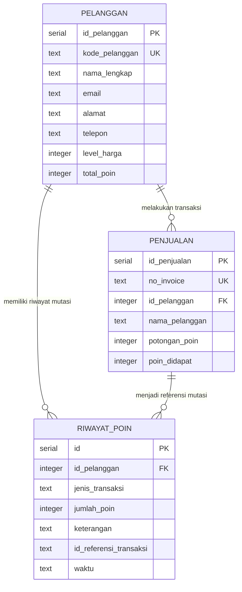
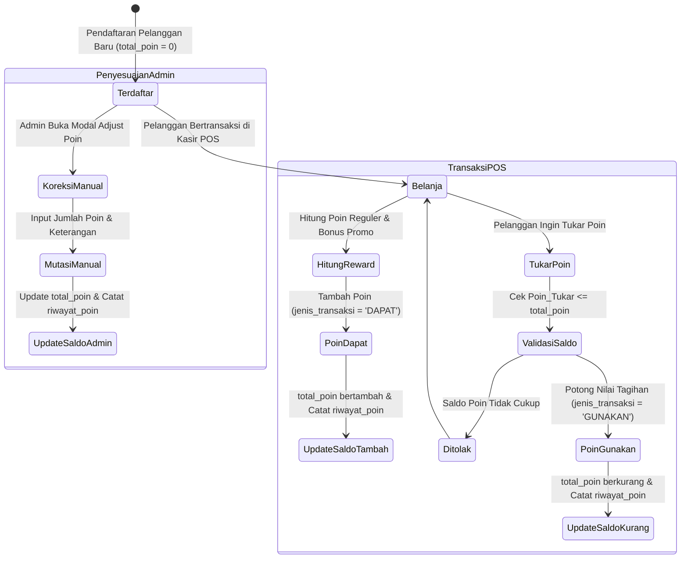

# 👥 DOKUMENTASI TEKNIS SISTEM
## MAIN MENU PELANGGAN: DAFTAR PELANGGAN, TIER LEVEL HARGA & LOYALITAS POIN
### SISTEM ENTERPRISE RESOURCE PLANNING (ERP) AL MUBAROK

> **Status Dokumen:** Faktual / Spesifikasi Fungsional & Teknis Lengkap  
> **Target Pengguna Dokumen:** AI Agent / Software Architect / Lead Developer untuk Analisis Sistem & Perencanaan Fitur  
> **Stack Arsitektur:** Next.js 16 (App Router, Turbopack), React 19, Tailwind CSS v4, Hono REST API, PostgreSQL, Drizzle ORM  
> **Domain Konteks:** Manajemen Hubungan Pelanggan (CRM Ritel), Klasifikasi Tier Konsumen (Silver, Gold, Platinum), Integrasi Matriks Harga Jual 3x3, Buku Besar Mutasi Poin (*Loyalty Points Ledger*), dan Impor/Ekspor Massal (Excel & CSV).

---

## 📑 DAFTAR ISI

1. [Ringkasan Eksekutif & Ruang Lingkup Sistem](#1-ringkasan-eksekutif--ruang-lingkup-sistem)
2. [Peta Arsitektur File & Komponen Kode](#2-peta-arsitektur-file--komponen-kode)
3. [Kamus Data & Skema Database (Database Dictionary)](#3-kamus-data--skema-database-database-dictionary)
4. [Spesifikasi REST API Endpoints (Hono Framework)](#4-spesifikasi-rest-api-endpoints-hono-framework)
5. [Logika Bisnis, Algoritma & Formula Matematis](#5-logika-bisnis-algoritma--formula-matematis)
6. [Alur Bisnis & State Machine (Mermaid Diagrams)](#6-alur-bisnis--state-machine-mermaid-diagrams)
7. [Struktur UI / UX Frontend & Interaksi Pengguna](#7-struktur-ui--ux-frontend--interaksi-pengguna)
8. [Matriks Hak Akses & Keamanan Sistem (RBAC)](#8-matriks-hak-akses--keamanan-sistem-rbac)

---

## 1. Ringkasan Eksekutif & Ruang Lingkup Sistem

Main Menu **Pelanggan** (Urutan 5 pada navigasi utama ERP Al Mubarok, ikon: `Users`) menangani data identitas konsumen, klasifikasi segmentasi pasar (*Customer Tiering*), serta tata kelola program loyalitas berbasis poin reward. Modul ini terhubung secara langsung dengan modul Penjualan (Kasir POS) untuk menentukan level harga jual barang otomatis serta memproses perolehan dan penukaran poin belanja.

### 2 Submenu Utama:
1. **Daftar Pelanggan (`/pelanggan`):** Manajemen direktori master pelanggan (kode unik pelanggan, nama lengkap, kontak nomor telepon/WhatsApp, email, dan alamat domisili), penentuan klasifikasi tier level harga (*Level 1 Silver, Level 2 Gold, Level 3 Platinum*), saldo akumulasi poin aktif, modal penyesuaian manual poin (*manual point adjustment*), serta fitur impor dan ekspor massal berbasis file Excel (.xlsx) dan CSV.
2. **Riwayat Poin (`/pelanggan/poin`):** Buku besar pencatatan riwayat audit (*audit trail log*) pergerakan poin loyalitas pelanggan. Mencatat setiap penambahan poin reward dari transaksi belanja POS atau promo toko (`DAPAT`), pengurangan poin saat ditukarkan sebagai pemotong nilai tagihan nota belanja (`GUNAKAN`), maupun penyesuaian koreksi manual oleh administrator dengan nomor referensi nota invoice terkait.

---

## 2. Peta Arsitektur File & Komponen Kode

### A. Backend API (Hono Framework + Drizzle ORM)
* **Direktori:** `erp-almubarok-nextjs/erp-almubarok-api/`
* **Skema Database:** [`src/lib/db/schema.ts`](file:///c:/Users/AFB/erp-almubarok/erp-almubarok-nextjs/erp-almubarok-api/src/lib/db/schema.ts)
  * Tabel Master Pelanggan: Baris 279–288 (`pelanggan`)
  * Tabel Riwayat Poin: Baris 330–338 (`riwayat_poin`)
  * Relasi Transaksi Penjualan: Baris 291–311 (`penjualan.id_pelanggan`, `penjualan.potongan_poin`, `penjualan.poin_didapat`)
* **Route Controllers:**
  * Router Master: [`src/routes/master.ts`](file:///c:/Users/AFB/erp-almubarok/erp-almubarok-nextjs/erp-almubarok-api/src/routes/master.ts) (Baris 551–596 menangani CRUD tabel `pelanggan`)
  * Router Penjualan: [`src/routes/penjualan.ts`](file:///c:/Users/AFB/erp-almubarok/erp-almubarok-nextjs/erp-almubarok-api/src/routes/penjualan.ts) (Baris 231–277 memproses transaksi atomik penambahan poin `DAPAT` dan penukaran poin `GUNAKAN` saat kasir POS checkout)
* **Mounting Router:** [`src/index.ts`](file:///c:/Users/AFB/erp-almubarok/erp-almubarok-nextjs/erp-almubarok-api/src/index.ts) (`/api/master` dan `/api`).

### B. Frontend Web (Next.js 16 App Router)
* **Direktori:** `erp-almubarok-nextjs/src/app/(dashboard)/pelanggan/`
* **File Halaman Utama:**
  * [`page.tsx`](file:///c:/Users/AFB/erp-almubarok/erp-almubarok-nextjs/src/app/(dashboard)/pelanggan/page.tsx): Katalog master pelanggan, form modal pendaftaran/edit pelanggan, modal penyesuaian poin manual (Dapat/Gunakan), wizard impor Excel/CSV 3-tahap (Upload $\rightarrow$ Validasi & Preview $\rightarrow$ Eksekusi), dan generator ekspor kustom kolom.
  * [`poin/page.tsx`](file:///c:/Users/AFB/erp-almubarok/erp-almubarok-nextjs/src/app/(dashboard)/pelanggan/poin/page.tsx): Buku besar mutasi poin loyalitas, kartu rekapitulasi poin (Total Diperoleh vs Total Digunakan), filter pencarian per pelanggan/jenis mutasi/rentang tanggal, dan penautan ke invoice penjualan terkait.
* **Integrasi Kasir POS:**
  * [`../penjualan/pos/page.tsx`](file:///c:/Users/AFB/erp-almubarok/erp-almubarok-nextjs/src/app/(dashboard)/penjualan/pos/page.tsx): Tombol pilih pelanggan (F8), lookup otomatis level harga, tampilan saldo poin konsumen, input penukaran poin, dan perolehan poin transaksi.

---

## 3. Kamus Data & Skema Database (Database Dictionary)

Database diatur menggunakan PostgreSQL dengan definisi tabel Drizzle ORM (`drizzle-orm/pg-core`).



### 1. Tabel `pelanggan` (Master Data Pelanggan)
Tabel induk profil konsumen dan klasifikasi tingkat harga.
```typescript
export const pelanggan = pgTable("pelanggan", {
  id_pelanggan: serial("id_pelanggan").primaryKey(),
  kode_pelanggan: text("kode_pelanggan").notNull(),          // Kode unik pelanggan (contoh: 'PLG-0001')
  nama_lengkap: text("nama_lengkap").notNull(),              // Nama pribadi / instansi pelanggan
  email: text("email"),                                      // Alamat surat elektronik
  alamat: text("alamat"),                                    // Alamat tempat tinggal / kantor
  telepon: text("telepon"),                                  // Nomor HP / WhatsApp
  level_harga: integer("level_harga").default(1),            // 1 = Silver (Umum), 2 = Gold (Member), 3 = Platinum (Grosir)
  total_poin: integer("total_poin").default(0),              // Saldo total poin loyalitas aktif terkini
});
```

### 2. Tabel `riwayat_poin` (Buku Besar Mutasi Poin)
Tabel log transaksi pergerakan poin loyalitas konsumen.
```typescript
export const riwayat_poin = pgTable("riwayat_poin", {
  id: serial("id").primaryKey(),
  id_pelanggan: integer("id_pelanggan").references(() => pelanggan.id_pelanggan), // FK -> pelanggan.id_pelanggan
  jenis_transaksi: text("jenis_transaksi").notNull(),        // 'DAPAT' (Penambahan) | 'GUNAKAN' (Pengurangan)
  jumlah_poin: integer("jumlah_poin").notNull(),             // Besaran kuantitas poin yang bermutasi
  keterangan: text("keterangan"),                            // Deskripsi penyebab mutasi / penyesuaian manual
  id_referensi_transaksi: text("id_referensi_transaksi"),    // Nomor Invoice transaksi kasir terkait (contoh: 'INV/20261029/2/0001')
  waktu: text("waktu").default(sql`(CURRENT_TIMESTAMP)`),    // Timestamp ISO mutasi poin terjadi
});
```

---

## 4. Spesifikasi REST API Endpoints (Hono Framework)

Seluruh endpoint terpasang otentikasi JWT (`authMiddleware`).

### A. Endpoints Master Pelanggan (`/api/master/pelanggan` atau `/api/pelanggan`)
| Endpoint | Method | Parameter / Payload | Aturan Validasi & Logika Bisnis |
|---|---|---|---|
| `/pelanggan` | `GET` | Query param: `q` (opsional untuk pencarian nama/kode) | Mengembalikan daftar seluruh pelanggan terurut alfabetis berdasarkan `nama_lengkap`. Menyertakan informasi saldo `total_poin` dan `level_harga`. |
| `/pelanggan` | `POST` | Body JSON: `{ kode_pelanggan, nama_lengkap, email, telepon, alamat, level_harga, total_poin }` | Pendaftaran pelanggan baru. `level_harga` bernilai default 1 (Silver) jika tidak ditentukan. |
| `/pelanggan/:id` | `PUT` | Path param: `id`. Body: Properti pelanggan yang diperbarui | Pembaruan identitas kontak, alamat, klasifikasi tier level harga, dan saldo poin. |
| `/pelanggan/:id` | `DELETE` | Path param: `id` | Menghapus data pelanggan dari database jika tidak memiliki dependensi transaksi penjualan. |

### B. Endpoints Riwayat Poin Pelanggan (`/api/pelanggan/poin`)
| Endpoint | Method | Parameter / Payload | Aturan Validasi & Logika Bisnis |
|---|---|---|---|
| `/pelanggan/poin` | `GET` | Query params: `id_pelanggan` (filter pelanggan), `jenis_transaksi` (`DAPAT`\|`GUNAKAN`), `tanggal_awal`, `tanggal_akhir` | Menampilkan seluruh mutasi riwayat poin yang cocok dengan kriteria filter, di-join dengan tabel `pelanggan` untuk menyertakan `nama_lengkap` dan `kode_pelanggan`. |
| `/pelanggan/poin` | `POST` | Body JSON: `{ id_pelanggan, jenis_transaksi, jumlah_poin, keterangan }` | **Penyesuaian Poin Manual (Point Adjustment):**<br>1. Validasi saldo: Jika `jenis_transaksi === 'GUNAKAN'`, saldo poin pelanggan tidak boleh menjadi minus.<br>2. Mencatat baris log mutasi ke tabel `riwayat_poin`.<br>3. Memperbarui kolom `total_poin` pada tabel `pelanggan` secara atomik. |

---

## 5. Logika Bisnis, Algoritma & Formula Matematis

### A. Klasifikasi Tier Level Harga Pelanggan
ERP Al Mubarok memetakan profil konsumen ke dalam 3 tingkatan harga jual (*Price Tiering*) yang terintegrasi secara dinamis dengan matriks harga jual 3x3 pada tabel `barang`:

| Level | Kategori Tier | Target Segmen Konsumen | Pemetaan Kolom Harga Barang Satuan 1 | Pemetaan Kolom Harga Barang Satuan 2 | Pemetaan Kolom Harga Barang Satuan 3 |
|---|---|---|---|---|---|
| **1** | **Silver** | Pelanggan Umum / Non-Member / Ritel | `harga_jual_1_1` | `harga_jual_2_1` | `harga_jual_3_1` |
| **2** | **Gold** | Pelanggan Member / Santri / Komunitas Terdaftar | `harga_jual_1_2` | `harga_jual_2_2` | `harga_jual_3_2` |
| **3** | **Platinum**| Grosir / Agen / Mitra Usaha / Partai Besar | `harga_jual_1_3` | `harga_jual_2_3` | `harga_jual_3_3` |

#### Penentuan Harga Jual Otomatis di Kasir POS:
Ketika kasir memilih pelanggan dengan ID tertentu pada keranjang POS, sistem membaca `pelanggan.level_harga` ($L \in \{1, 2, 3\}$). Saat produk dengan kuantitas pada satuan $U \in \{1, 2, 3\}$ ditambahkan ke keranjang, harga satuan yang dikenakan ($P$) ditentukan secara instan melalui:
$$P = \text{barang}[\text{"harga\_jual\_" + } U \text{ + "\_" + } L]$$

### B. Formula Perolehan & Penukaran Poin Loyalitas

#### 1. Perolehan Poin Transaksi (Poin Reward):
Poin reward didapatkan melalui dua saluran:
1. **Aturan Belanja Reguler:** Rasio standar perolehan poin dari total nilai belanja bersih (misal: setiap kelipatan Rp 10.000 mendapatkan 1 poin):
   $$P_{\text{reguler}} = \left\lfloor \frac{\text{TotalAkhir}}{\text{RasioBelanjaPoin}} \right\rfloor$$
2. **Hadiah Promo Khusus:** Tambahan poin ekstra dari program promosi aktif (`POIN_PEMBELANJAAN` atau `POIN_BARANG`):
   $$P_{\text{didapat}} = P_{\text{reguler}} + P_{\text{promo}}$$
* Saldo baru setelah transaksi belanja:
  $$\text{TotalPoin}_{\text{baru}} = \text{TotalPoin}_{\text{lama}} + P_{\text{didapat}}$$

#### 2. Penukaran Poin Belanja (Point Redemption):
Konsumen dapat menukarkan poin reward miliknya untuk memotong nilai tagihan nota transaksi pada kasir POS:
$$\text{PotonganRupiah} = P_{\text{digunakan}} \times \text{NilaiRupiahPerPoin}$$
* *Syarat Validitas:*
  $$P_{\text{digunakan}} \le \text{TotalPoin}_{\text{lama}}$$
  $$\text{PotonganRupiah} \le (\text{Subtotal} - \text{DiskonPromo})$$
* Saldo baru setelah pemotongan poin:
  $$\text{TotalPoin}_{\text{baru}} = \text{TotalPoin}_{\text{lama}} - P_{\text{digunakan}}$$

#### 3. Penyesuaian Saldo Poin Manual (Adjustment):
Koreksi saldo poin yang dilakukan oleh manajemen/administrator (misal: kompensasi klaim, reward hari ulang tahun, atau koreksi audit):
$$\text{TotalPoin}_{\text{baru}} = \begin{cases} \text{TotalPoin}_{\text{lama}} + \Delta P, & \text{jenis\_transaksi} = \text{'DAPAT'} \\ \max(0, \text{TotalPoin}_{\text{lama}} - \Delta P), & \text{jenis\_transaksi} = \text{'GUNAKAN'} \end{cases}$$

---

## 6. Alur Bisnis & State Machine (Mermaid Diagrams)

### A. Siklus Poin Loyalitas Pelanggan (Loyalty Point Lifecycle)


### B. Integrasi Pelanggan pada Kasir POS Toko
```mermaid
flowchart TD
    A[Kasir Buka Transaksi POS] --> B{Identifikasi Pelanggan?}
    B -- "Tidak (Pelanggan Umum)" --> C[Level Harga = 1 (Silver)]
    C --> D[Poin Reward = 0 & Tidak Ada Opsi Tukar Poin]
    
    B -- "Ya (Pilih Member via F8)" --> E[Ambil Data Pelanggan dari Database]
    E --> F[Terapkan Level Harga: 1/2/3]
    F --> G[Tampilkan Saldo Poin Aktif di Layar POS]
    
    G --> H{Ingin Tukar Poin?}
    H -- "Ya" --> I[Input Jumlah Poin Ditukar]
    I --> J[Kurangi Tagihan Nota Sebesar Nilai Rupiah Poin]
    H -- "Tidak" --> K[Lanjutkan ke Pembayaran]
    J --> K
    
    K --> L[Checkout Sukses: Terbitkan Invoice]
    L --> M[Update Saldo Poin & Simpan Buku Besar riwayat_poin]
```

---

## 7. Struktur UI / UX Frontend & Interaksi Pengguna

Frontend dikembangkan dengan Next.js 16 menggunakan antarmuka modern Tailwind CSS v4, modal dialog transparan, serta library Lucide React.

```text
src/app/(dashboard)/pelanggan/
├── page.tsx                  # Direktori Master Pelanggan, Tiering, Wizard Import/Export
└── poin/
    └── page.tsx              # Buku Besar Riwayat Poin, Filter Tanggal, Rekap Diperoleh/Digunakan
```

### Fitur Antarmuka Utama:
1. **Wizard Impor Excel / CSV 3-Tahap (`/pelanggan`):**
   * **Tahap 1 (Upload):** Drag & drop file atau unduh template resmi (`template_import_pelanggan.csv`).
   * **Tahap 2 (Validasi & Preview):** Normalisasi header cerdas (mendeteksi variasi penamaan seperti `no_hp`, `telp`, `wa` menjadi `telepon`) dan pelaporan error per baris jika data tidak valid.
   * **Tahap 3 (Eksekusi):** Mengimpor data bersih secara massal ke database dengan progress bar.
2. **Generator Ekspor Fleksibel:**
   * Pilihan format: Excel Workbook (.xlsx) atau Comma-Separated Values (.csv).
   * Pilihan delimiter CSV (Koma `,` atau Titik Koma `;`).
   * Pemilih kolom (*Column Picker*): Pengguna dapat memilih field spesifik yang ingin diunduh.
3. **Kartu Statistik Mutasi Poin (`/pelanggan/poin`):**
   * Menampilkan ringkasan visual instan: **Total Poin Diperoleh** (Badge Hijau) dan **Total Poin Digunakan** (Badge Merah/Oranye) sesuai rentang filter yang aktif.
4. **Navigasi 1-Klik ke Riwayat Poin:** Pada tabel daftar pelanggan, klik tombol icon poin pada baris pelanggan akan langsung mengarahkan kasir/admin ke halaman `/pelanggan/poin?id_pelanggan={id}` yang terfilter otomatis untuk konsumen tersebut.

---

## 8. Matriks Hak Akses & Keamanan Sistem (RBAC)

Otorisasi level API dikendalikan melalui token JWT (`activeUser.id_jabatan` dan `activeUser.id_cabang`).

| Menu / Operasi | Super User (`1`) | IT Administrator (`2`) | Manager Cabang (`3`) | Staff Kasir (`4+`) |
|---|---|---|---|---|
| **Lihat Direktori Pelanggan (`/pelanggan`)** | Full Akses | Full Akses | Full Akses | Full Akses (Daftar & Pencarian) |
| **Tambah Pelanggan Baru** | Diizinkan | Diizinkan | Diizinkan | Diizinkan (Pendaftaran Member Cepat) |
| **Ubah Profil / Tier Level Harga** | Diizinkan | Diizinkan | Diizinkan | **Ditolak** (Hanya Administrator & Manager) |
| **Hapus Pelanggan** | Diizinkan | Diizinkan | **Ditolak** | **Ditolak** |
| **Penyesuaian Manual Poin (Adjustment)** | Diizinkan | Diizinkan | Diizinkan (Dengan Alasan) | **Ditolak** |
| **Impor & Ekspor Massal (Excel/CSV)** | Diizinkan | Diizinkan | Diizinkan | **Ditolak** |
| **Lihat Riwayat Buku Besar Poin (`/poin`)** | Full Akses | Full Akses | Full Akses | Hanya Baca (*Read Only*) |

---

*Dokumen ini merupakan representasi teknis faktual dari Main Menu Pelanggan ERP Al Mubarok per Oktober 2026 dan siap dijadikan konteks input untuk analisis, refactoring, atau integrasi AI.*

