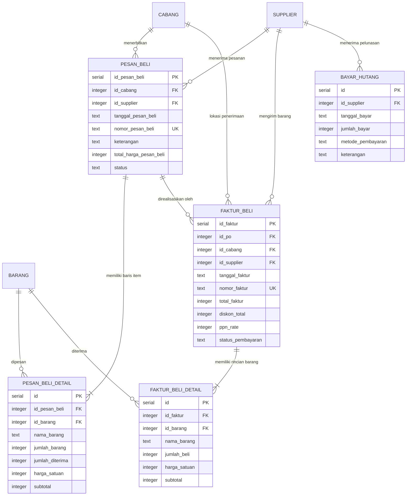
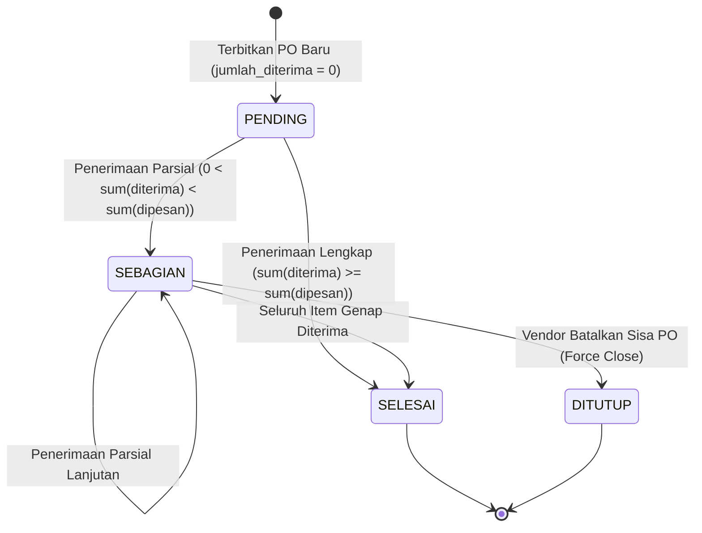
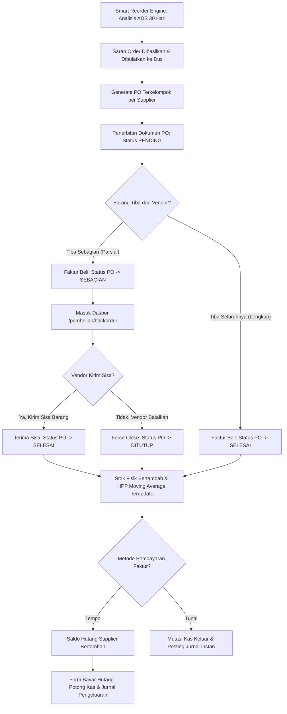

# 📦 DOKUMENTASI TEKNIS SISTEM
## MAIN MENU PEMBELIAN: PENGADAAN (PROCUREMENT), SARAN ORDER CERDAS, MANAJEMEN BACKORDER & HUTANG SUPPLIER
### SISTEM ENTERPRISE RESOURCE PLANNING (ERP) AL MUBAROK

> **Status Dokumen:** Faktual / Spesifikasi Fungsional & Teknis Lengkap (*As-Is Specification*)  
> **Target Pengguna Dokumen:** AI Agent / Software Architect / Lead Developer untuk Analisis Sistem, Audit Rantai Pasok & Perencanaan Fitur  
> **Stack Arsitektur:** Next.js 16 (App Router, Turbopack), React 19, Tailwind CSS v4, Hono REST API, PostgreSQL, Drizzle ORM  
> **Domain Konteks:** Manajemen Pengadaan Rantai Pasok (*Supply Chain & Procurement*), Analisis Prediktif Stok Berbasis ADS (*Average Daily Sales 30 Hari*), Siklus Hidup Backorder PO & Penerimaan Bertahap (*Partial Receiving*), Rekalkulasi HPP Rata-Rata Bergerak (*Moving Average Cost*), serta Manajemen Hutang Dagang (*Accounts Payable*) dan Integrasi Kas Keluar.

---

## 📑 DAFTAR ISI

1. [Ringkasan Eksekutif & Ruang Lingkup Sistem](#1-ringkasan-eksekutif--ruang-lingkup-sistem)
2. [Peta Arsitektur File & Komponen Kode](#2-peta-arsitektur-file--komponen-kode)
3. [Kamus Data & Skema Database (Database Dictionary)](#3-kamus-data--skema-database-database-dictionary)
4. [Spesifikasi REST API Endpoints (Hono Framework)](#4-spesifikasi-rest-api-endpoints-hono-framework)
5. [Logika Bisnis, Algoritma & Formula Matematis](#5-logika-bisnis-algoritma--formula-matematis)
6. [Alur Bisnis & State Machine (Mermaid Diagrams)](#6-alur-bisnis--state-machine-mermaid-diagrams)
7. [Struktur UI / UX Frontend & Interaksi Pengguna](#7-struktur-ui--ux-frontend--interaksi-pengguna)
8. [Matriks Hak Akses & Keamanan Sistem (RBAC)](#8-matriks-hak-akses--keamanan-sistem-rbac)

---

## 1. Ringkasan Eksekutif & Ruang Lingkup Sistem

Main Menu **Pembelian** (Urutan 6 pada navigasi utama ERP Al Mubarok, ikon: `ShoppingBag`) bertanggung jawab menangani seluruh siklus hidup pengadaan barang dagangan, mulai dari analisis kebutuhan restock prediktif, penerbitan surat pesanan resmi (*Purchase Order*), pemantauan sisa pesanan tertahan vendor (*Backorder Tracking*), penerimaan fisik barang ke gudang toko, rekalkulasi nilai aset persediaan (HPP Moving Average), pencatatan kewajiban hutang dagang, integrasi kas keluar, hingga pelunasan ke supplier.

### 6 Submodul Operasional:
1. **Saran Order Pembelian Cerdas (`/pembelian/saran-order`):** Mesin analisis prediktif restock stok konsolidasi seluruh cabang berbasis rata-rata penjualan harian 30 hari (*Average Daily Sales / ADS*), ketahanan stok (*runout days*), saldo fisik aktual, kuantitas pesanan yang sedang berjalan (*PO on-order*), serta pembulatan ke atas (*ceiling*) sesuai satuan kemasan vendor (Dus/Karton).
2. **Purchase Order (PO) / Surat Pesanan (`/pembelian/po`):** Pembuatan, pemantauan status (*PENDING*, *Diproses*, *Sebagian*, *Selesai*, *Ditutup*), dan pencetakan dokumen surat pesanan resmi ke vendor per cabang.
3. **Manajemen Backorder & Penerimaan Parsial (`/pembelian/backorder`):** Dasbor khusus untuk memantau surat pesanan yang baru dipenuhi sebagian oleh vendor, kalkulasi persentase pemenuhan fisik per baris item, penerimaan sisa barang 1-klik, dan penutupan paksa (*Force Close*) jika vendor membatalkan sisa pesanan.
4. **Penerimaan Barang / Faktur Beli (`/pembelian/invoice`):** Pencatatan kedatangan fisik barang dari supplier, rekonsiliasi bertahap terhadap PO, pembaruan otomatis stok fisik toko, serta rekalkulasi HPP rata-rata bergerak.
5. **Riwayat Faktur Pembelian (`/pembelian/history`):** Arsip digital seluruh faktur pembelian masuk, pelacakan rincian item nota, dan status pelunasan pembayaran.
6. **Manajemen Hutang Supplier (`/pembelian/hutang`):** Pencatatan kewajiban tempo, monitoring saldo hutang per supplier, form transaksi pembayaran/cicilan hutang, dan integrasi pengeluaran kas/bank otomatis.

---

## 2. Peta Arsitektur File & Komponen Kode

### A. Backend API (Hono Framework + Drizzle ORM)
* **Direktori:** `erp-almubarok-nextjs/erp-almubarok-api/`
* **Skema Database:** [`src/lib/db/schema.ts`](file:///c:/Users/AFB/erp-almubarok/erp-almubarok-nextjs/erp-almubarok-api/src/lib/db/schema.ts)
  * Surat Pesanan: Baris 360–382 (`pesan_beli`, `pesan_beli_detail`)
  * Faktur Pembelian: Baris 385–408 (`faktur_beli`, `faktur_beli_detail`)
  * Pembayaran Hutang: Baris 411–419 (`bayar_hutang`)
  * Saldo Hutang Supplier: Baris 216–231 (`supplier.hutang`)
* **Route Controller:** [`src/routes/pembelian.ts`](file:///c:/Users/AFB/erp-almubarok/erp-almubarok-nextjs/erp-almubarok-api/src/routes/pembelian.ts) (1.142 baris kode menangani Purchase Order, Backorder, Faktur Beli, Smart Reorder Engine, dan Pembayaran Hutang)
* **Mounting Router:** [`src/index.ts`](file:///c:/Users/AFB/erp-almubarok/erp-almubarok-nextjs/erp-almubarok-api/src/index.ts) (`/api/pembelian`).

### B. Frontend Web (Next.js 16 App Router)
* **Direktori:** `erp-almubarok-nextjs/src/app/(dashboard)/pembelian/`
* **File Halaman Utama:**
  * [`saran-order/page.tsx`](file:///c:/Users/AFB/erp-almubarok/erp-almubarok-nextjs/src/app/(dashboard)/pembelian/saran-order/page.tsx): Dasbor Smart Reorder Engine, kalkulator buffer stok hari, filter tingkat urgensi (Kritis, Perhatian, Aman), dan generator PO otomatis 1-klik terkelompok per supplier.
  * [`po/page.tsx`](file:///c:/Users/AFB/erp-almubarok/erp-almubarok-nextjs/src/app/(dashboard)/pembelian/po/page.tsx): Daftar Purchase Order, form pembuatan PO manual, filter status bertingkat, dan cetak dokumen PO resmi.
  * [`backorder/page.tsx`](file:///c:/Users/AFB/erp-almubarok/erp-almubarok-nextjs/src/app/(dashboard)/pembelian/backorder/page.tsx): Dasbor monitoring PO parsial (`status === 'Sebagian'`), visualisasi progress bar pemenuhan, pemicu penerimaan sisa, dan modal konfirmasi Force Close.
  * [`invoice/page.tsx`](file:///c:/Users/AFB/erp-almubarok/erp-almubarok-nextjs/src/app/(dashboard)/pembelian/invoice/page.tsx): Form penerimaan barang/faktur masuk, impor otomatis sisa kuantitas PO unfulfilled, input diskon faktur & PPN, opsi pembayaran tunai/tempo.
  * [`history/page.tsx`](file:///c:/Users/AFB/erp-almubarok/erp-almubarok-nextjs/src/app/(dashboard)/pembelian/history/page.tsx): Riwayat faktur pembelian, rincian item barang masuk, dan status pembayaran.
  * [`hutang/page.tsx`](file:///c:/Users/AFB/erp-almubarok/erp-almubarok-nextjs/src/app/(dashboard)/pembelian/hutang/page.tsx): Daftar saldo hutang vendor, modal pelunasan/cicilan hutang, pemilihan rekening kas sumber dana, dan cetak bukti kas keluar.

---

## 3. Kamus Data & Skema Database (Database Dictionary)

Database diatur menggunakan PostgreSQL dengan definisi tabel melalui Drizzle ORM (`drizzle-orm/pg-core`).



### 1. Tabel `pesan_beli` (Purchase Order Header)
```typescript
export const pesan_beli = pgTable("pesan_beli", {
  id_pesan_beli: serial("id_pesan_beli").primaryKey(),
  id_cabang: integer("id_cabang").references(() => cabang.id_cabang).notNull(),
  id_supplier: integer("id_supplier").references(() => supplier.id_supplier).notNull(),
  tanggal_pesan_beli: text("tanggal_pesan_beli").notNull(),   // Format: YYYY-MM-DD
  nomor_pesan_beli: text("nomor_pesan_beli").notNull(),       // Format: PO/YYYYMMDD/{id_cabang}/{sequence 4 digit}
  keterangan: text("keterangan"),                            // Catatan instruksi pengiriman
  total_harga_pesan_beli: integer("total_harga_pesan_beli").notNull(), // Estimasi total nilai pesanan (IDR)
  status: text("status").default("PENDING"),                 // 'PENDING' | 'Diproses' | 'Sebagian' | 'Selesai' | 'Ditutup'
  created_at: text("created_at").default(sql`(CURRENT_TIMESTAMP)`),
});
```

### 2. Tabel `pesan_beli_detail` (Purchase Order Items & Backorder Tracking)
```typescript
export const pesan_beli_detail = pgTable("pesan_beli_detail", {
  id: serial("id").primaryKey(),
  id_pesan_beli: integer("id_pesan_beli").references(() => pesan_beli.id_pesan_beli).notNull(),
  id_barang: integer("id_barang").references(() => barang.id_barang).notNull(),
  nama_barang: text("nama_barang").notNull(),                // Snapshot nama produk saat PO diterbitkan
  jumlah_barang: integer("jumlah_barang").notNull(),         // Total kuantitas barang dipesan (satuan dasar pcs)
  jumlah_diterima: integer("jumlah_diterima").default(0).notNull(), // Akumulasi kuantitas fisik yang sudah tiba
  harga_satuan: integer("harga_satuan").notNull(),           // Estimasi harga beli per satuan dasar
  subtotal: integer("subtotal").notNull(),                   // jumlah_barang * harga_satuan
});
```

### 3. Tabel `faktur_beli` (Purchase Invoice / Goods Receipt Header)
```typescript
export const faktur_beli = pgTable("faktur_beli", {
  id_faktur: serial("id_faktur").primaryKey(),
  id_po: integer("id_po").references(() => pesan_beli.id_pesan_beli), // FK -> pesan_beli (Opsional, null jika penerimaan non-PO)
  id_cabang: integer("id_cabang").references(() => cabang.id_cabang).notNull(),
  id_supplier: integer("id_supplier").references(() => supplier.id_supplier).notNull(),
  tanggal_faktur: text("tanggal_faktur").notNull(),           // Format: YYYY-MM-DD
  nomor_faktur: text("nomor_faktur").notNull(),               // Nomor surat jalan / faktur fisik supplier
  total_faktur: integer("total_faktur").notNull(),           // Nilai tagihan akhir setelah diskon & PPN (IDR)
  diskon_total: integer("diskon_total").default(0),          // Potongan global faktur supplier (IDR)
  ppn_rate: integer("ppn_rate").default(0),                  // Persentase PPN (misal: 11 atau 12)
  status_pembayaran: text("status_pembayaran").default("Belum Dibayar"), // 'Lunas' | 'Belum Dibayar' (Tempo)
  created_at: text("created_at").default(sql`(CURRENT_TIMESTAMP)`),
});
```

### 4. Tabel `faktur_beli_detail` (Goods Receipt Items)
```typescript
export const faktur_beli_detail = pgTable("faktur_beli_detail", {
  id: serial("id").primaryKey(),
  id_faktur: integer("id_faktur").references(() => faktur_beli.id_faktur).notNull(),
  id_barang: integer("id_barang").references(() => barang.id_barang).notNull(),
  nama_barang: text("nama_barang"),                          // Snapshot nama produk saat barang diterima
  jumlah_beli: integer("jumlah_beli").notNull(),             // Kuantitas fisik riil yang diterima (pcs)
  harga_satuan: integer("harga_satuan").notNull(),           // Harga beli satuan riil dari faktur vendor
  subtotal: integer("subtotal").notNull(),                   // jumlah_beli * harga_satuan
});
```

### 5. Tabel `bayar_hutang` (Buku Besar Pelunasan Hutang Supplier)
```typescript
export const bayar_hutang = pgTable("bayar_hutang", {
  id: serial("id").primaryKey(),
  id_supplier: integer("id_supplier").references(() => supplier.id_supplier).notNull(),
  tanggal_bayar: text("tanggal_bayar").notNull(),            // Format: YYYY-MM-DD
  jumlah_bayar: integer("jumlah_bayar").notNull(),           // Nominal pembayaran yang diserahkan (IDR)
  metode_pembayaran: text("metode_pembayaran").notNull(),    // 'Tunai' | 'Transfer Bank' | 'Giro'
  keterangan: text("keterangan"),                            // Nomor bukti transfer / keterangan cek
  created_at: text("created_at").default(sql`(CURRENT_TIMESTAMP)`),
});
```

---

## 4. Spesifikasi REST API Endpoints (Hono Framework)

Seluruh endpoint diproteksi oleh otentikasi JWT (`authMiddleware`).

### A. Endpoints Purchase Order & Backorder
| Endpoint | Method | Parameter / Payload | Aturan Validasi & Logika Bisnis |
|---|---|---|---|
| `/api/pembelian/po` | `GET` | Query params: `status`, `id_supplier`, `id_cabang` | Mengembalikan daftar surat pesanan terurut tanggal terbaru, menyertakan relasi nama supplier, cabang, dan rincian baris item. |
| `/api/pembelian/po` | `POST` | Body JSON: `{ id_cabang, id_supplier, tanggal_pesan_beli, keterangan, items: [{ id_barang, nama_barang, jumlah_barang, harga_satuan, subtotal }] }` | **Penerbitan PO Baru:**<br>1. Generate nomor PO: `PO/YYYYMMDD/{id_cabang}/{sequence 4 digit}`.<br>2. Insert header `pesan_beli` (`status = 'PENDING'`).<br>3. Batch insert `pesan_beli_detail` dengan `jumlah_diterima = 0`. |
| `/api/pembelian/backorder` | `GET` | - | Mengembalikan daftar PO yang berstatus `SEBAGIAN` (terisi parsial) beserta kuantitas sisa yang belum tiba (*unfulfilled quantity*). |
| `/api/pembelian/po/:id/force-close` | `POST` | Path param: `id`. Body: `{ catatan }` | **Penutupan Paksa Sisa PO:** Jika vendor membatalkan sisa pengiriman, PO diubah statusnya menjadi `'Ditutup'`. Sisa kuantitas tidak akan lagi dihitung sebagai `on_order` pada mesin saran order. |

### B. Endpoints Penerimaan Barang & Faktur Beli
| Endpoint | Method | Parameter / Payload | Aturan Validasi & Logika Bisnis |
|---|---|---|---|
| `/api/pembelian/invoice` | `GET` | Query params: `id_supplier`, `id_cabang`, `status_pembayaran` | Mengembalikan riwayat dokumen faktur beli, rincian barang masuk, dan status pelunasan. |
| `/api/pembelian/invoice` | `POST` | Body JSON: `{ id_po, id_cabang, id_supplier, tanggal_faktur, nomor_faktur, total_faktur, diskon_total, ppn_rate, status_pembayaran, id_rekening, items: [...] }` | **Penerimaan Barang Atomik (ACID):**<br>1. Validasi duplikasi `nomor_faktur` untuk supplier terpilih.<br>2. Insert `faktur_beli` & `faktur_beli_detail`.<br>3. Tambah `stok_barang.stok_akhir` di cabang penerima.<br>4. Rekalkulasi HPP Moving Average (`barang.harga_rata`) dan update `barang.harga_beli`.<br>5. Jika tempo: Tambah `supplier.hutang`. Jika tunai: Rekam kas keluar `kas_transaksi` & kurangi `rekening_kas.saldo`.<br>6. Jika terkait PO: Tambah `pesan_beli_detail.jumlah_diterima` dan perbarui status PO menjadi `'Selesai'` (jika tuntas) atau `'Sebagian'`. |

### C. Endpoints Smart Reorder & Hutang Supplier
| Endpoint | Method | Parameter / Payload | Aturan Validasi & Logika Bisnis |
|---|---|---|---|
| `/api/pembelian/saran-order` | `GET` | Query params: `target_days` (default 14), `id_supplier`, `urgency` (`kritis`\|`perhatian`\|`aman`), `search` | **Mesin Saran Order Cerdas:** Menjalankan query analisis SQL CTE (ADS 30 hari, stok aktual, PO on-order aktif) untuk menghitung rekomendasi kuantitas belanja bersih dibulatkan ke kemasan karton/dus vendor. |
| `/api/pembelian/saran-order/generate-po`| `POST` | Body JSON: `{ items: [...], id_cabang }` | Mengelompokkan item saran order terpilih berdasarkan `id_supplier` dan menerbitkan draf Purchase Order resmi secara otomatis per vendor. |
| `/api/pembelian/hutang` | `GET` | Query param: `id_supplier` (opsional) | Menampilkan rekapitulasi saldo hutang per supplier dan riwayat pembayaran cicilan. |
| `/api/pembelian/hutang` | `POST` | Body JSON: `{ id_supplier, jumlah_bayar, tanggal_bayar, metode_pembayaran, id_rekening, keterangan }` | **Pelunasan Hutang Dagang:**<br>1. Validasi nominal $\le$ saldo hutang.<br>2. Kurangi `supplier.hutang`.<br>3. Insert `bayar_hutang`.<br>4. Rekam kas keluar `kas_transaksi` (`KK/YYYYMMDD/...`) dan update `rekening_kas.saldo`.<br>5. Posting Jurnal Umum (Debit Hutang Usaha, Kredit Kas/Bank). |

---

## 5. Logika Bisnis, Algoritma & Formula Matematis

### A. Algoritma Mesin Saran Order Cerdas (Smart Reorder Engine)
Engine mengevaluasi kebutuhan restock barang melalui query SQL CTE terpadu:

#### 1. Average Daily Sales 30 Hari (ADS):
$$\text{ADS} = \text{round}\left( \frac{\sum_{t=1}^{30} Q_{\text{terjual}, t}}{30.0}, 2 \right)$$

#### 2. Kuantitas Pesanan Sedang Berjalan (On-Order PO):
Menghitung hanya sisa pesanan unfulfilled dari PO yang masih aktif (`PENDING`, `Diproses`, `Sebagian`):
$$Q_{\text{on\_order}} = \sum \max(0, \text{jumlah\_barang} - \text{jumlah\_diterima})$$

#### 3. Ketahanan Stok (Runout Days):
$$\text{RunoutDays} = \begin{cases} 
\text{round}\left( \frac{\text{TotalStok}}{\text{ADS}}, 1 \right), & \text{ADS} > 0 \\
999 \text{ hari (Aman)}, & \text{ADS} = 0 \land \text{TotalStok} > 0 \\
0 \text{ hari (Kosong)}, & \text{ADS} = 0 \land \text{TotalStok} \le 0 
\end{cases}$$

#### 4. Klasifikasi Tingkat Urgensi:
$$\text{StatusUrgensi} = \begin{cases} 
\text{\textbf{KRITIS}}, & \text{RunoutDays} \le 3 \lor \text{TotalStok} \le \text{MinStok} \lor (\text{TotalStok} \le 0 \land \text{ADS} > 0) \\
\text{\textbf{PERHATIAN}}, & 3 < \text{RunoutDays} \le 7 \\
\text{\textbf{AMAN}}, & \text{RunoutDays} > 7 
\end{cases}$$

#### 5. Kebutuhan Bersih & Pembulatan Kemasan Vendor:
$$\text{TargetDemand} = \text{TargetDays} \times \text{ADS}$$
$$\text{KebutuhanDasarPcs} = \max(0, \lceil \text{TargetDemand} + \text{TotalMinStok} - \text{TotalStok} - Q_{\text{on\_order}} \rceil)$$
* **Pembulatan ke Atas Kemasan Vendor (Dus / Karton):**
  $$\text{SaranKemasan} = \begin{cases} \lceil \frac{\text{KebutuhanDasarPcs}}{\text{IsiKemasan}} \rceil, & \text{KebutuhanDasarPcs} > 0 \\ 0, & \text{KebutuhanDasarPcs} = 0 \end{cases}$$
  $$\text{FinalQtyPcs} = \text{SaranKemasan} \times \text{IsiKemasan}$$
  $$\text{EstimasiSubtotal} = \text{SaranKemasan} \times (\text{HargaBeliPcs} \times \text{IsiKemasan})$$

### B. Formula HPP Rata-Rata Bergerak (Moving Average Cost)
Ketika barang diterima di gudang toko melalui faktur pembelian, HPP produk direkalkulasi secara atomik:
$$\text{HPP}_{\text{baru}} = \text{round}\left( \frac{(S_{\text{lama}} \times \text{HPP}_{\text{lama}}) + (Q_{\text{masuk}} \times P_{\text{netto\_pcs}})}{S_{\text{lama}} + Q_{\text{masuk}}} \right)$$
* Di mana:
  * $S_{\text{lama}} = \max(0, \text{stok\_akhir}_{\text{lama}})$ (stok negatif dikunci ke 0 agar tidak merusak kalkulasi aset).
  * $P_{\text{netto\_pcs}} = \text{HargaSatuanFaktur} \times \text{DiscountRatio}$.
  * $\text{DiscountRatio} = \frac{\text{TotalSubtotalFaktur} - \text{DiskonTotalFaktur}}{\text{TotalSubtotalFaktur}}$.
* Nilai `barang.harga_beli` diperbarui menjadi $P_{\text{netto\_pcs}}$.

### C. Mesin Status Transisi Purchase Order & Backorder


### D. Manajemen Hutang Supplier & Akuntansi Kas Keluar
1. **Faktur Pembelian Tempo (Belum Dibayar):**
   $$\text{supplier.hutang}_{\text{baru}} = \text{supplier.hutang}_{\text{lama}} + \text{TotalFaktur}$$
2. **Pelunasan Hutang Dagang (`POST /api/pembelian/hutang`):**
   $$\text{supplier.hutang}_{\text{baru}} = \text{supplier.hutang}_{\text{lama}} - \text{JumlahBayar}$$
   * Dicatat transaksi kas keluar `kas_transaksi` (`KK/YYYYMMDD/...`).
   * Saldo `rekening_kas` berkurang sebesar $\text{JumlahBayar}$.
   * **Jurnal Akuntansi Otomatis:**
     * **Debit:** Akun Hutang Usaha (`2.101.01`) sebesar $\text{JumlahBayar}$.
     * **Kredit:** Akun Kas/Bank Toko (`1.101.01`) sebesar $\text{JumlahBayar}$.

---

## 6. Alur Bisnis & State Machine (Mermaid Diagrams)

### A. Alur Siklus Hidup Pengadaan Lengkap (Procurement Lifecycle)


---

## 7. Struktur UI / UX Frontend & Interaksi Pengguna

Frontend dikembangkan dengan Next.js 16 menggunakan styling Tailwind CSS v4, modal dialog transparan, serta integrasi komponen Lucide React.

```text
src/app/(dashboard)/pembelian/
├── backorder/
│   └── page.tsx              # Monitoring PO parsial, persentase keterisian, Force Close
├── history/
│   └── page.tsx              # Riwayat arsip faktur pembelian & status pelunasan
├── hutang/
│   └── page.tsx              # Monitoring saldo hutang vendor & form pelunasan cicilan kas
├── invoice/
│   └── page.tsx              # Input faktur masuk, impor kuantitas PO unfulfilled, rekalkulasi HPP
├── po/
│   └── page.tsx              # Daftar PO, filter status bertingkat, form PO manual
└── saran-order/
    └── page.tsx              # Dasbor Smart Reorder, filter ADS/urgensi, 1-klik generate PO
```

### Karakteristik Desain & UX:
1. **Dasbor Smart Reorder Interaktif:** Slider penentuan target buffer hari (default 14 hari) yang meregenerasi kalkulasi anggaran belanja secara instan di sisi klien.
2. **Visual Progress Bar Backorder:** Pada `/pembelian/backorder`, setiap baris PO parsial dilengkapi progress bar persentase penerimaan fisik ($0\% \dots 100\%$) dan tombol aksi cepat *Terima Sisa Barang*.
3. **Impor Unfulfilled PO Cerdas:** Pada form faktur beli, memilih nomor PO akan mengimpor seluruh baris barang yang belum tiba ($\text{jumlah\_barang} - \text{jumlah\_diterima}$), mencegah kesalahan input kasir gudang.
4. **Cetak Dokumen Resmi:** Mendukung format cetak Purchase Order standar A4 dengan kop surat institusi Al Mubarok dan tanda tangan otorisasi ganda (Purchasing & Manager).

---

## 8. Matriks Hak Akses & Keamanan Sistem (RBAC)

Otorisasi level API dikendalikan melalui `activeUser.id_jabatan` dan `activeUser.id_cabang`.

| Submenu / Operasi | Super User (`1`) | IT Administrator (`2`) | Manager Cabang (`3`) | Staff Purchasing / Gudang (`4+`) |
|---|---|---|---|---|
| **Saran Order Cerdas (`/saran-order`)** | Full Akses (Semua Cabang) | Full Akses | Cabang Sendiri | Hanya Lihat (*Read Only*) |
| **Terbitkan PO (`/po`)** | Diizinkan | Diizinkan | Diizinkan di Cabangnya | Diizinkan Draf |
| **Penerimaan Barang (`/invoice`)** | Diizinkan | Diizinkan | Diizinkan di Cabangnya | Diizinkan Input Fisik |
| **Force Close PO Backorder** | Diizinkan | Diizinkan | Diizinkan (Dengan Catatan) | **Ditolak** (Wajib Manajerial) |
| **Pelunasan Hutang Supplier (`/hutang`)**| Diizinkan | Diizinkan | Diizinkan di Cabangnya | **Ditolak** (Wajib Keuangan/Manajer) |
| **Hapus Faktur Pembelian Aktif** | **Ditolak Sistem** | **Ditolak Sistem** | **Ditolak Sistem** | **Ditolak Sistem** |

---

*Dokumen ini merupakan representasi teknis faktual dari Main Menu Pembelian ERP Al Mubarok per Oktober 2026 dan siap dijadikan konteks input untuk analisis, refactoring, atau integrasi AI.*

