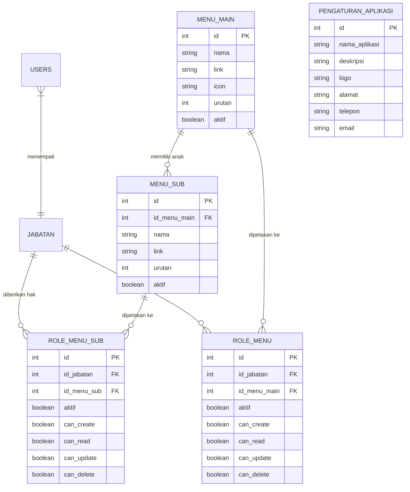
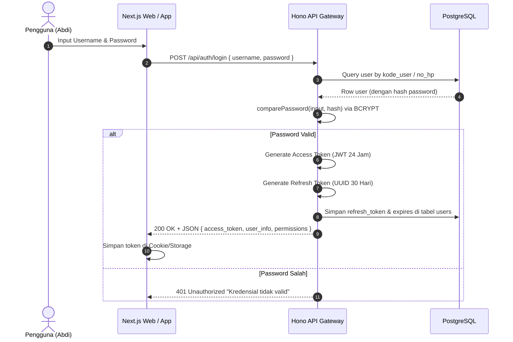

# DOKUMENTASI TEKNIS & SPESIFIKASI SISTEM
# MODUL 10: PENGATURAN, ROLE PERMISSION & KEAMANAN SISTEM
**ERP AL MUBAROK (CORE PLATFORM SPECIFICATION)**

---

## 1. Executive Summary & Ruang Lingkup Domain

Modul **Pengaturan, Role Permission & Keamanan Sistem** merupakan fondasi tata kelola (*governance*), otentikasi, otorisasi, dan konfigurasi global ERP Al Mubarok. Modul ini bertanggung jawab memastikan keamanan data perusahaan, pemisahan tugas (*Segregation of Duties* / SoD) antar jabatan, kontrol akses granular berbasis peran (Granular Role-Based Access Control / RBAC), serta manajemen identitas dan kredensial pengguna (*Identity & Credential Management*).

```mermaid
graph TD
    subgraph Klien (Frontend Next.js / Mobile)
        FE[Web Browser / Next.js]
        MOB[Mobile Android / iOS]
    end

    subgraph Gerbang Keamanan (API Hono.js)
        JWT[JWT Auth Middleware]
        RBAC[RBAC Role Guard: CRUD Matrix]
        AUDIT[Security Policy & Password Policy]
    end

    subgraph Data Store (PostgreSQL)
        U[(users & credentials)]
        RM[(role_menu & role_menu_sub)]
        MM[(menu_main & menu_sub)]
        CFG[(pengaturan_aplikasi)]
    end

    FE -->|Bearer Token / Cookie| JWT
    MOB -->|Bearer Access Token| JWT
    JWT --> RBAC
    RBAC -->|Query Hak Akses Jabatan| RM
    RM --> MM
    RBAC -->|Otorisasi Lolos| CFG
    AUDIT -->|Hash & Verify BCRYPT| U
```

### Ruang Lingkup Fungsional:
1. **Otentikasi & Manajemen Sesi**: Login multi-channel (Web Browser & Mobile App), penerbitan pasangan Access Token (JWT) dan Refresh Token, serta rotasi sesi aman.
2. **Granular RBAC (Role-Based Access Control)**: Matriks hak akses bertingkat per jabatan (Menu Utama & Submenu) dengan 4 kuadran izin granular: `can_create`, `can_read`, `can_update`, `can_delete`.
3. **Menu Engine & Auto-Seeding**: Sinkronisasi dinamis menu aplikasi dari database ke sidebar antarmuka pengguna tanpa perlu *hardcoded* kode di frontend.
4. **Keamanan Kredensial & Sandi**: Mekanisme hashing password menggunakan Bcrypt/Scrypt salt, validasi kecocokan password lama saat ubah sandi, dan proteksi dari serangan brute force.
5. **Konfigurasi Global Aplikasi**: Nama institusi, logo, nomor kontak WhatsApp CS, alamat kantor pusat/DC, dan toleransi radius presensi GPS.

---

## 2. Arsitektur Skema Basis Data (Drizzle ORM & DDL)

Modul ini mengelola 5 tabel utama dalam skema PostgreSQL:



### 2.1. Definisi Skema Drizzle ORM (`src/lib/db/schema.ts`)

```typescript
// ─── 1. MENU UTAMA (MAIN MENU) ──────────────────────────────────────────────
export const menu_main = pgTable("menu_main", {
  id: serial("id").primaryKey(),
  nama: text("nama").notNull(),                              // Misal: "Barang", "Penjualan", "Akuntansi"
  link: text("link").notNull().default("#"),                 // URL atau '#' jika memiliki submenu
  icon: text("icon"),                                        // Nama ikon Lucide: "Package", "ShoppingCart"
  urutan: integer("urutan").default(0),                      // Nomor sorting urutan di sidebar
  aktif: boolean("aktif").default(true),                     // Flag visibilitas global
});

// ─── 2. SUBMENU ─────────────────────────────────────────────────────────────
export const menu_sub = pgTable("menu_sub", {
  id: serial("id").primaryKey(),
  id_menu_main: integer("id_menu_main").notNull(),           // Relasi ke menu_main.id
  nama: text("nama").notNull(),                              // Misal: "Batch & Kadaluarsa", "Stock Opname"
  link: text("link").notNull(),                              // Route Next.js: "/barang/batch"
  urutan: integer("urutan").default(0),
  aktif: boolean("aktif").default(true),
});

// ─── 3. ROLE MENU UTAMA (RBAC HEADER) ────────────────────────────────────────
export const role_menu = pgTable("role_menu", {
  id: serial("id").primaryKey(),
  id_jabatan: integer("id_jabatan").notNull(),               // Relasi ke jabatan.id_jabatan
  id_menu_main: integer("id_menu_main").notNull(),           // Relasi ke menu_main.id
  aktif: boolean("aktif").default(true),                     // Apakah menu utama ditampilkan ke role ini
  can_create: boolean("can_create").default(false),          // Hak tambah data
  can_read: boolean("can_read").default(true),              // Hak lihat data
  can_update: boolean("can_update").default(false),          // Hak edit/update
  can_delete: boolean("can_delete").default(false),          // Hak hapus data
});

// ─── 4. ROLE SUBMENU (RBAC DETAIL GRANULAR) ──────────────────────────────────
export const role_menu_sub = pgTable("role_menu_sub", {
  id: serial("id").primaryKey(),
  id_jabatan: integer("id_jabatan").notNull(),               // Relasi ke jabatan.id_jabatan
  id_menu_sub: integer("id_menu_sub").notNull(),             // Relasi ke menu_sub.id
  aktif: boolean("aktif").default(true),                     // Apakah submenu ditampilkan ke role ini
  can_create: boolean("can_create").default(false),
  can_read: boolean("can_read").default(true),
  can_update: boolean("can_update").default(false),
  can_delete: boolean("can_delete").default(false),
});

// ─── 5. PENGATURAN GLOBAL APLIKASI ──────────────────────────────────────────
export const pengaturan_aplikasi = pgTable("pengaturan_aplikasi", {
  id: serial("id").primaryKey(),
  nama_aplikasi: text("nama_aplikasi").notNull(),            // "ERP Al Mubarok"
  deskripsi: text("deskripsi"),                              // "Sistem Terpadu Ritel, SCM & Akuntansi"
  logo: text("logo"),                                        // URL logo instansi
  alamat: text("alamat"),
  telepon: text("telepon"),
  email: text("email"),
  radius_absen_meter: integer("radius_absen_meter").default(100), // Batas radius GPS check-in (meter)
  updated_at: text("updated_at").default(sql`(CURRENT_TIMESTAMP)`),
});
```

---

## 3. Matriks Otorisasi Granular & Tata Kelola RBAC

ERP Al Mubarok menggunakan model otorisasi matriks di mana setiap kombinasi `(id_jabatan, id_menu_sub)` memiliki 4 bit izin akses:

$$\text{Akses}(U, M) = \{\text{Aktif}, \text{Create}, \text{Read}, \text{Update}, \text{Delete}\}$$

### Matriks Hak Akses Standar:

| Jabatan / Role | Menu Utama yang Diakses | Create | Read | Update | Delete | Keterangan Khusus |
|---|---|:---:|:---:|:---:|:---:|---|
| **Super User (Direksi / IT Admin)** | Seluruh Modul (11 Modul) | ✅ | ✅ | ✅ | ✅ | Akses bypass periode closing & approval tingkat tinggi |
| **Kepala Toko / Supervisor** | Barang, Stok, PO, Kasir, Kas | ✅ | ✅ | ✅ | ❌ | Dapat menyetujui Stock Opname & Kasir EOD |
| **Kasir POS** | Penjualan POS, Kas Masuk/Keluar | ✅ | ✅ | ❌ | ❌ | Terkunci hanya pada transaksi cabang aktif kasir |
| **Staff Gudang / Logistik** | Stok Opname, Surat Jalan, Penerimaan | ✅ | ✅ | ✅ | ❌ | Input hitung fisik persediaan & verifikasi armada |
| **Akuntansi & Finance** | Jurnal, CoA, Pajak, Aset, Laporan | ✅ | ✅ | ✅ | ❌ | Kontrol Kunci Periode Buku & Depresiasi Aset |
| **HRD & Kepegawaian** | Master Abdi, Absensi, Bisyaroh | ✅ | ✅ | ✅ | ❌ | Penggajian & Izin Cuti |

### Alur Evaluasi Hak Akses di Frontend (`PermissionProvider.tsx`):
1. Saat user membuka halaman (misal: `/barang/stok-opname`), `PermissionProvider` membaca pathname aktif.
2. Provider mencocokkan route dengan `menu_sub.link` user.
3. Hook `useMenuPermissions()` mengekspor:
   - `can_create`: Tombol "Tambah / Mulai Sesi Baru" aktif.
   - `can_read`: Tabel data dimuat. Jika `false`, tampilkan halaman *"403 Access Denied"*.
   - `can_update`: Tombol edit / aksi approval tampil.
   - `can_delete`: Tombol hapus ditampilkan.

---

## 4. Keamanan Sandi, Sesi & Kriptografi



### Mekanisme Pengubahan Sandi (`PUT /api/pengaturan/change-password`):
1. User wajib menyertakan:
   - `old_password`: Sandi saat ini.
   - `new_password`: Sandi baru (minimal 6 karakter).
   - `confirm_password`: Konfirmasi sandi baru (harus identik).
2. Backend memverifikasi hash `old_password` terhadap basis data.
3. Jika valid, backend melakukan enkripsi hash `new_password` dengan *salt rounds* standar dan menyimpan ke database.

---

## 5. Spesifikasi Antarmuka Pemrograman Aplikasi (REST API Endpoints)

Router: `erp-almubarok-api/src/routes/pengaturan.ts` & `user.ts` (Base path: `/api/pengaturan` & `/api/user`).

### 5.1. Ringkasan Endpoint

| No | Metode | Endpoint | Deskripsi Fungsi | Otorisasi Role |
|---|---|---|---|---|
| 1 | `GET` | `/api/pengaturan/role-menu` | Ambil matriks role menu untuk semua jabatan | Super User |
| 2 | `GET` | `/api/pengaturan/role-menu/:id` | Ambil permission spesifik jabatan tertentu | Super User |
| 3 | `POST` | `/api/pengaturan/role-menu` | Simpan/update matriks izin menu & submenu | Super User |
| 4 | `GET` | `/api/pengaturan/profile` | Ambil profil abdi/pengguna yang login | Semua User Aktif |
| 5 | `PUT` | `/api/pengaturan/profile` | Perbarui data profil mandiri (No. HP, Alamat) | Semua User Aktif |
| 6 | `PUT` | `/api/pengaturan/change-password` | Ganti password akun pengguna | Semua User Aktif |
| 7 | `GET` | `/api/pengaturan/aplikasi` | Ambil konfigurasi global aplikasi | Semua User |
| 8 | `PUT` | `/api/pengaturan/aplikasi` | Update konfigurasi nama, logo, radius GPS | Super User |

---

## 6. Arsitektur Frontend & Navigasi Dinamis

Halaman frontend pada Next.js App Router:
- `src/app/(dashboard)/pengaturan/role-menu/page.tsx`: Antarmuka visual pengaturan hak akses matriks jabatan.
- `src/app/(dashboard)/profil/page.tsx`: Informasi identitas abdi dan riwayat penugasan cabang.
- `src/app/(dashboard)/ubah-password/page.tsx`: Form mandiri penggantian sandi akun.
- `src/components/layout/Sidebar.tsx`: Sidebar dinamis yang merender `menu_main` dan `menu_sub` sesuai hasil filtering otorisasi `role_menu` user yang sedang login.

---

## 7. Audit Keamanan & Rekomendasi Peningkatan Enterprise

Untuk memperkuat postur keamanan sistem sekelas ERP profesional:
1. **Change Data Capture (CDC) Audit Logging**:
   - Merekam setiap mutasi data kritis (siapa yang mengubah harga barang, siapa yang membuka kunci periode, siapa yang menyetujui opname) ke dalam tabel `system_audit_log` dengan format JSON diff (`old_values` vs `new_values`).
2. **Rate Limiting & Anti-Brute Force**:
   - Membatasi percobaan login maksimal 5 kali gagal per IP/Akun dalam 15 menit menggunakan Redis atau in-memory counter.
3. **Session Revocation**:
   - Mekanisme *Force Logout* seketika jika peran atau jabatan seorang abdi diubah atau dinonaktifkan oleh HRD.

