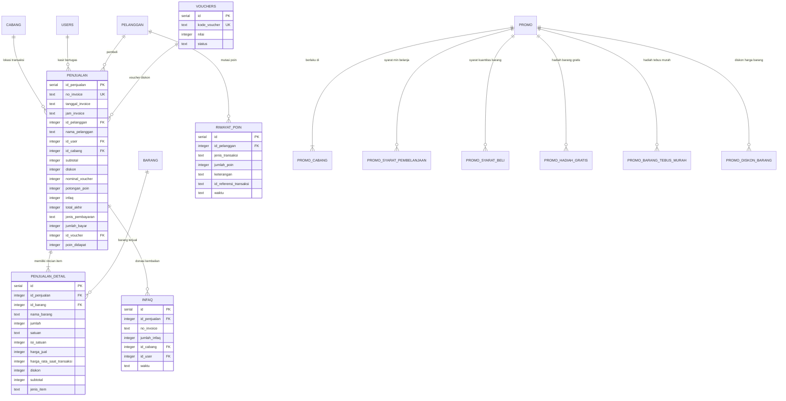
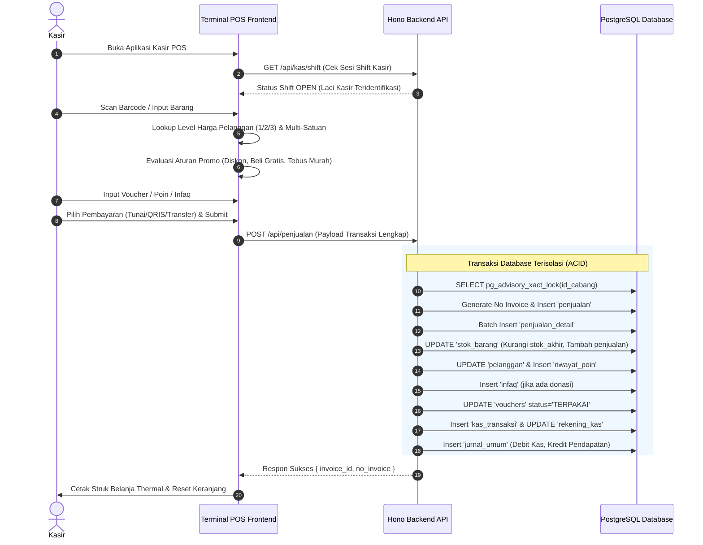
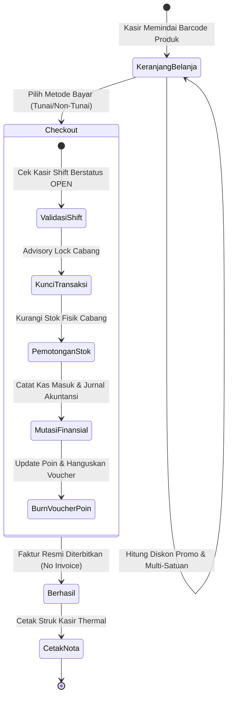

# 🛒 DOKUMENTASI TEKNIS AS-IS (GROUND TRUTH)
## MAIN MENU PENJUALAN: KASIR POS, RIWAYAT TRANSAKSI, ENGINE PROMO & LOYALITAS PELANGGAN
### SISTEM ENTERPRISE RESOURCE PLANNING (ERP) AL MUBAROK

> **Status Dokumen:** Faktual / Kondisi Riil Sistem Saat Ini (*As-Is Technical Specification*)  
> **Target Pengguna Dokumen:** AI Agent / Software Architect / Lead Developer untuk Analisis Sistem, Audit Transaksional & Perencanaan Fitur  
> **Stack Arsitektur:** Next.js 16 (App Router, Turbopack), React 19, Tailwind CSS v4, Hono REST API, PostgreSQL, Drizzle ORM  
> **Domain Konteks:** Point of Sales (POS) Kasir Ritel-Grosir, Transaksi Multi-Satuan & Multi-Level Harga, Mesin Promosi Otomatis (10 Jenis Promo), Voucher Belanja, Loyalitas Poin Pelanggan, Sedekah/Infaq Kembalian, dan Integrasi Akuntansi Kasir (*Double-Entry Bookkeeping*).

---

## 📑 DAFTAR ISI

1. [Ringkasan Eksekutif & Ruang Lingkup Sistem](#1-ringkasan-eksekutif--ruang-lingkup-sistem)
2. [Peta Arsitektur File & Komponen Kode](#2-peta-arsitektur-file--komponen-kode)
3. [Kamus Data & Skema Database (Database Dictionary)](#3-kamus-data--skema-database-database-dictionary)
4. [Spesifikasi REST API Endpoints (Hono Framework)](#4-spesifikasi-rest-api-endpoints-hono-framework)
5. [Logika Bisnis, Algoritma & Formula Matematis](#5-logika-bisnis-algoritma--formula-matematis)
6. [Alur Bisnis & State Machine (Mermaid Diagrams)](#6-alur-bisnis--state-machine-mermaid-diagrams)
7. [Struktur UI / UX Frontend & Interaksi Kasir](#7-struktur-ui--ux-frontend--interaksi-kasir)
8. [Matriks Hak Akses & Isolasi Data Cabang (RBAC)](#8-matriks-hak-akses--isolasi-data-cabang-rbac)

---

## 1. Ringkasan Eksekutif & Ruang Lingkup Sistem

Main Menu **Penjualan** (Urutan 4 pada navigasi utama ERP Al Mubarok, ikon: `ShoppingCart`) adalah pusat penerimaan pendapatan (*revenue engine*) institusi yang menangani transaksi kasir harian toko ritel dan grosir. Modul ini terhubung erat secara atomik (*ACID transaction*) dengan modul Master Barang (pengurangan stok seketika), Pelanggan (loyalitas poin & level harga), Kasir Shift (pembatasan laci kas aktif), serta Akuntansi (mutasi kas masuk dan jurnal pendapatan otomatis).

### 3 Submenu Utama:
1. **Kasir POS (`/penjualan/pos`):** Antarmuka kasir cepat (*high-speed Point of Sale*) dengan pemindai barcode, pemilihan satuan bertingkat (Satuan 1, 2, 3), penentuan harga otomatis berdasarkan profil pelanggan (Level 1 Umum, Level 2 Member, Level 3 Grosir), kalkulator diskon promo otomatis, penukaran voucher, penggunaan/perolehan poin belanja, serta fitur pembulatan donasi infaq.
2. **Riwayat Nota (`/penjualan/history`):** Arsip audit seluruh transaksi penjualan toko, visualisasi struk digital per invoice, margin keuntungan kotor per transaksi (Omset vs HPP), cetak ulang struk thermal kasir (58mm/80mm), dan pelacakan kasir bertugas.
3. **Manajemen Promo (`/penjualan/promo`):** Mesin promosi terpusat (*Centralized Promo Rule Engine*) yang mengelola 10 jenis skema promosi penjualan ritel (Diskon Langsung, Beli A Gratis B, Tebus Murah, Diskon Total Belanja, Poin Loyalitas Ekstra, dll.) dengan validasi cabang dan periode aktif.

---

## 2. Peta Arsitektur File & Komponen Kode

### A. Backend API (Hono Framework + Drizzle ORM)
* **Direktori:** `erp-almubarok-nextjs/erp-almubarok-api/`
* **Skema Database:** [`src/lib/db/schema.ts`](file:///c:/Users/AFB/erp-almubarok/erp-almubarok-nextjs/erp-almubarok-api/src/lib/db/schema.ts)
  * Tabel Transaksi Penjualan: Baris 291–357 (`penjualan`, `penjualan_detail`, `riwayat_poin`, `infaq`, `vouchers`)
  * Tabel Mesin Promo (13 Tabel): Baris 588–705 (`promo`, `promo_cabang`, `promo_syarat_*`, `promo_hadiah_*`, dll.)
* **Route Controllers:**
  * Penjualan Controller: [`src/routes/penjualan.ts`](file:///c:/Users/AFB/erp-almubarok/erp-almubarok-nextjs/erp-almubarok-api/src/routes/penjualan.ts) (Checkout atomik, `pg_advisory_xact_lock`, potong stok, jurnal otomatis, infaq, poin)
  * Promo Controller: [`src/routes/promo.ts`](file:///c:/Users/AFB/erp-almubarok/erp-almubarok-nextjs/erp-almubarok-api/src/routes/promo.ts) (CRUD konfigurasi promosi kompleks)
  * Voucher Controller: [`src/routes/voucher.ts`](file:///c:/Users/AFB/erp-almubarok/erp-almubarok-nextjs/erp-almubarok-api/src/routes/voucher.ts) (Pengecekan validitas dan pembakaran voucher belanja)
* **Mounting Router:** [`src/index.ts`](file:///c:/Users/AFB/erp-almubarok/erp-almubarok-nextjs/erp-almubarok-api/src/index.ts) (`/api/penjualan`, `/api/promo`, `/api/voucher`).

### B. Frontend Web (Next.js 16 App Router)
* **Direktori:** `erp-almubarok-nextjs/src/app/(dashboard)/penjualan/`
* **Halaman Utama:**
  * [`pos/page.tsx`](file:///c:/Users/AFB/erp-almubarok/erp-almubarok-nextjs/src/app/(dashboard)/penjualan/pos/page.tsx): Terminal Kasir POS (Pencarian barcode, keranjang belanja, kalkulator promo client-side, modal pembayaran tunai/non-tunai, pembulatan infaq, cetak struk thermal).
  * [`history/page.tsx`](file:///c:/Users/AFB/erp-almubarok/erp-almubarok-nextjs/src/app/(dashboard)/penjualan/history/page.tsx): Data riwayat nota, rincian item nota, kalkulasi profit kotor (Revenue - COGS), dan cetak ulang nota.
  * [`promo/page.tsx`](file:///c:/Users/AFB/erp-almubarok/erp-almubarok-nextjs/src/app/(dashboard)/penjualan/promo/page.tsx): Dasbor aturan promosi, modal konfigurasi bertingkat (Beli X Gratis Y, Tebus Murah, Diskon Bertingkat, Poin Ekstra).

---

## 3. Kamus Data & Skema Database (Database Dictionary)

Database diatur menggunakan PostgreSQL dengan definisi tabel Drizzle ORM (`drizzle-orm/pg-core`).



### A. Tabel Transaksi Penjualan Inti

#### 1. Tabel `penjualan` (Header Transaksi)
```typescript
export const penjualan = pgTable("penjualan", {
  id_penjualan: serial("id_penjualan").primaryKey(),
  no_invoice: text("no_invoice").notNull(),                   // Format: INV/YYYYMMDD/{id_cabang}/{sequence 4 digit}
  tanggal_invoice: text("tanggal_invoice").notNull(),         // Format: YYYY-MM-DD
  jam_invoice: text("jam_invoice").notNull(),                 // Format: HH:mm:ss
  id_pelanggan: integer("id_pelanggan"),                     // FK -> pelanggan.id_pelanggan (Null jika Pelanggan Umum)
  nama_pelanggan: text("nama_pelanggan"),                     // Nama saat transaksi (default 'Umum')
  id_user: integer("id_user").references(() => users.id),     // FK -> users.id (Kasir yang bertugas)
  id_cabang: integer("id_cabang").references(() => cabang.id_cabang), // FK -> cabang.id_cabang
  subtotal: integer("subtotal").notNull(),                   // Nilai kotor sebelum diskon & infaq (IDR)
  diskon: integer("diskon").default(0),                      // Total potongan harga promo (IDR)
  nominal_voucher: integer("nominal_voucher").default(0),    // Potongan kupon belanja voucher (IDR)
  potongan_poin: integer("potongan_poin").default(0),        // Nilai rupiah dari poin pelanggan yang ditukar (IDR)
  infaq: integer("infaq").default(0),                        // Nilai donasi sukarela / pembulatan kembalian (IDR)
  total_akhir: integer("total_akhir").notNull(),             // Nilai tagihan bersih = subtotal - diskon - voucher - poin + infaq
  jenis_pembayaran: text("jenis_pembayaran").notNull(),       // 'Tunai' | 'Transfer' | 'Tempo' | 'QRIS'
  jumlah_bayar: integer("jumlah_bayar").default(0),          // Uang fisik yang diserahkan konsumen
  id_voucher: integer("id_voucher"),                         // FK -> vouchers.id (jika menggunakan voucher)
  poin_didapat: integer("poin_didapat").default(0),          // Akumulasi poin reward baru dari transaksi ini
  created_at: text("created_at").default(sql`(CURRENT_TIMESTAMP)`),
});
```

#### 2. Tabel `penjualan_detail` (Rincian Item Transaksi)
```typescript
export const penjualan_detail = pgTable("penjualan_detail", {
  id: serial("id").primaryKey(),
  id_penjualan: integer("id_penjualan").references(() => penjualan.id_penjualan),
  id_barang: integer("id_barang").references(() => barang.id_barang),
  nama_barang: text("nama_barang").notNull(),                // Snapshot nama produk saat transaksi
  jumlah: integer("jumlah").notNull(),                       // Kuantitas terjual dalam satuan yang dipilih
  satuan: text("satuan").notNull(),                          // Nama satuan (contoh: 'pcs', 'pack', 'dus')
  isi_satuan: integer("isi_satuan").notNull(),               // Rasio konversi ke satuan terkecil (1, 10, 40)
  harga_jual: integer("harga_jual").notNull(),               // Harga jual satuan saat transaksi
  harga_rata_saat_transaksi: integer("harga_rata_saat_transaksi").notNull(), // Snapshot HPP dasar (per pcs) untuk audit laba
  diskon: integer("diskon").default(0),                      // Potongan promo per baris item
  subtotal: integer("subtotal").notNull(),                   // (jumlah * harga_jual) - diskon
  jenis_item: text("jenis_item").default("TRANSAKSI"),       // 'TRANSAKSI' | 'HADIAH_PROMO' | 'TEBUS_MURAH'
});
```

#### 3. Tabel `riwayat_poin` (Buku Besar Poin Loyalitas)
```typescript
export const riwayat_poin = pgTable("riwayat_poin", {
  id: serial("id").primaryKey(),
  id_pelanggan: integer("id_pelanggan").references(() => pelanggan.id_pelanggan),
  jenis_transaksi: text("jenis_transaksi").notNull(),        // 'DAPAT' (Penambahan) | 'GUNAKAN' (Pengurangan)
  jumlah_poin: integer("jumlah_poin").notNull(),             // Besaran poin reward
  keterangan: text("keterangan"),                            // Deskripsi referensi transaksi
  id_referensi_transaksi: text("id_referensi_transaksi"),    // Nomor Invoice transaksi terkait
  waktu: text("waktu").default(sql`(CURRENT_TIMESTAMP)`),
});
```

#### 4. Tabel `infaq` (Pencatatan Donasi Kembalian Kasir)
```typescript
export const infaq = pgTable("infaq", {
  id: serial("id").primaryKey(),
  id_penjualan: integer("id_penjualan").references(() => penjualan.id_penjualan),
  no_invoice: text("no_invoice").notNull(),
  jumlah_infaq: integer("jumlah_infaq").notNull(),           // Nominal donasi sukarela (IDR)
  id_cabang: integer("id_cabang").references(() => cabang.id_cabang),
  id_user: integer("id_user").references(() => users.id),
  waktu: text("waktu").default(sql`(CURRENT_TIMESTAMP)`),
});
```

#### 5. Tabel `vouchers` (Kupon Diskon Belanja)
```typescript
export const vouchers = pgTable("vouchers", {
  id: serial("id").primaryKey(),
  kode_voucher: text("kode_voucher").notNull(),              // Kode kupon alfanumerik unik
  nilai: integer("nilai").notNull(),                         // Nilai nominal potongan rupiah (IDR)
  status: text("status").default("AKTIF"),                   // 'AKTIF' | 'TERPAKAI' | 'KADALUARSA'
});
```

---

### B. Tabel Mesin Promo (Promo Engine Schema - 13 Tabel)

#### 1. `promo` (Tabel Induk Promosi)
```typescript
export const promo = pgTable("promo", {
  id_promo: serial("id_promo").primaryKey(),
  nama_promo: text("nama_promo").notNull(),
  tipe_promo: text("tipe_promo").notNull(),                  // 10 Jenis Promo (Lihat Bab 5)
  deskripsi: text("deskripsi"),
  berlaku_untuk: text("berlaku_untuk").notNull(),            // 'SEMUA_PELANGGAN' | 'MEMBER_SAJA'
  tanggal_mulai: text("tanggal_mulai").notNull(),            // Format YYYY-MM-DD
  tanggal_selesai: text("tanggal_selesai").notNull(),        // Format YYYY-MM-DD
  status: text("status").default("Aktif").notNull(),         // 'Aktif' | 'Non-Aktif'
  berlaku_kelipatan: integer("berlaku_kelipatan").default(0).notNull(), // 0 = Tidak; 1 = Ya
  created_by: integer("created_by"),
  updated_by: integer("updated_by"),
  id_cabang_pembuat: integer("id_cabang_pembuat"),
  created_at: text("created_at").default(sql`(CURRENT_TIMESTAMP)`),
  updated_at: text("updated_at").default(sql`(CURRENT_TIMESTAMP)`),
});
```

#### 2. Tabel Relasi & Syarat Promo
* **`promo_cabang`:** Pemetaan lokasi cabang berlakunya promo (`id_promo`, `id_cabang`).
* **`promo_syarat_pembelanjaan`:** Syarat minimal nominal transaksi keranjang (`id_promo`, `minimum_pembelanjaan`, `berlaku_kelipatan`).
* **`promo_syarat_kategori`:** Syarat transaksi produk dari kategori tertentu (`id_promo`, `id_kategori`).
* **`promo_syarat_supplier`:** Syarat transaksi produk dari supplier tertentu (`id_promo`, `id_supplier`).
* **`promo_syarat_barang_tertentu`:** Syarat keberadaan item barang spesifik dalam keranjang (`id_promo`, `id_barang`).
* **`promo_syarat_beli`:** Syarat kuantitas pembelian produk target (`id_promo`, `id_barang`, `jumlah`, `id_satuan`).

#### 3. Tabel Reward & Hadiah Promo
* **`promo_hadiah_diskon`:** Reward potongan nominal tunai atau persentase belanja (`id_promo`, `jenis_diskon`: `'NOMINAL'`|`'PERSEN'`, `nilai_diskon`).
* **`promo_hadiah_poin`:** Reward bonus poin loyalitas (`id_promo`, `jumlah_poin`).
* **`promo_hadiah_gratis`:** Reward barang gratis (Buy X Get Y Free) (`id_promo`, `id_barang`, `jumlah`, `id_satuan`).
* **`promo_diskon_barang`:** Potongan harga pada produk tertentu (`id_promo`, `id_barang`, `jumlah`, `id_satuan`, `jenis_diskon`, `nilai_diskon`, `berlaku_kelipatan`).
* **`promo_poin_barang`:** Hadiah poin loyalitas berbasis kuantitas produk (`id_promo`, `id_barang`, `jumlah_barang`, `id_satuan`, `jumlah_poin`, `berlaku_kelipatan`).
* **`promo_hadiah_barang`:** Hadiah barang fisik dari syarat belanja (`id_promo`, `id_barang`, `jumlah`, `id_satuan`).
* **`promo_barang_tebus_murah`:** Hak membeli produk tertentu dengan harga khusus miring setelah memenuhi syarat belanja (`id_promo`, `id_barang`, `jumlah`, `id_satuan`, `harga_tebus`).

---

## 4. Spesifikasi REST API Endpoints (Hono Framework)

### A. Endpoints Penjualan (`/api/penjualan`)
| Endpoint | Method | Parameter / Payload | Aturan Validasi & Logika Bisnis |
|---|---|---|---|
| `/api/penjualan` | `GET` | Query param: `id` (opsional) | Jika `id` disertakan: mengembalikan objek `{ invoice, details }`. Jika tanpa parameter: mengembalikan 50 transaksi penjualan terakhir di cabang user pemanggil. |
| `/api/penjualan` | `POST` | Body JSON: `{ id_pelanggan, nama_pelanggan, items: [...], subtotal, diskon, nominal_voucher, potongan_poin, poin_digunakan, infaq, total_akhir, jenis_pembayaran, jumlah_bayar, id_voucher, poin_didapat }` | **Kasir POS Checkout Atomik:**<br>1. Mengunci sequence cabang via `pg_advisory_xact_lock(idCabang)`.<br>2. Generate nomor faktur: `INV/YYYYMMDD/{id_cabang}/{sequence}`.<br>3. Insert header `penjualan` & batch insert `penjualan_detail`.<br>4. Potong fisik `stok_barang.stok_akhir` dan tambah `stok_barang.penjualan`.<br>5. Mutasi poin loyalitas & simpan ke `riwayat_poin`.<br>6. Rekam `infaq` jika nominal $> 0$.<br>7. Bakar voucher menjadi status `TERPAKAI`.<br>8. Validasi shift kasir wajib berstatus `OPEN`.<br>9. Rekam mutasi kas masuk `kas_transaksi` (`KM/YYYYMMDD/...`) dan update saldo `rekening_kas`.<br>10. Posting otomatis Jurnal Umum Akuntansi (Debit Kas vs Kredit Pendapatan Penjualan). |
| `/api/penjualan/promo` | `GET` | - | Mengambil seluruh promo aktif yang terdaftar untuk diproses di kasir POS. |

### B. Endpoints Promo (`/api/promo`)
| Endpoint | Method | Parameter / Payload | Aturan Validasi & Logika |
|---|---|---|---|
| `/api/promo` | `GET` | Query param: `id` (opsional) | Jika `id` disertakan: mengambil detail lengkap promo berserta seluruh 12 tabel relasinya (syarat belanja, supplier, kategori, hadiah diskon, tebus murah, dll). Jika tanpa parameter: daftar seluruh promo terurut ID terbaru. |
| `/api/promo` | `POST` | Body JSON: Objek definisi promo lengkap beserta tabel relasinya | Menyimpan skema promo baru dalam satu transaksi database PostgreSQL. |

### C. Endpoints Voucher (`/api/voucher`)
| Endpoint | Method | Parameter / Payload | Aturan Validasi & Logika |
|---|---|---|---|
| `/api/voucher` | `GET` | Query param: `kode` | Memvalidasi keberadaan voucher dan statusnya (`status === 'AKTIF'`). Melempar error jika voucher tidak ditemukan atau sudah pernah digunakan (`TERPAKAI`). |

---

## 5. Logika Bisnis, Algoritma & Formula Matematis

### A. Generator Nomor Invoice Atomik & Pencegahan Race Condition
Untuk mencegah duplikasi nomor invoice pada jam sibuk kasir di banyak terminal secara paralel, checkout backend mengunci tabel pada level cabang menggunakan PostgreSQL Transaction Advisory Lock:
```sql
SELECT pg_advisory_xact_lock(id_cabang);
```
Nomor invoice dibentuk dengan format:
$$\text{NoInvoice} = \text{"INV/"} + \text{YYYYMMDD} + \text{"/"} + \text{id\_cabang} + \text{"/"} + \text{lpad}(\text{count}_{\text{today}} + 1, 4, \text{'0'})$$
*Contoh:* `INV/20261029/2/0042` (Invoice ke-42 pada tanggal 29 Oktober 2026 di Cabang ID 2).

### B. Formula Evaluasi Transaksi & Total Tagihan Akhir
$$\text{Subtotal} = \sum_{i=1}^{n} \left( \text{Jumlah}_i \times \text{HargaJual}_{i, \text{level}} \right)$$
$$\text{TotalDiskon} = \text{DiskonPromoBarang} + \text{DiskonKeranjang}$$
$$\text{TotalAkhir} = \text{Subtotal} - \text{TotalDiskon} - \text{NominalVoucher} - \text{PotonganPoin} + \text{Infaq}$$
$$\text{Kembalian} = \text{JumlahBayar} - \text{TotalAkhir}$$
*Syarat Validitas:* $\text{TotalAkhir} \ge 0$ dan $\text{JumlahBayar} \ge \text{TotalAkhir}$ (untuk pembayaran Tunai).

### C. 10 Jenis Promosi pada Promo Rule Engine

| No | Tipe Promo (`tipe_promo`) | Logika Evaluasi Syarat Keranjang | Logika Pemberian Hadiah / Potongan |
|---|---|---|---|
| 1 | `BELI_GRATIS` | Beli produk $A$ sebanyak $Q_A$ | Gratis produk $B$ sebanyak $Q_B$. Jika `berlaku_kelipatan = 1`, hadiah dikalikan $\lfloor \frac{Q_{\text{beli}}}{Q_A} \rfloor$. |
| 2 | `DISKON_BARANG` | Membeli produk $X$ minimal $Q_{\text{min}}$ | Potongan harga produk $X$ sebesar nilai nominal tunai atau persentase (%). |
| 3 | `POIN_BARANG` | Membeli produk $X$ sebanyak $Q_X$ | Bonus poin loyalitas sebesar $P$ poin per kelipatan pembelian. |
| 4 | `DISKON_PEMBELANJAAN` | Total belanja keranjang $\ge \text{MinBelanja}$ | Potongan diskon pada total transaksi (Persen % atau Nominal Rp). |
| 5 | `POIN_PEMBELANJAAN` | Total belanja keranjang $\ge \text{MinBelanja}$ | Bonus poin reward konsumen sebesar $P$ poin. |
| 6 | `GRATIS_BARANG_PEMBELANJAAN`| Total belanja keranjang $\ge \text{MinBelanja}$ | Gratis 1 unit produk fisik hadiah yang telah ditentukan. |
| 7 | `TEBUS_MURAH` | Total belanja keranjang $\ge \text{MinBelanja}$ | Konsumen berhak membeli produk promosi seharga $\text{HargaTebus}$ miring. |
| 8 | `TEBUS_MURAH_BARANG_TERTENTU`| Keranjang memuat produk syarat tertentu | Berhak menebus produk promosi dengan harga miring. |
| 9 | `DISKON_BELANJA_BARANG_TERTENTU`| Membeli produk dari kategori/supplier tertentu | Diskon khusus pada produk yang bersangkutan. |
| 10 | `GRATIS_BARANG_BELANJA_TERTENTU`| Membeli produk dari kategori/supplier tertentu | Mendapatkan hadiah produk gratis pelengkap. |

### D. Formula Deduksi Stok Fisik & Akumulasi Penjualan
Untuk setiap baris item transaksi $i$ yang terjual:
$$Q_{\text{pcs}} = \text{jumlah}_i \times \text{isi\_satuan}_i$$
* **Pembaruan Saldo Fisik (`stok_barang`):**
  $$\text{stok\_akhir}_{\text{baru}} = \text{stok\_akhir}_{\text{lama}} - Q_{\text{pcs}}$$
  $$\text{penjualan}_{\text{baru}} = \text{penjualan}_{\text{lama}} + Q_{\text{pcs}}$$

### E. Integrasi Kas Masuk & Akuntansi Double-Entry
Sistem mengidentifikasi rekening laci kasir yang terikat pada sesi shift aktif (`kasir_shift.id_rekening` di mana `status = 'OPEN'`).
1. **Mutasi Kas Masuk (`kas_transaksi`):**
   * Dicatat nomor transaksi: $\text{"KM/"} + \text{YYYYMMDD} + \text{"/"} + \text{id\_cabang} + \text{"/"} + \text{sequence}$
   * Tipe: `MASUK`, Kategori: `PENJUALAN`, Nominal: $\text{TotalAkhir}$.
2. **Pembaruan Saldo Kas:** $\text{rekening\_kas.saldo} = \text{rekening\_kas.saldo} + \text{TotalAkhir}$.
3. **Posting Jurnal Umum Otomatis (`jurnal_umum`):**
   * **Debit:** Akun Kas Laci Kasir (`rekening.id_akun_coa`) sebesar $\text{TotalAkhir}$.
   * **Kredit:** Akun Pendapatan Penjualan Toko (`coa_kategori_penjualan` / ID Akun `7`) sebesar $\text{TotalAkhir}$.

---

## 6. Alur Bisnis & State Machine (Mermaid Diagrams)

### A. Alur Transaksi Kasir POS (POS Checkout Pipeline)


### B. Diagram Siklus Hidup Transaksi Penjualan (Sale Lifecycle)


---

## 7. Struktur UI / UX Frontend & Interaksi Kasir

Frontend dikembangkan dengan Next.js 16 menggunakan antarmuka interaktif dan efisien untuk operasional kasir ritel cepat.

```text
src/app/(dashboard)/penjualan/
├── history/
│   └── page.tsx              # Riwayat nota penjualan, rincian per invoice, cetak ulang struk
├── pos/
│   └── page.tsx              # Layar sentuh Kasir POS, pemindai barcode, keranjang belanja, modal bayar
└── promo/
    └── page.tsx              # Manajemen aturan promosi, modal konfigurasi 10 tipe promo
```

### Karakteristik Desain Terminal Kasir POS (`/penjualan/pos`):
1. **Shortcut Keyboard Kasir:** Mendukung navigasi tombol cepat kasir (*Enter* untuk cari/tambah barang, *F2* ganti kuantitas, *F8* pilih pelanggan/member, *Space/F9* buka modal pembayaran tunai).
2. **Kalkulator Donasi / Infaq Cerdas:** Menghitung selisih pembulatan ke ratusan atau ribuan rupiah terdekat (misal: total Rp 23.400 dibulatkan menjadi Rp 24.000 dengan donasi Rp 600) yang dapat diaktifkan dalam 1-klik.
3. **Pemberitahuan Hak Tebus Murah:** Saat keranjang belanja mencapai batas nominal promo tebus murah, modal penawaran produk tebus murah otomatis menyala untuk menawarkan produk terkait kepada konsumen.
4. **Thermal Printer Formatting:** Mendukung pencetakan langsung dokumen struk kasir berbasis format *ESC/POS standard monospace* untuk printer thermal 58mm dan 80mm.

---

## 8. Matriks Hak Akses & Isolasi Data Cabang (RBAC)

Otorisasi level API dikendalikan melalui token JWT (`activeUser.id_jabatan` dan `activeUser.id_cabang`).

| Submenu / Aksi | Super User (`1`) | IT Administrator (`2`) | Manager Cabang (`3`) | Staff Kasir (`4+`) |
|---|---|---|---|---|
| **Layar Kasir POS (`/pos`)** | Akses Penuh (Pilih Cabang) | Akses Penuh | Terkunci Cabang Sendiri | Terkunci Cabang Sendiri (Wajib Shift OPEN) |
| **Riwayat Nota: Cabang Sendiri** | Lihat Seluruh Transaksi | Lihat Seluruh Transaksi | Lihat Transaksi Cabang | Lihat Transaksi Cabang |
| **Riwayat Nota: Lintas Cabang Lain** | **Diizinkan** (Multi-Cabang) | **Diizinkan** (Multi-Cabang) | **Ditolak** (Isolasi Cabang) | **Ditolak** (Isolasi Cabang) |
| **Audit Margin Laba Kotor (Profit)** | Visibel (Omset vs HPP) | Visibel | Visibel di Cabangnya | **Disembunyikan** (Hanya total belanja) |
| **Setup Aturan Promo (`/promo`)** | Full Akses (Buat & Edit) | Full Akses (Buat & Edit) | Pengajuan Promo Cabang | Hanya Baca (*Read Only*) |
| **Transaksi Tanpa Shift Kasir OPEN** | **Ditolak Otomatis oleh Sistem (Wajib Buka Shift)** | **Ditolak Otomatis oleh Sistem (Wajib Buka Shift)** | **Ditolak Otomatis oleh Sistem (Wajib Buka Shift)** | **Ditolak Otomatis oleh Sistem (Wajib Buka Shift)** |

---

*Dokumen ini merupakan representasi teknis faktual (As-Is) dari Main Menu Penjualan ERP Al Mubarok per Oktober 2026 dan siap dijadikan konteks input untuk analisis, refactoring, atau integrasi AI.*

